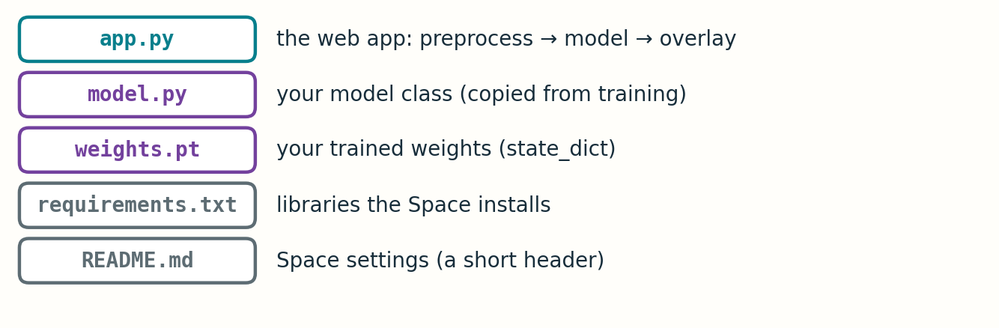

# 1 · Prepare the files

Your Space is a folder with five files.



[Download the starter folder](surface_defect_space.zip) and edit it, or copy the code below. The download holds the four text files; add your own `weights.pt`. Only `model.py`, `weights.pt` and the marked lines of `app.py` are specific to you.

## Step 1 · Save the weights

At the end of training, in your notebook or script:

```python
torch.save(model.state_dict(), "weights.pt")
```

Save the `state_dict` only. Do not save the optimizer or the whole model object. The file is smaller and loads on any machine.

## Step 2 · `model.py`: your architecture

Copy your model class here and add a function that builds it **without downloading anything**:

```python
import torch.nn as nn

def build_model():
    # Replace with YOUR architecture. Output: (batch, 4, 128, 800) logits.
    return nn.Sequential(
        nn.Conv2d(1, 16, 3, padding=1), nn.ReLU(),
        nn.Conv2d(16, 16, 3, padding=1), nn.ReLU(),
        nn.Conv2d(16, 4, 1),
    )
```

The starter body is a tiny placeholder so the folder runs out of the box. Replace it with the layers you trained.

If you used a pretrained encoder, build it with `encoder_weights=None`. The trained values already live in `weights.pt`, so the app must not download ImageNet weights again.

## Step 3 · `app.py`: the whole app

```python
import gradio as gr
import numpy as np
import torch
from PIL import Image

from model import build_model          # your model class lives in model.py

THRESHOLD = 0.5                        # use the value you tuned on validation
NAMES = ["defect_a", "defect_b", "defect_c", "defect_d"]
COLORS = np.array([[230, 57, 70], [42, 157, 143], [69, 123, 255], [244, 162, 97]], dtype=np.float32)

model = build_model()
model.load_state_dict(torch.load("weights.pt", map_location="cpu"))
model.eval()


def preprocess(gray):
    """MUST match training. Edit this to your own preprocessing."""
    x = np.asarray(gray, dtype=np.float32) / 255.0
    x = (x - x.mean()) / max(float(x.std()), 0.05)
    return torch.from_numpy(x)[None, None]            # (1, 1, 128, 800)


def predict(image):
    gray = image.convert("L").resize((800, 128))       # width 800, height 128
    with torch.no_grad():
        probs = torch.sigmoid(model(preprocess(gray)))[0].numpy()   # (4, 128, 800)

    canvas = np.stack([np.asarray(gray, dtype=np.float32)] * 3, axis=-1)
    for c in range(4):
        hit = probs[c] > THRESHOLD
        canvas[hit] = 0.5 * canvas[hit] + 0.5 * COLORS[c]
    return Image.fromarray(canvas.astype(np.uint8))


demo = gr.Interface(
    fn=predict,
    inputs=gr.Image(type="pil", label="Surface image"),
    outputs=gr.Image(label="Predicted masks"),
    title="Industrial surface defect segmentation",
    description="Upload a surface image. Overlay colours: "
                "🔴 defect_a · 🟢 defect_b · 🔵 defect_c · 🟠 defect_d",
)

if __name__ == "__main__":
    demo.launch()
```

### Read it in four chunks

| Chunk | What it does |
| --- | --- |
| **Load once** | Builds the model, loads `weights.pt`, calls `eval()`. This runs when the Space starts, not on every upload. |
| **`preprocess`** | Turns a grayscale picture into a `(1, 1, 128, 800)` tensor. **Copy your training recipe here.** |
| **`predict`** | Resizes to 800 × 128, runs the model, applies `sigmoid`, keeps pixels above the threshold. |
| **Overlay** | For each defect, blends 50 % of its colour into the masked pixels. `canvas[hit]` selects only the defect pixels. |

`gr.Interface` then connects `predict` to an upload box and an output image. That one call *is* the web app.

### Three things to check in your own copy

1. **Preprocessing** is identical to training: same scaling, same normalisation, same size.
2. **Output meaning** is four independent channels with `sigmoid`, in the order a, b, c, d.
3. **`THRESHOLD`** is the value you chose from validation, not a default you never examined.

### If your model is different

| Your model | Change |
| --- | --- |
| Five outputs, background first, trained with softmax | `probs = torch.softmax(model(x), 1)[0, 1:].numpy()` |
| Expects 3 input channels | `x = preprocess(gray).repeat(1, 3, 1, 1)` before calling the model |
| A different threshold for each class | `THRESHOLD = [0.4, 0.5, 0.6, 0.5]` and use `probs[c] > THRESHOLD[c]` |
| Uses `segmentation_models_pytorch` | Add `segmentation-models-pytorch` to `requirements.txt` and build with `encoder_weights=None` |

## Step 4 · `requirements.txt`

```text
--extra-index-url https://download.pytorch.org/whl/cpu
torch
numpy
pillow
```

The first line asks for the smaller CPU build of PyTorch, so the Space builds faster. Gradio is installed automatically from the version named in `README.md`; do not list it here.

## Step 5 · `README.md`: the Space settings

Hugging Face reads this short header to know how to run your app:

```yaml
---
title: Surface Defect Segmentation
emoji: 🔍
colorFrom: blue
colorTo: green
sdk: gradio
sdk_version: 6.31.0
app_file: app.py
pinned: false
---
```

## Step 6 · Test on your own computer first

```bash
pip install gradio==6.31.0 torch numpy pillow
python app.py
```

Open the address printed in the terminal (usually `http://127.0.0.1:7860`), upload an image and look at the result.

- The overlay lands on the defects you expect.
- The output has the same width and height as the model input (800 × 128).
- A clean image gives little or no colour.

If it works here, it will work on Hugging Face. Debugging on your laptop takes seconds; debugging a remote build takes minutes.

**Check yourself:** your model was trained on images divided by 255 only, but the starter `preprocess` also subtracts the mean and divides by the standard deviation. The app runs without errors. What do you expect to see, and why will no error message warn you?

[Next: publish on Hugging Face →](02_publish.md)
