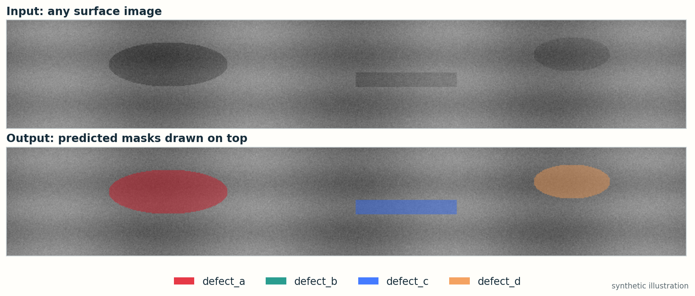

# 2 · Publish on Hugging Face

Your folder works locally. Now put it online.

## Step 1 · Create the Space

1. Sign in at [huggingface.co](https://huggingface.co) and open **New Space** from the profile menu, or go to `huggingface.co/new-space`.
2. Give it a name, for example `surface-defects`.
3. Choose **Gradio** as the SDK and the **Blank** template.
4. Choose **ZeroGPU** as the hardware. It is the free option for Gradio apps on a free account (the **CPU basic** card is greyed out unless you have PRO).
5. Choose **Public** to share a link, or **Private** to keep it to yourself. Press **Create Space**.

## Step 2 · Upload the five files

Open your new Space, go to **Files**, then **Contribute → Upload files**. Drag in:

`app.py` · `model.py` · `weights.pt` · `requirements.txt` · `README.md`

Replace the README that Hugging Face generated. Press **Commit changes to main**. The web uploader handles large weight files for you.

## Step 3 · Wait for the build

Open the **App** tab. The status badge goes **Building → Running**. The first build installs PyTorch, which is large, so give it a few minutes. Press **Logs** to watch.

When the badge says **Running**, your app appears on the page and at `https://huggingface.co/spaces/<your-username>/<space-name>`.

## Step 4 · Try it

Upload an image. Wait a moment and look for the overlay.



Free Spaces may pause when nobody uses them. Opening the link wakes the app up again, which takes a short while.

## When something goes wrong

Open **Logs** first. The last red line usually names the problem.

| What you see | Likely cause | Fix |
| --- | --- | --- |
| `ModuleNotFoundError: No module named ...` | A library is missing | Add it to `requirements.txt` |
| `Missing key(s)` or `size mismatch` in `load_state_dict` | `model.py` is not the architecture you trained | Copy the exact class and arguments from training |
| `FileNotFoundError: weights.pt` | The weights were not uploaded | Upload the file to the root of the Space |
| Output shows no colour at all | Threshold too high, or wrong activation | Print `probs.max()` locally. Check `sigmoid` versus `softmax` |
| The whole image is coloured | Preprocessing differs from training, or the threshold is too low | Compare `preprocess` with the training pipeline |
| `No @spaces.GPU function detected` | ZeroGPU is selected but no function carries the marker | Use the template `app.py`: it has `@gpu` above `predict` |
| `Expected all tensors to be on the same device` | The model and the image are on different devices | Keep `.to(device)` on the input and `.cpu()` on the output, as in the template |
| `Python version ... not supported` | Wrong `python_version` for ZeroGPU | Use `3.12.12` (or `3.10.13`) in the `README.md` header |
| `You have exceeded your GPU quota` | The daily free GPU time is used up | Wait for it to reset, or log in. It resets 24 hours after first use |

## Optional · Upload from the command line

If you prefer a terminal to the web page:

```bash
pip install -U huggingface_hub
hf auth login
hf repos create surface-defects --repo-type space --sdk gradio
hf upload <your-username>/surface-defects . . --repo-type=space
```

The last command uploads the current folder. Run it again after every edit, and the Space rebuilds.

## Free-account limits

- A free account can host **2 ZeroGPU Spaces**, and only if the account is more than **30 days old** with a **verified email**.
- GPU time is a daily quota per visitor: about **5 minutes** for a logged-in free account, **2 minutes** for a visitor who is not logged in. One image takes a second or two, so this is plenty.
- If you cannot create a ZeroGPU Space, check your email verification and account age first.

## Keep your deployment honest

- Upload only code and weights. **Never** upload the competition dataset or test images.
- Say what the model was trained on. The demo shows what *this* model does on *your* picture, not a guaranteed score.
- When you change the model, preprocessing or threshold, test locally again before uploading.

## Check yourself

1. Why is `model.eval()` called once at the top of `app.py` instead of inside `predict`?
2. A classmate's overlay colours the whole strip red. List two causes you would check first, and the one-line experiment for each.
3. Your Space works, but a new upload of a 400 × 64 image gives a blurry overlay. Which line resizes it, and what would you change if you wanted a 2× larger output?

[← Back to the overview](index.html) · [← Prepare the files](01_prepare.md)
