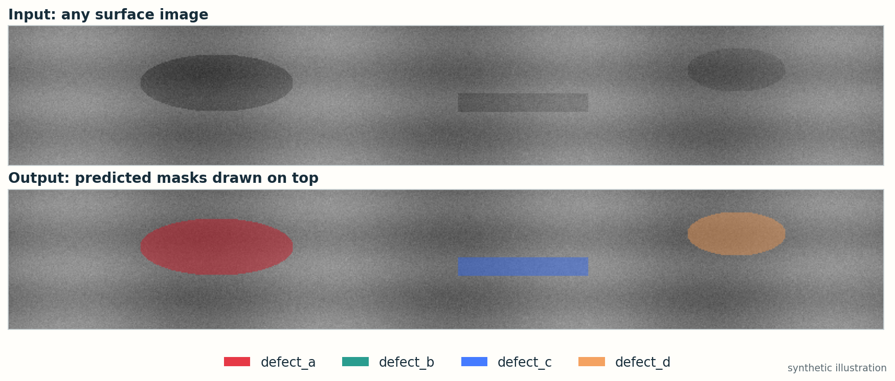
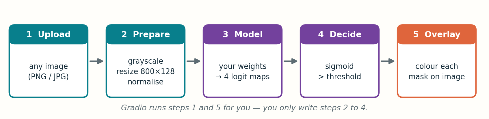

# Deploy your model on Hugging Face

**A 20-minute guide · no web-development experience needed**

You have trained a segmentation model. Now give it a web page: a visitor uploads an image and gets the same image back with the **predicted defect masks drawn on top**.

[Prepare the files](01_prepare.md) · [Publish on Hugging Face](02_publish.md)

## Why this is the simplest route

| Choice | Why |
| --- | --- |
| **Hugging Face Spaces** | Free hosting for small apps, with a public link you can share. |
| **Gradio** | One `gr.Interface(...)` call builds the whole upload-and-show page. No HTML, no server code. |
| **CPU only** | One 128 × 800 image is small. A free CPU Space is enough. |

## What the app does

Steps 2 to 4 are the same three things you already do at validation time: prepare the image, run the model, threshold the probabilities. The only new part is painting the result.

## What you need before you start

- A trained model's **weights file** (`weights.pt`) and the **Python class** that builds the same architecture.
- The **preprocessing** used in training (resize, normalisation).
- Your chosen **threshold**.
- A free account on [huggingface.co](https://huggingface.co).

You do **not** need the competition data. Never upload it. The Space needs only code and weights.

## The route

1. [Prepare five small files](01_prepare.md) and test them on your own computer.
2. [Create a Space and upload them](02_publish.md). Hugging Face builds and runs the app for you.
3. Open your link, drop in an image, and check the overlay.

**One rule runs through everything:** the app must prepare an image *exactly* the way training did. Most deployment bugs are a preprocessing mismatch, not a coding error.
