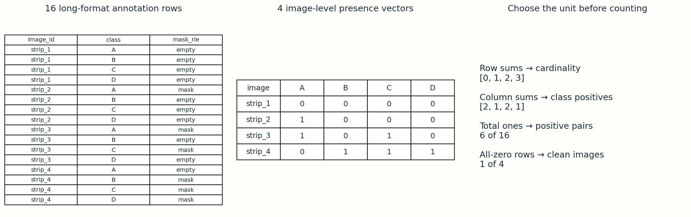
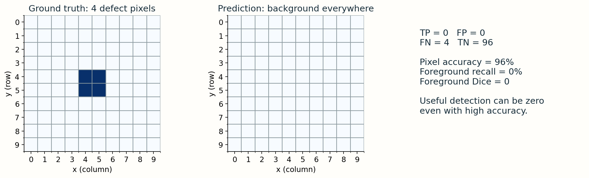

# 1 · Count the right things

Examples, masks, statistics and sensor dimensions on this page are synthetic teaching examples.
**Guide 1.** Three units matter: images, image–class pairs, and pixels. Their imbalance can be very different.

## A strip is not a CSV row

The long annotation table has one row per image and defect class. Four rows describe one image. A blank/NaN/whitespace mask means that class is absent. An image is clean only when all four masks are absent.

| Image | A | B | C | D | Cardinality |
|---|---|---|---|---|---|
| toy_1 | 0 | 0 | 0 | 0 | 0 |
| toy_2 | 1 | 0 | 0 | 0 | 1 |
| toy_3 | 1 | 0 | 1 | 0 | 2 |
| toy_4 | 0 | 1 | 1 | 1 | 3 |

There are 16 rows, 4 images, 6 positive image–class pairs and one clean image. Cardinality is the row sum of this presence matrix, not the number of defect pixels or connected components. A class with three disconnected regions still contributes one label.

<div class="lab" data-lab="cardinality"></div>

## Use three different denominators

The table counts above refer only to the four fictional strips. Image prevalence uses four images as its denominator. Pair prevalence uses sixteen image–class pairs. Pixel prevalence requires the decoded foreground area divided by all canvas pixels. These quantities need not agree.

A class can occur in several images yet occupy very little area in each one. Draw your own tiny masks to test that idea before analyzing a dataset.

## Compute presence without losing clean images

```python
has = df["mask_rle"].fillna("").str.strip().ne("")
presence = df.assign(has=has).pivot(
    index="image_id", columns="defect_type", values="has")
assert len(df) == 4 * len(presence)
assert not presence.isna().any().any()
cardinality = presence.sum(axis=1)
clean_count = (cardinality == 0).sum()
class_counts = presence.sum(axis=0)
```

Check uniqueness of `(image_id, defect_type)` and the exact set of four classes first. `pivot` rejects duplicates. Grouping only positive rows drops clean images from the cardinality distribution unless you reindex all image IDs.

## Why this changes training and evaluation

A detector predicting background everywhere can score excellent pixel accuracy while detecting zero defects. Background-heavy BCE may prioritize common negatives. Weighting, sampling and overlap-focused losses can help, but each changes optimization; evaluate rare classes and clean cases separately. Oversampling can alter class priors, so calibration still belongs on an untouched validation distribution.

**Pause and predict:** Do two positive class rows necessarily imply two images? Do two labels on a strip imply the same pixel has both labels?

<details><summary>Answers and take-home exercise</summary>
No to both. Rows count image–class pairs; spatial overlap requires decoded masks. On the toy table, count each class and verify the total equals the sum of cardinalities: A=2, B=1, C=2, D=1; total=6. Add a second disconnected A region to toy_2: cardinality stays 1.
</details>

## Worked example: from long rows to image labels



Read the table vertically: each strip appears four times. Read the presence matrix horizontally: `[1,0,1,0]` describes one strip with A and C. Summing a column counts positive images of that class. Summing a row counts that strip’s labels. Summing all entries counts positive image–class pairs. These operations answer different questions.

On the four-strip example: positive images=3, clean images=1, positive pairs=6, total pairs=16. The positive-pair fraction is 6/16, while the defective-image fraction is 3/4. Neither tells us the foreground-pixel fraction. To obtain that, decode masks and divide foreground area by the number of native sensor pixels.

## The background-only accuracy trap



A toy 10 × 10 canvas contains four foreground pixels. An all-background prediction gets 96/100 pixel decisions right: 96% accuracy. Yet TP=0, FP=0, FN=4, so foreground recall=0 and foreground Dice=0. High accuracy is compatible with zero useful defect detection.

Dice is `2TP / (2TP + FP + FN)`. Always state the averaging population. Averaging positive masks measures localization; averaging all masks also depends on the chosen empty-mask convention. This is a teaching diagnostic, not the competition’s complete scoring formula.

## Choosing an intervention

| Observation | Candidate change | Verification needed |
|---|---|---|
| Few images of class B | Class-aware sampling | Preserve validation frequencies and monitor B recall |
| Tiny foreground area | Foreground-weighted loss | Check false positives on clean images |
| Multiple labels per strip | Combination-aware split | Count each label and combination in each partition |
| Different defect shapes | Class-specific diagnostics | Compare overlays, not just a global average |

Weights and sampling are hypotheses to validate. Excessive positive weighting can trade missed defects for widespread false positives. Split at the original image level before extracting tiles or augmentations.

<noscript>Interactive controls require JavaScript. The numbered figures, worked examples and code on this page provide the same concepts for static reading.</noscript>
