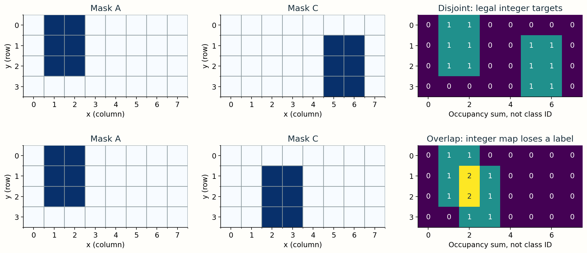
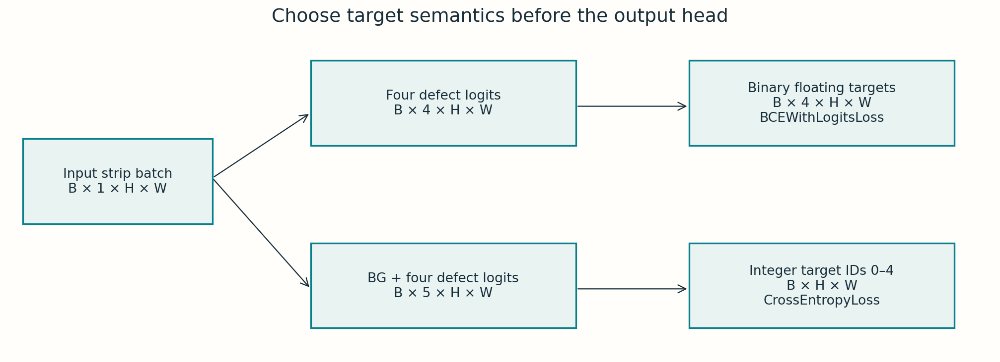

# 2 · Decide what a pixel can mean

**Guide 2.** Multiple labels in an image and multiple labels at a pixel are separate questions.

## Co-occurrence is not overlap

A strip can contain A on the left and C on the right. Its image label is `[1,0,1,0]`, yet every pixel can still have at most one defect class. Stack four decoded binary masks and sum along the class axis: values above one reveal pixel overlap.

<div class="lab" data-lab="overlap"></div>

```python
# masks: [4, H, W], binary and registered to the same image
occupancy = masks.sum(axis=0)
overlap_pixels = (occupancy > 1).sum()
```

Audit all images with multiple positive class rows; single-label images cannot have cross-class overlap. This dataset's audit found disjoint labels. That is evidence about these annotations, not a universal law of defect physics. Annotation policies, mixed materials or another dataset may allow overlap. Check before choosing a head.

## From logits to probabilities

Logits are unrestricted real numbers. Independent sigmoid outputs use `p = 1 / (1 + exp(-z))`. Raising A's logit does not directly change B's probability. Four probabilities need not sum to one, and more than one can exceed a threshold.

Softmax uses `p_k = exp(z_k) / sum_j exp(z_j)`. Five channels include background; the probabilities sum to one at each pixel. Argmax assigns one label. Softmax probabilities are a distribution over mutually exclusive categories, but they are not automatically calibrated estimates of real-world frequency.

<div class="lab" data-lab="heads"></div>

## Tensor and target choices

| Design | Output logits | Training target | Typical loss | Binary decision |
|---|---|---|---|---|
| Four sigmoids | B × 4 × 128 × 800 | Four binary masks, same shape | BCEWithLogitsLoss | Independent class thresholds |
| Five-way softmax | B × 5 × 128 × 800 | B × 128 × 800 integer labels 0–4 | CrossEntropyLoss | Background-inclusive argmax |

Feed raw logits to these losses; their implementations apply the appropriate stable activation internally. For disjoint targets, construct integer labels only after checking overlap. Otherwise converting with argmax silently erases a label. A four-sigmoid design can still be used on disjoint data, but competing predictions require explicit decision rules.

## What the constraint does and does not buy

Softmax makes categories compete and supports an exclusive labeling. It does not guarantee accurate boundaries, rare-class recall or a good score. Independent sigmoid is necessary when overlapping pixel labels are meaningful. Model choice follows target semantics and validation evidence, not the appearance of two defects in the same photograph.

**Check:** Why does a mutually exclusive head need five channels here? Background must be a learnable category; four defect-only softmax channels would force even pristine pixels into a defect category.

## Two masks through the overlap audit



For two binary masks A and C, `A & C` identifies overlap. For all four classes, `masks.sum(axis=0) > 1` identifies pixels with at least two labels. Count **overlapping pixels** separately from **images containing any overlap**. Report how many multi-label images were examined; a zero overlap result on ten examples is weaker evidence than an exhaustive annotation audit.

For exclusive masks, the background channel is `1 - union_of_defects`. A clean pixel becomes integer label 0, A becomes 1, B becomes 2, C becomes 3, D becomes 4. These are category identifiers: class 4 is not four times as defective as class 1.

```python
# Four native binary masks, with classes in a fixed A/B/C/D order.
assert ((masks == 0) | (masks == 1)).all()
assert (masks.sum(axis=0) <= 1).all()
integer_target = np.zeros(masks.shape[1:], dtype=np.int64)
for class_id, mask in enumerate(masks, start=1):
    integer_target[mask.astype(bool)] = class_id
```

## One pixel, two probability systems

Take A logit=2 and B logit=1. Their independent sigmoid probabilities are approximately 0.881 and 0.731. Both pass a 0.5 threshold. With five logits `[0,2,1,-1,-2]`, the softmax vector is approximately `[0.086,0.637,0.234,0.032,0.012]`; its entries sum to 1, and A wins argmax. Raising B’s logit increases its softmax probability and decreases the other probabilities through the shared denominator.



**Implementation check:** BCE targets are floating binary masks with the same shape as logits. Cross-entropy targets are integer class IDs and omit the channel dimension. Apply `sigmoid` or `softmax` when inspecting predictions, while feeding raw logits into the corresponding stable loss. A one-channel softmax is always 1, so it cannot solve the notebook’s binary foreground/background task.

<noscript>Interactive controls require JavaScript. The numbered figures, worked examples and code on this page provide the same concepts for static reading.</noscript>
