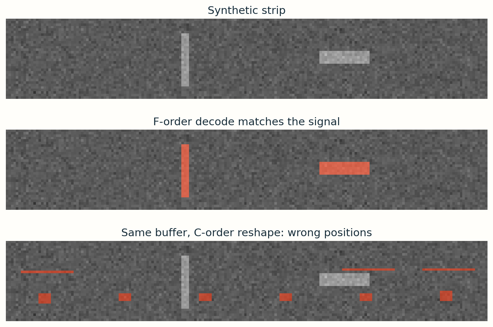

# 3 · Turn masks into numbers

Examples, masks, statistics and sensor dimensions on this page are synthetic teaching examples.
**Guide 3.** RLE describes a binary mask. It does not encode the photograph, a bounding box, or defect intensity.

## Paint → flatten → find runs → serialize

Each consecutive foreground sequence becomes a pair: **1-based start, number of pixels**. In this teaching example, traversal walks down each column, then begins at the top of the next column. NumPy calls this Fortran order (`F`). It is a dataset convention, not a universal camera or Kaggle standard.

<div class="lab" data-lab="rle"></div>

The toy canvas has height 4, width 6. Paint cells or use presets. Read the same mask in row-major order to see how traversal changes encoding. Step through the flattened buffer; the current cell and its index are highlighted. A run can cross a column boundary even when pixels are far apart visually.

## Decode a mask one step at a time

Use the same **4-row, 6-column grid** as the interactive example above. A binary mask stores `1` for a foreground pixel and `0` for background. To write that grid as a sequence, we must choose the order in which to visit its cells.

In **F order**, start at the top-left cell, move down the first column, then return to the top of the next column. The numbers below are the positions in that sequence; they are not image brightness values.

| Row / column | Column 0 | Column 1 | Column 2 | Column 3 | Column 4 | Column 5 |
|---|---|---|---|---|---|---|
| Row 0 | 1 | 5 | 9 | 13 | 17 | 21 |
| Row 1 | 2 | 6 | 10 | 14 | 18 | 22 |
| Row 2 | 3 | 7 | 11 | 15 | 19 | 23 |
| Row 3 | 4 | 8 | 12 | 16 | 20 | 24 |

### Read each pair as “start here, fill this many pixels”

The RLE string `3 4 10 2` contains **two pairs**, `(3, 4)` and `(10, 2)`. The second number in each pair is a length, not an ending index.

| Pair | Starting index | Number of pixels | Indices set to 1 |
|---|---|---|---|
| `3 4` | 3 | 4 | 3, 4, 5, 6 |
| `10 2` | 10 | 2 | 10, 11 |

Start with 24 zeros. Set the six listed positions to 1, then arrange the sequence back into the grid using the **same F order**. All other positions remain zero. The resulting foreground pixels are:

| Sequence index (1-based) | Column x (zero-based) | Row y (zero-based) |
|---|---|---|
| 3 | 0 | 2 |
| 4 | 0 | 3 |
| 5 | 1 | 0 |
| 6 | 1 | 1 |
| 10 | 2 | 1 |
| 11 | 2 | 2 |

Notice indices **4 and 5**: index 4 is at the bottom of column 0, while index 5 is at the top of column 1. They are consecutive in the visiting sequence, so RLE keeps them in the same run even though they are far apart on the grid. A run describes consecutive sequence positions; it need not describe one connected region in the image.


The left grid and first buffer show the F-order example we just decoded. The right grid keeps the foreground cells in the **same physical locations**, but numbers them across rows (C order). Its buffer and RLE string therefore differ. Both conventions can describe a mask; the encoder and decoder must agree on the convention specified by the dataset.

### Why Python uses `[2:6]` for the pair `3 4`

RLE positions in this example start at **1**, while Python array positions start at **0**. Subtract one from the starting position: RLE index 3 becomes Python offset 2. Four pixels occupy offsets 2, 3, 4 and 5. Python’s slice `[2:6]` includes the start and stops before 6:

```python
flat = np.zeros(24, dtype=np.uint8)
flat[2:6] = 1    # RLE pair 3 4 → indices 3, 4, 5, 6
flat[9:11] = 1   # RLE pair 10 2 → indices 10, 11
mask = flat.reshape(4, 6, order="F")
```

### Convert an index into a grid location

Coordinates start at zero: $x$ is the column and $y$ is the row. For a grid of height $H$, each complete column contains $H$ positions. Subtract 1 from the RLE index $k$, divide by $H$ to count complete columns, and use the remainder to find the row:

$$
x = \left\lfloor \frac{k-1}{H} \right\rfloor,
\qquad y = (k-1) \bmod H
$$

For index $k=6$ and height $H=4$, $k-1=5$. Dividing 5 by 4 gives one complete column and remainder 1, so the pixel is at **column 1, row 1**. To go in the other direction:

$$
k = xH + y + 1
$$

For $(x,y)=(1,1)$, this gives $1\times4+1+1=6$. In NumPy, access this pixel as `mask[y, x]`, which is `mask[1, 1]` here; array indexing puts the row before the column.

## The right number of pixels can still make the wrong mask

The decoder first fills a one-dimensional sequence. It then needs to place those values on the image. **Using the wrong reshape order changes which image location receives each value.**

Take index 6 on our 4-row, 6-column grid:

| How the sequence is placed | Visiting rule | Location of index 6 |
|---|---|---|
| F order | Down each column | Column 1, row 1 |
| C order | Across each row | Column 5, row 0 |

The foreground value has not changed, but it now lands on a different pixel. Apply this mistake to every foreground position and the mask can become scattered or stretched across unrelated parts of the image.



Read the three panels from top to bottom:

1. **Original image:** the bright vertical and horizontal patches are the regions labeled in this synthetic example.
2. **Correct F-order decode:** the orange mask covers those patches because the encoding and reshape use the same visiting order.
3. **Wrong C-order reshape:** the very same flat mask values are placed across rows instead. The orange pixels move away from the labeled regions, even though their total count stays unchanged.

For the small worked example, both reshapes still contain six foreground pixels. Counting them cannot reveal the placement error. Overlay the decoded mask on the image and check a known location, such as index 6. Also compare `decode(encode(mask))` against a known mask. A round trip alone can pass if both functions share the same wrong convention, so confirm the dataset’s order with a known reference too.

## Boundaries and malformed input

A canvas of height H and width W has H × W pixels. Inclusive last index is `start + length - 1`. Valid runs must have positive starts and lengths and stay within the canvas. Empty masks decode to all zeros.

For a 24-pixel toy canvas, run `23 4` requests 23,24,25,26. A tolerant training decoder clamps the end and keeps 23,24. A strict submission validator rejects the overflow. Inspect your own inputs for boundary violations. Clamping is a policy choice that requires a documented reason; it is not a substitute for validation.

```python
flat = np.zeros(H * W, dtype=np.uint8)
for start, length in pairs:
    lo = start - 1
    hi = min(lo + length, H * W)  # optional tolerant-decoder policy
    flat[lo:hi] = 1
mask = flat.reshape(H, W, order="F")
```

This snippet assumes validated positive pairs. A robust parser also checks even token count, integer tokens, positive starts/lengths, ordering and bounds. Encoding uses a binary `mask.ravel(order='F')`, pads zeros at both ends, finds transitions, then writes start/length pairs.

## Compression has conditions

An all-zero mask needs no runs. A compact patch is economical; a checkerboard creates many short runs and may be larger as text than packed bits. RLE is useful for long uniform sequences, not a guaranteed compression ratio.

**Student task:** Paint two foreground cells at the last row of one column and first row of the next. Explain why they become one run. Then compare `decode(encode(mask))` to the original, and encode a completely empty mask.

## Encoder and decoder you can test

```python
import numpy as np

def encode_rle(mask):
    if mask.ndim != 2 or not np.isin(mask, [0, 1]).all():
        raise ValueError("Expected a 2D binary mask")
    flat = mask.ravel(order="F").astype(np.uint8)
    padded = np.r_[0, flat, 0]
    edges = np.flatnonzero(padded[1:] != padded[:-1]) + 1
    starts, stops = edges[::2], edges[1::2]
    return " ".join(str(v) for pair in zip(starts, stops-starts) for v in pair)

def decode_rle(text, height, width, clamp=False):
    flat = np.zeros(height * width, dtype=np.uint8)
    tokens = str(text).strip().split() if text is not None else []
    if len(tokens) % 2:
        raise ValueError("Expected start/length pairs")
    previous_end = 0
    for s, n in np.asarray(tokens, dtype=int).reshape(-1, 2):
        end = s + n - 1  # inclusive, 1-based
        if s < 1 or n < 1 or s <= previous_end or s > flat.size:
            raise ValueError("Invalid or overlapping run")
        if end > flat.size and not clamp:
            raise ValueError("Run exceeds canvas")
        flat[s-1:min(end, flat.size)] = 1
        previous_end = end
    return flat.reshape(height, width, order="F")

mask = np.zeros((4, 6), dtype=np.uint8)
mask[2:4, 0] = 1; mask[0:2, 1] = 1; mask[1:3, 2] = 1
assert encode_rle(mask) == "3 4 10 2"
assert np.array_equal(decode_rle(encode_rle(mask), 4, 6), mask)
assert decode_rle("", 4, 6).sum() == 0
```

Normalize CSV NaN/blank values to an empty string before calling this teaching decoder. Strict validation rejects bad tokens and out-of-bounds runs; enable `clamp=True` only if your chosen data-validation policy explicitly allows clipping.


**Boundary arithmetic:** `23 4` means last requested index `23+4−1=26`. The zero-based slice is `[22:26]`. On a 24-pixel buffer, tolerant decoding clips the exclusive end to 24, leaving `[22:24]`: exactly two pixels. Subtract one from the start once, not twice.

## What “masked RLE” means here

The encoded object is the binary **segmentation mask** associated with one image–class pair. The photograph supplies intensities; the mask supplies membership. Overlaying the mask on the image is a visualization step. To log it to W&B, send a 2D integer mask and its class labels alongside the image; to serialize it into this CSV format, send its F-order runs. Neither operation replaces the raw image with run lengths.

Do not confuse this start/length convention with formats that store alternating background/foreground counts, or with compressed COCO RLE. An RLE decoder must match the dataset’s indexing, traversal and serialization rules.

<noscript>Interactive controls require JavaScript. The numbered figures, worked examples and code on this page provide the same concepts for static reading.</noscript>
