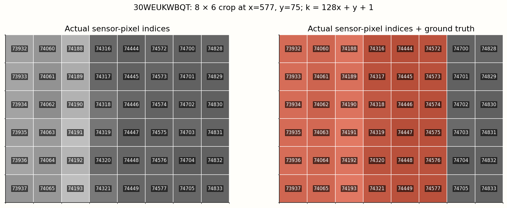
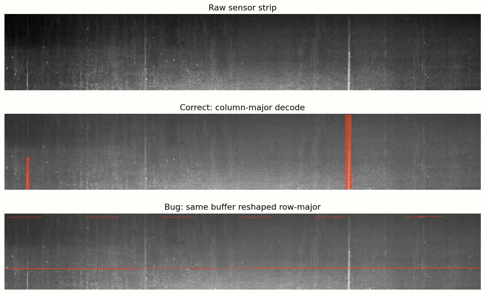
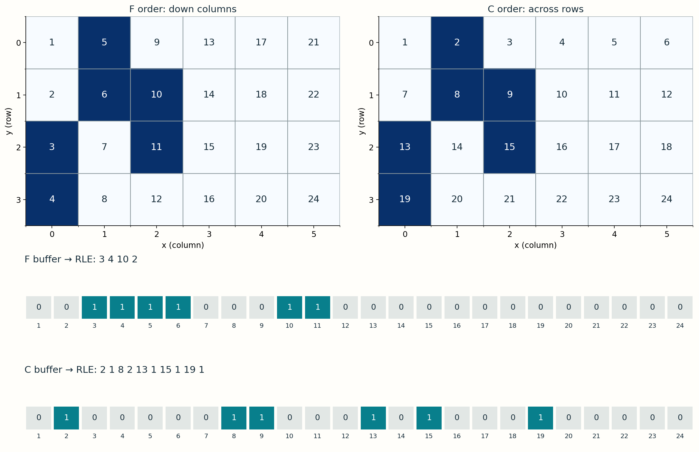
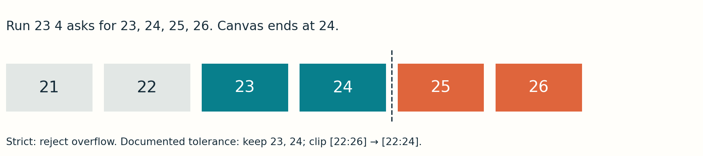

# 3 · Turn masks into numbers

**Guide 3.** RLE describes a binary mask. It does not encode the photograph, a bounding box, or defect intensity.

## Paint → flatten → find runs → serialize

Each consecutive foreground sequence becomes a pair: **1-based start, number of pixels**. This dataset walks down each column, then begins at the top of the next column. NumPy calls this Fortran order (`F`). It is a dataset convention, not a universal camera or Kaggle standard.

<div class="lab" data-lab="rle"></div>

The toy canvas has height 4, width 6. Paint cells or use presets. Read the same mask in row-major order to see how traversal changes encoding. Step through the flattened buffer; the current cell and its index are highlighted. A run can cross a column boundary even when pixels are far apart visually.

## A worked decode with every index

For height 4, `3 4 10 2` marks indices 3,4,5,6,10,11. Run `3 4` starts at zero-based offset 2 and fills slice `[2:6]`. The end is exclusive. Foreground at indices 4 and 5 is consecutive in memory but jumps from the bottom of column 0 to the top of column 1.

For zero-based coordinates `(x,y)`:

- Encode index: `k = x * H + y + 1`.
- Decode coordinate: `x = (k - 1) // H`, `y = (k - 1) % H`.
- On the real strip, index 130 means `(x=1,y=1)`, not row 0 column 129.



Each number is a native image pixel's actual global 1-based index. The crop is enlarged for reading; it is not a downsampled grid. The overlay uses the original annotation.

## Correct pixels, wrong locations



Reshaping the same flat buffer with `order='C'` keeps the foreground count but changes locations. A pixel-count sanity check cannot detect this bug. Always overlay on the photograph, test a known coordinate, and verify encode/decode round trips.

## Boundaries and malformed input

A native canvas has 102,400 pixels. Inclusive last index is `start + length - 1`. Valid runs must have positive starts and lengths and stay within the canvas. Empty masks decode to all zeros.

For a 24-pixel toy canvas, run `23 4` requests 23,24,25,26. A tolerant training decoder clamps the end and keeps 23,24. A strict submission validator rejects the overflow. Two training rows in this dataset extend one pixel beyond the native canvas; record this known exception rather than silently treating arbitrary malformed annotations as valid.

```python
flat = np.zeros(H * W, dtype=np.uint8)
for start, length in pairs:
    lo = start - 1
    hi = min(lo + length, H * W)  # documented training-only tolerance
    flat[lo:hi] = 1
mask = flat.reshape(H, W, order="F")
```

This snippet assumes validated positive pairs. A robust parser also checks even token count, integer tokens, positive starts/lengths, ordering and bounds. Encoding uses a binary `mask.ravel(order='F')`, pads zeros at both ends, finds transitions, then writes start/length pairs.

## Compression has conditions

An all-zero mask needs no runs. A compact patch is economical; a checkerboard creates many short runs and may be larger as text than packed bits. RLE is useful for long uniform sequences, not a guaranteed compression ratio.

**Student task:** Paint two foreground cells at the last row of one column and first row of the next. Explain why they become one run. Then compare `decode(encode(mask))` to the original, and encode a completely empty mask.

## Trace the same pixels in two memory orders



The highlighted mask has foreground coordinates `(0,2),(0,3),(1,0),(1,1),(2,1),(2,2)` in `(x,y)` notation. In F order the active indices are 3,4,5,6,10,11, giving `3 4 10 2`. In C order those same pixels lie at 2,8,9,13,15,19, giving a different set of runs. The diagram’s exact numbered cells make the convention visible; it is not enough to remember the letter F.

## Encoder and decoder you can test

```python
import numpy as np

def encode_rle(mask):
    if mask.ndim != 2 or not np.isin(mask, [0, 1]).all():
        raise ValueError("Expected a 2D binary mask")
    flat = mask.ravel(order="F").astype(np.uint8)
    padded = np.r_[0, flat, 0]
    edges = np.flatnonzero(padded[1:] != padded[:-1]) + 1
    starts, stops = edges[::2], edges[1::2]
    return " ".join(str(v) for pair in zip(starts, stops-starts) for v in pair)

def decode_rle(text, height, width, clamp=False):
    flat = np.zeros(height * width, dtype=np.uint8)
    tokens = str(text).strip().split() if text is not None else []
    if len(tokens) % 2:
        raise ValueError("Expected start/length pairs")
    previous_end = 0
    for s, n in np.asarray(tokens, dtype=int).reshape(-1, 2):
        end = s + n - 1  # inclusive, 1-based
        if s < 1 or n < 1 or s <= previous_end or s > flat.size:
            raise ValueError("Invalid or overlapping run")
        if end > flat.size and not clamp:
            raise ValueError("Run exceeds canvas")
        flat[s-1:min(end, flat.size)] = 1
        previous_end = end
    return flat.reshape(height, width, order="F")

mask = np.zeros((4, 6), dtype=np.uint8)
mask[2:4, 0] = 1; mask[0:2, 1] = 1; mask[1:3, 2] = 1
assert encode_rle(mask) == "3 4 10 2"
assert np.array_equal(decode_rle(encode_rle(mask), 4, 6), mask)
assert decode_rle("", 4, 6).sum() == 0
```

Normalize CSV NaN/blank values to an empty string before calling this teaching decoder. Strict validation rejects bad tokens and out-of-bounds runs; enable `clamp=True` only for the documented training annotation exception.



**Boundary arithmetic:** `23 4` means last requested index `23+4−1=26`. The zero-based slice is `[22:26]`. On a 24-pixel buffer, tolerant decoding clips the exclusive end to 24, leaving `[22:24]`: exactly two pixels. Subtract one from the start once, not twice.

## What “masked RLE” means here

The encoded object is the binary **segmentation mask** associated with one image–class pair. The photograph supplies intensities; the mask supplies membership. Overlaying the mask on the image is a visualization step. To log it to W&B, send a 2D integer mask and its class labels alongside the image; to serialize it into this CSV format, send its F-order runs. Neither operation replaces the raw image with run lengths.

Do not confuse this start/length convention with formats that store alternating background/foreground counts, or with compressed COCO RLE. An RLE decoder must match the dataset’s indexing, traversal and serialization rules.

<noscript>Interactive controls require JavaScript. The numbered figures, worked examples and code on this page provide the same concepts for static reading.</noscript>
