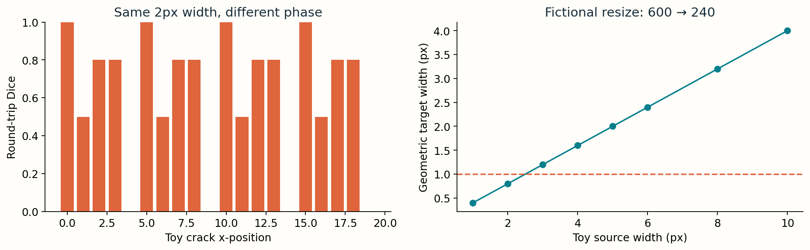
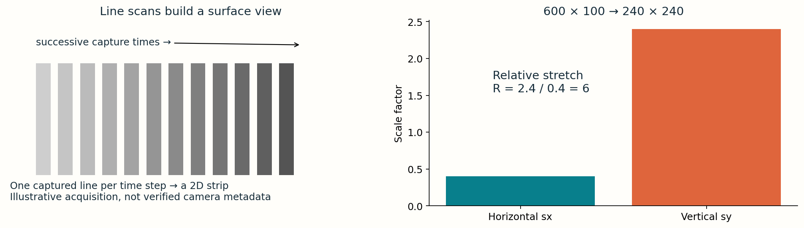
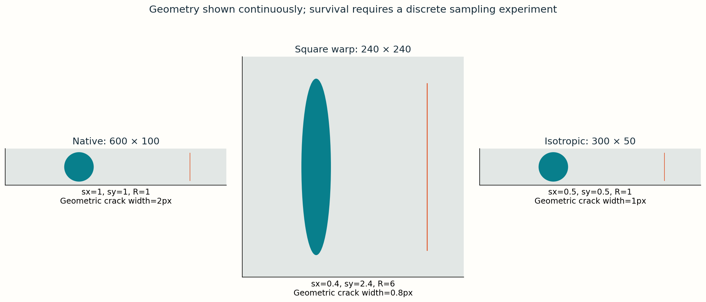

# 4 · Preserve geometry and evidence

Examples, masks, statistics and sensor dimensions on this page are synthetic teaching examples.
**Guide 4.** All dimensions and calculations here are fictional teaching examples, independent of the graded dataset. Our fictional sensor strip has width 600 and height 100; shape in arrays is `(100,600)`. Keep this order explicit.

## Square resizing changes shape

For target width W′ and height H′, `s_x = W′/600`, `s_y = H′/100`. Distortion is `R = s_y/s_x`. An isotropic resize has R=1. For 240 × 240, s_x=0.4, s_y=2.4 and R=6. A native circle becomes a tall ellipse; a 2-pixel vertical crack has a geometric horizontal footprint of 0.8 target pixels.

The diagram uses a native sensor-shaped synthetic strip and resamples its binary crack with nearest-neighbor pixel centers. Change position as well as width. This exposes phase-dependent disappearance rather than inventing an opacity rule for thin cracks. The round-trip metric compares native labels with resized-and-restored labels.

## Subpixel does not always mean gone

A thin feature may disappear, shift, widen or survive depending on alignment, filter and threshold. Nearest-neighbor picks sample locations and can miss it entirely. Bilinear/area interpolation may retain weak fractional evidence in an image, but thresholding can discard that evidence. Enlargement later cannot reconstruct details already discarded.

All cracks in the left experiment have the same 2-pixel width. Only the x-position changes. Both use an explicit nearest-neighbor pixel-center rule on this fictional strip. Neither is a universal guarantee that every subpixel crack disappears.

## Images and labels require different treatment

Images can use antialiased downsampling. Categorical integer labels should use nearest-neighbor to avoid inventing class IDs. With soft occupancy targets, area-based averaging can be intentional, but that changes target semantics and loss interpretation. Apply the same spatial transform to image and mask, and inspect overlays afterward.

Nyquist says a band-limited signal needs sampling above twice its highest frequency to avoid aliasing. A crack boundary is not band-limited, so “width < 1 pixel” is a warning about lost evidence, not an exact Nyquist theorem. Antialias filtering trades detail for stable sampling; it cannot preserve arbitrary tiny structures after aggressive reduction.

## Safer options and their costs

- Native 600 × 100 input retains sensor geometry and labels, but uses more memory.
- Isotropic 300 × 50 keeps aspect ratio but reduces a 2-pixel crack to 1 pixel; preserving shape does not preserve all detail.
- Horizontal crops/tiles keep local sampling. Overlap and stitch carefully; split by original image before tiling to prevent validation leakage.
- Letterboxing preserves geometry within a square canvas but wastes pixels on padding and needs padding-aware prediction removal.

**Check:** A 360 × 100 resize has s_x=0.6, s_y=1 and R≈1.667. A 300 × 50 resize has R=1 but still loses spatial detail. Explain why both facts can be true.

## A sensor strip becomes a tensor

A line-scan camera repeatedly captures one line while material moves. Stacking successive lines makes a 2D surface view. The illustration describes a possible acquisition geometry; the stored 600 × 100 shape alone does not prove the camera’s physical pixel pitch or material speed. Array indices and physical distances are separate coordinate systems.

## Track a circle and a crack separately

For square 240 × 240 input, a native circle with diameter 20 pixels becomes 8 target pixels wide and 48 tall. Its vertical/horizontal ratio becomes 6. The vertical crack’s **width** follows `s_x`; a horizontal crack’s **height** follows `s_y`. Thin vertical and horizontal defects therefore experience different risks under this transform.

| Input strategy | Shape preserved? | Fine-detail cost | Operational concern |
|---|---|---|---|
| Native 600 × 100 | Yes | None from resizing | Memory and encoder stride alignment |
| 300 × 50 | Yes | Half the samples per axis | Small defects still vulnerable |
| Square warp | No | Unequal sampling by axis | Shape change plus loss of narrow structures |
| Aspect-preserving fit + padding | Yes | Fit may still downsample | Remove padding before native-coordinate RLE |
| Native-resolution overlapping tiles | Within each tile | No resize loss | Stitch boundaries and prevent image leakage |

## Interpolation is an experiment, not a slogan

Nearest-neighbor reads one source value per target sample. Bilinear computes a weighted combination of nearby values. Area-based downsampling approximates averages over source coverage. These rules can yield different retained evidence. Fractional image intensities are valid; a fractional **class ID** is meaningless. If a binary mask is deliberately converted into a fractional occupancy target, state that change explicitly.

When decoding a prediction back into native coordinates, reverse the actual preprocessing pipeline: remove padding, resize probabilities or labels using the chosen rule, threshold or assign class IDs, and then encode the native binary mask. A correct RLE encoder cannot undo an incorrect spatial transform.

**Practice:** Set target size to 240 × 240 and crack width to 2. Move x one pixel at a time. Identify a disappearing phase and a surviving phase. Then select 300 × 50: distortion becomes 1, yet the round trip can still shift boundaries. Use native size to check that Dice returns to 1.

<noscript>Interactive controls require JavaScript. The numbered figures, worked examples and code on this page provide the same concepts for static reading.</noscript>
