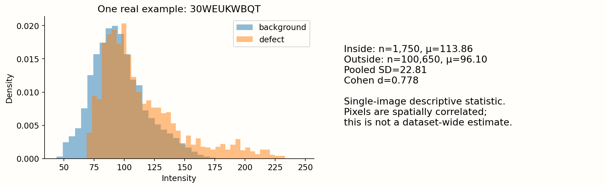
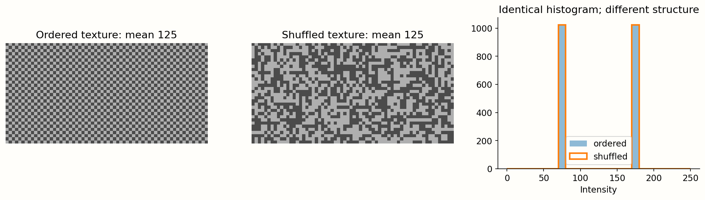
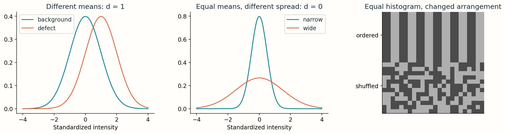
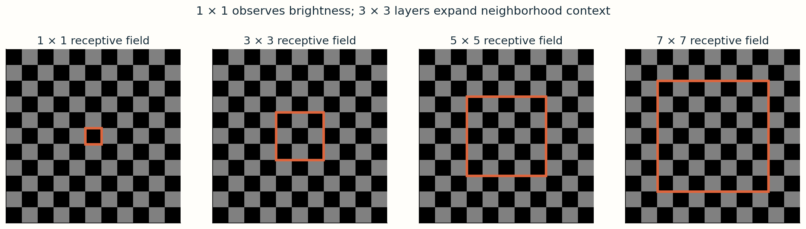

# 5 · See beyond average brightness

**Guide 5.** A region can look structurally different while having the same average brightness as its surroundings.

## Contrast as a standardized mean difference

Cohen's d compares inside-mask and background intensity means relative to pooled variability:

`d = (mean_inside - mean_background) / pooled_SD`

`pooled_SD = sqrt(((n_inside-1)*s_inside² + (n_background-1)*s_background²) / (n_inside+n_background-2))`

Positive d means the defect is brighter on average; negative means darker. Magnitude measures mean separation in pooled SD units. Conventional 0.2/0.5/0.8 small/medium/large labels are heuristics, not reliable defect-detection thresholds. If pooled SD is zero, d is undefined; do not hide that with an arbitrary epsilon.

## One measured real example

This is a single-image descriptive statistic, recomputed from the image and decoded label. It is not a dataset-wide class estimate. Pooling all pixels across images weights large masks and lighting conditions differently from averaging per-image d. Report the aggregation and sampling protocol when comparing classes. Pixels are correlated; treat images, not individual pixels, as independent units for uncertainty estimates.

## Same histogram, different arrangement

Both synthetic regions contain exactly the same multiset of intensities: same mean, SD and histogram. Their spatial arrangement differs. A histogram cannot distinguish them, while local edges, autocorrelation or convolutional features can.

The interactive example keeps the histogram fixed while shuffling pixels with a seeded generator. Neighbor differences change because local structure changes. This is an educational pattern, not a simulated specimen of a particular defect class.

## Why a small d is not proof of invisibility

Small d means weak separation of the **means**. Distributions could differ in spread, tails or local structure. Large d does not prove a global brightness threshold will work: lighting varies, labels include boundary/background mixtures, and per-image normalization changes scales. Evaluate a proposed threshold on held-out images rather than infer success from d alone.

A uniform linear transform `I′=aI+b` with positive a leaves d unchanged: the mean difference and pooled SD both scale by a. Contrast enhancement can improve visual inspection without introducing new information. Nonlinear local enhancement such as CLAHE changes distributions and may also amplify noise; verify effects on both image and task metrics.

## From texture to receptive fields

A 1 × 1 convolution sees intensity at one pixel. A 3 × 3 convolution can respond to neighboring patterns. Three stride-1 3 × 3 convolutions have a theoretical 7 × 7 receptive field; downsampling/dilation expand context. Bigger context helps distinguish a local scratch from a repeated background pattern, but a theoretical receptive field alone does not establish learned detection ability. Pooling may erase the very thin structures needed by the task.

**Worked example:** Inside mean=110, background mean=100, both SD=20 and both n=100. Pooled SD=20, so d=0.5. Add 30 to every intensity: d stays 0.5. Shuffle inside pixels: d stays 0.5, but texture changes.

**Exit question:** If mean intensity is equal inside and outside a mask, what would you inspect next? Compare full distributions, local spatial patterns, illumination, annotation quality and held-out model errors.

## Compute the statistic rather than naming it

Suppose the defect has n=5 intensities with mean 120 and sample SD 10. Background has n=9, mean 100 and sample SD 20. The pooled variance is `(4×100 + 8×400)/12 = 300`. Pooled SD is √300≈17.321. Therefore d=(120−100)/17.321≈1.155. The pooled SD is not the unweighted average of 10 and 20; sample sizes control the weights.

Three progressively richer questions: do means differ, do intensity distributions differ, and do spatial arrangements differ? Cohen’s d answers the first. A histogram helps with the second. Local neighborhoods help with the third. No single statistic substitutes for looking at the annotated region.

## Contrast enhancement preserves some quantities, changes others

For a positive uniform linear transform, `mean′=a×mean+b` and `SD′=a×SD`; dividing cancels a, so d stays unchanged. This statement assumes no clipping or quantization loss. In an 8-bit image, saturation can violate the assumptions. For a negative a the sign reverses. A non-invertible transform cannot manufacture information; it can emphasize features for human viewing or make learning easier for a limited model.

CLAHE uses local histograms and clipping. Compare original and enhanced images with the same masks, record the settings, and measure held-out results. Avoid interpreting a visually dramatic result as a validated increase in defect recall.

## Why neighborhoods add evidence

A single pixel does not reveal a stripe’s direction. A neighborhood can. For stride-1, no-dilation 3 × 3 convolutions, the receptive field grows 1 → 3 → 5 → 7. More generally, `r_new = r_old + (kernel−1) × dilation × jump_old`, and `jump_new = jump_old × stride`. Pooling expands context but may discard thin edges; architecture must balance context and spatial resolution.

When reporting a class contrast profile, show how you selected images, whether intensities were normalized, what counts as background, and whether each image receives equal weight. Using the whole strip background may confound a local defect with illumination gradients; a local ring can be a useful comparison, but it changes the statistic and must be specified.

**Worked exit answer:** If d≈0, inspect variance/tails and local edge patterns, compare the original mask overlay, and check several independent images. Equal means do not imply identical appearance or random labels.

<noscript>Interactive controls require JavaScript. The numbered figures, worked examples and code on this page provide the same concepts for static reading.</noscript>
