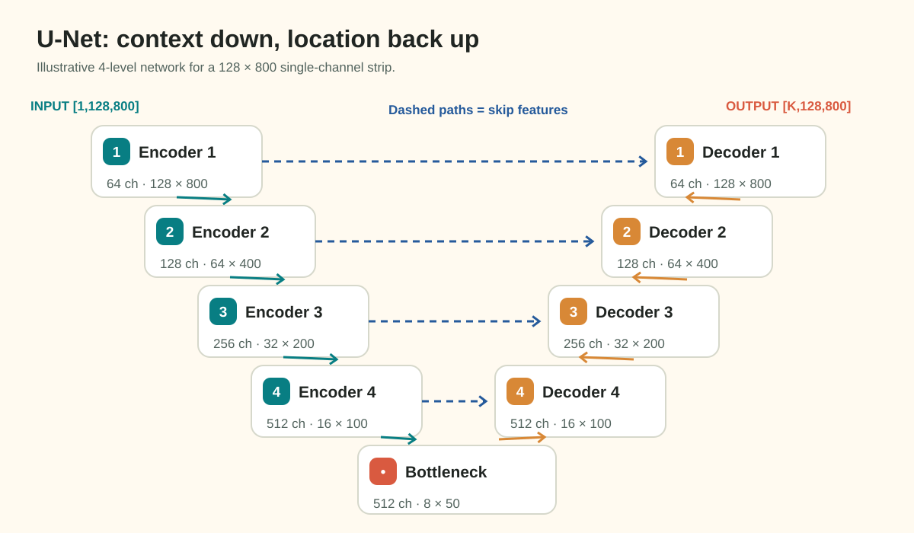

# Feature Map Spatial Geometry & Downsampling Arithmetic
*(Milestone 3 · Question 1 Study Guide)*

## 1. Why Keep the Strip Geometry?

The competition images are height × width $128 \times 800$. Resizing them to a square changes horizontal and vertical distances by different factors, which distorts defect shapes. Keep the native dimensions for this assessment. Downsampling inside a model is a separate operation: it reduces feature resolution while increasing channels and context.



*This conceptual diagram illustrates skip fusion. Q1 defines its own four pooling stages; the SMP models used in Q2 use five encoder stages by default. Do not infer Q1's bottleneck from another model's diagram.*

## 2. Compute Shapes from the Actual Operator

For dilation 1, a pooling or convolution output dimension is:
$$D_{out}=\left\lfloor\frac{D_{in}+2p-k}{s}\right\rfloor+1.$$

With `MaxPool2d(kernel_size=2, stride=2, padding=0, ceil_mode=False)`, this becomes $\lfloor D_{in}/2\rfloor$. A `Conv2d(kernel_size=3, stride=2, padding=1)` instead gives $\lceil D_{in}/2\rceil$. They agree on even inputs but differ on odd inputs. Q1 explicitly uses the floor-pooling rule.

For dimensions divisible by $2^n$, $n$ such pooling stages reduce each axis by $2^n$ and area by $4^n$. This is a sampling-area ratio, **not the receptive field**: stacked convolutions can make a feature depend on a much larger input region.

### Practice with Different Dimensions

Consider a fictional $96 \times 640$ tensor and three pooling stages:

| Stage | Height | Width |
| :--- | ---: | ---: |
| Input | 96 | 640 |
| Pool 1 | 48 | 320 |
| Pool 2 | 24 | 160 |
| Pool 3 | 12 | 80 |

The area ratio is $(96\cdot640)/(12\cdot80)=64$. Repeat this procedure with the assessment's dimensions and stage count yourself.

## 3. Skip Mismatch and Full-Canvas Deficit Are Different

A U-Net decoder concatenates a decoder tensor with an encoder skip at the same spatial resolution. `torch.cat(..., dim=1)` allows channel counts to differ, but batch, height and width must agree.

Use a **different toy width of 643 and three pooling stages**:
$$643\to321\to160\to80.$$

Doubling the bottleneck gives 160, which matches the first skip. Doubling again gives 320, which disagrees with the next skip of width 321. A decoder with no alignment stops at that concatenation. Blindly multiplying the bottleneck by $2^3$ gives 640, a full-canvas deficit of 3; that is not the mismatch at a particular skip.

Common alignment choices include padding the input, cropping a skip, or interpolating to the skip's explicit size:

```python
import torch.nn.functional as F
# In a decoder that intentionally aligns to the skip:
upsampled = F.interpolate(decoder, size=skip.shape[-2:], mode="bilinear", align_corners=False)
```

This fixes tensor shape, not lost image detail. Q1 instead asks about the **first decoder skip**, immediately after the bottleneck is doubled, before any cropping, padding or interpolation-to-size.

## 4. Practice Check

<details>
<summary>Why do the two stride-2 operators disagree at an odd width?</summary>

For a toy width of 101, floor pooling produces 50 while a padded 3-tap stride-2 convolution produces 51. Substituting the padding and kernel values in the general formula explains the difference. Always trace the operator used by your model.

</details>

## 5. Guiding Hints and Assignment Task

1. Read [Question 1](../../MILESTONE_3.md#question-1-feature-map-spatial-geometry-downsampling-arithmetic).
2. Trace both axes through the four specified pooling operations.
3. For the odd-width input, keep every intermediate width. Compare the Stage 3 skip width with twice the Stage 4 bottleneck width. Stop before alignment; do not substitute a full-canvas deficit.
4. Divide input area by bottleneck area for the native even-sized strip.
5. Report `H_bottle, W_bottle; first_skip_mismatch_px; downsample_factor`.
