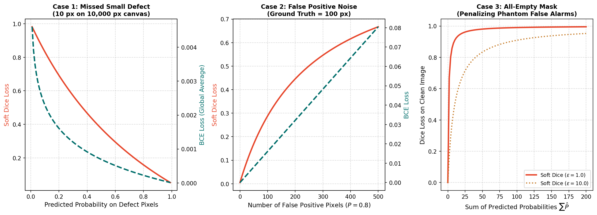

# Differentiable Soft Dice Loss & Numerical Smoothing
*(Milestone 3 · Question 5 Study Guide)*

## 1. Sparse Foreground and the Objective

A model can attain high pixel accuracy on a sparse-defect dataset by predicting background too often. This does not make all-background prediction the mathematical optimum of BCE: a missed positive pixel still has a nonzero logit gradient. At an exactly zero predicted probability on a positive target, ideal BCE is unbounded. The practical concern is imbalance in aggregate contributions and shared-parameter updates, not an absence of a foreground penalty.

Measure class and pixel distributions yourself. This guide's numerical examples are fictional and reveal no competition statistics.

## 2. From Hard Overlap to a Differentiable Loss

Binary Dice compares a predicted set $X$ and target set $Y$:
$$D(X,Y)=\frac{2|X\cap Y|}{|X|+|Y|}.$$

Thresholding probabilities creates a step function, so hard Dice is unsuitable as a direct differentiable training loss. In the assessment's Soft Dice, use probabilities $p_i=\sigma(z_i)$:
$$L_D=1-\frac{2\sum_i p_i y_i+\epsilon}{\sum_i p_i+\sum_i y_i+\epsilon}.$$

Compute three quantities before substituting: intersection $I=\sum p_i y_i$, predicted mass $P=\sum p_i$, and target mass $T=\sum y_i$. Then $L_D=1-(2I+\epsilon)/(P+T+\epsilon)$.

**Reduction matters.** The supplied `SoftDiceLoss` flattens all batch, channel and spatial dimensions into one global ratio. It is not an average of per-image or per-class Dice losses. Document that reduction when comparing implementations; a clean image inside a mixed batch is coupled to positives elsewhere in the batch.

## 3. What Smoothing Changes

With $\epsilon>0$, an entirely empty reduction ($P=T=0$) gives Dice 1 and loss 0. Without smoothing the ratio is undefined. Smoothing also changes losses and gradients for small objects; its numerical value is part of the objective, not just a harmless implementation detail.

Smoothing does not guarantee stable optimization under every probability distribution. Read [Guide 7](guide_07_compound_loss_and_clean_image_dynamics.md) to distinguish the value of a loss from its gradient.



*These are synthetic probability sweeps, not training results. The first two panels use different y-axis scales for BCE and Dice, so compare trends rather than line heights. A steep-looking loss curve does not establish a steep logit gradient.*

## 4. Worked Practice with Different Inputs

Use a fictional **20-pixel patch with 4 positives**, smoothing $\epsilon=1$.

**Model U** predicts 0.2 at every pixel. Then $I=4\cdot0.2=0.8$, $P=20\cdot0.2=4$, and $T=4$. Thus:
$$L_D=1-\frac{2(0.8)+1}{4+4+1}=1-\frac{2.6}{9}\approx0.7111.$$

**Model V** predicts 0.75 at the four positives and 0.05 at the sixteen negatives. Then $I=3$, $P=3+0.8=3.8$, and $T=4$:
$$L_D=1-\frac{2(3)+1}{3.8+4+1}=1-\frac{7}{8.8}\approx0.2045.$$

Even small background probabilities contribute to $P$. Foreground confidence contributes both to $P$ and to the overlap numerator. This explains the distinct effects of missed foreground and background leakage.

<details>
<summary>Practice: Model V now predicts zero on background. How does the loss change?</summary>

Now $P=3$, $I=3$, $T=4$, so $L_D=1-7/8=0.125$. Removing background leakage improves overlap without changing foreground confidence. These practice values differ from the assessment.

</details>

## 5. Verify the Practice Calculation

```python
import torch
p = torch.full((20,), 0.2, dtype=torch.float64)
y = torch.zeros_like(p)
y[:4] = 1
loss = 1 - (2 * (p * y).sum() + 1) / (p.sum() + y.sum() + 1)
print(float(loss))
```

This probability-based snippet is for arithmetic only. The official loss accepts raw logits and applies sigmoid internally. Applying sigmoid before calling that loss would apply it twice.

## 6. Guiding Hints and Assignment Task

1. Read [Question 5](../../MILESTONE_3.md#question-5-differentiable-soft-dice-loss-numerical-smoothing).
2. For each assessment model, calculate $I$, $P$ and $T$ using the question's own population and probabilities.
3. Substitute into the specified smoothed formula; retain precision until the final rounding to four decimal places.
4. Report `loss_model1, loss_model2`. Do not reuse the practice patch's losses.
