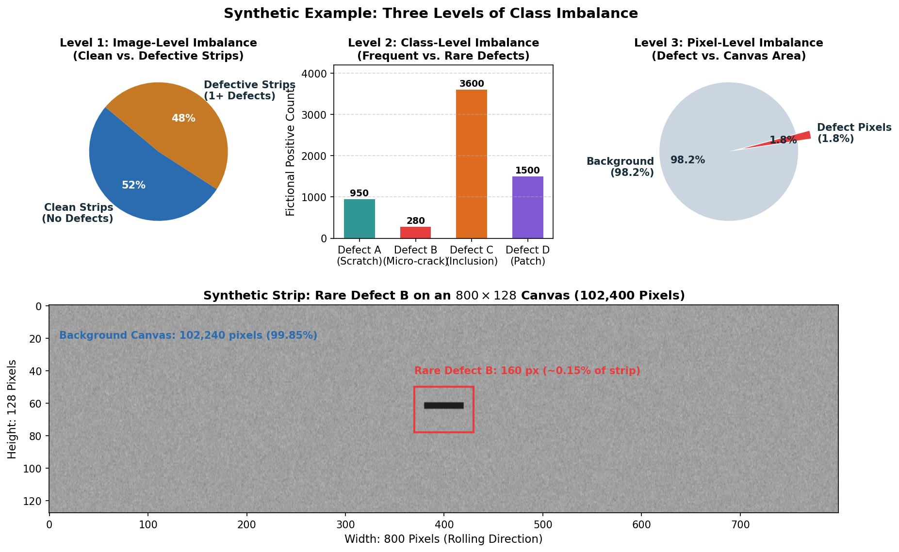
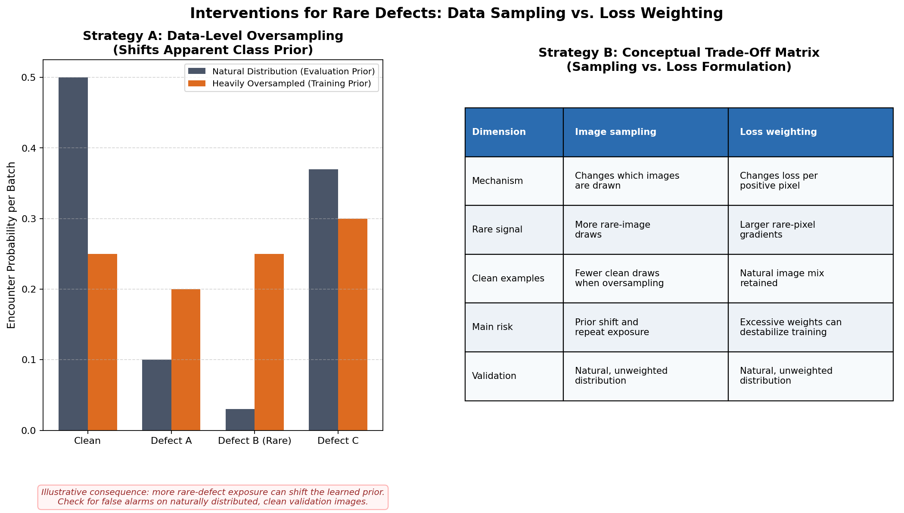

# Multi-Level Class Imbalance: Image, Class, and Pixel Mechanics

In segmentation, imbalance can appear at several linked but distinct levels. For this task, separate the number of images containing each class, the mix of class combinations, and the positive-pixel share inside masks. They have different denominators and call for different diagnostics.

An intervention designed to solve imbalance at one level can easily destabilize training or cause catastrophic error spikes at another level. This guide dissects the three tiers of imbalance, examines data-level and loss-level interventions, walks through a concrete numerical demonstration, and establishes strict validation safeguards to ensure your model detects rare anomalies without flooding clean material with false alarms.

---

## 1. Observable Problem: The Rare-Class Silence and False-Alarm Flood

Consider two hypothetical failure modes in a segmentation experiment:

```
Failure Mode 1: The "Silent Predictor"
Training Loss: 0.12 (descends smoothly)
Pixel Accuracy: 98.4%
Validation Dice (defect_c): 0.65
Validation Dice (defect_b): 0.00 (Zero predicted pixels across all validation images!)

Failure Mode 2: The "False-Alarm Flood"
Student applies 50x oversampling to rare defect_b images.
Validation Dice (defect_b positives): 0.48 (Rare defects are finally detected!)
Clean-Image Specificity: Drops from 99.1% to 64.3% (Clean images receive hundreds of false alarms!)
Leaderboard Score: Plummets dramatically due to false positive penalties.
```

These invented log values illustrate mechanisms, not measured outcomes. A model can receive little positive-class signal when positives are rare at image and pixel level. Oversampling changes the training draw distribution and may alter the model's effective prior; measure clean-image false alarms on the unchanged, naturally sampled validation set before drawing conclusions.

To solve this, we must deconstruct imbalance into its three constitutive levels.

---

## 2. The Three Levels of Imbalance


*Figure 1.1: Industrial surface segmentation exhibits three concurrent tiers of imbalance: image-level (clean vs. defective material), class-level (common vs. rare defect geometries), and pixel-level (defect area vs. canvas area).*

### Level 1: Image-Level Imbalance (Clean vs. Defective Strips)
The clean-image share is a property to measure for the chosen data partition; do not assume a prevalence from the application domain.
- **The Physical Meaning**: Clean images represent examples where the annotation marks no target defect. Their pixel patterns can still contain texture and illumination variation.
- **The Modeling Danger**: If you filter out clean images during training to "concentrate on defects," your model never learns what normal background looks like. When evaluated on real production strips, it will flag every benign surface texture as a defect.

### Level 2: Class and combination imbalance
Measure positive image counts separately for each class. Multi-label images contribute to multiple class counts, so those counts need not sum to the dataset size. A combination table answers a different question: how many images have each exact set of labels? Merging tiny combination groups can stabilize a split, but it loses their individual identity for stratification only; it does not change the annotations.

### Level 3: Pixel-Level Imbalance (Defect Canvas Occupancy)
Even when an image contains an active defect, the anomaly occupies only a tiny fraction of the strip.
On an industrial line-scan canvas of $128 \times 800 = 102,400\text{ pixels}$:
- A hairline scratch might be 2 pixels wide and 100 pixels long ($200\text{ pixels}$).
- That scratch occupies only $200 / 102,400 \approx 0.19\%$ of the image!
- The background class commands $99.81\%$ of all supervised pixels.
- **The Modeling Danger**: In standard Binary Cross-Entropy (BCE), gradient contributions from the $102,200$ background pixels easily drown out the gradients from the $200$ defect pixels.

---

## 3. Sampling by observed combination groups

To balance optimization gradients, practitioners employ interventions either at the **data pipeline level** (modifying what the model sees) or at the **loss function level** (modifying how the model is penalized).


*Figure 1.2: Comparison of data-level sampling and loss-level weighting. Sampling changes image exposure; loss weighting changes per-pixel objective contributions. Either can affect validation behavior, so measure the components rather than assuming the direction of change.*

### Strategy A: Data-Level Sampling
Data-level interventions adjust the probability $P(\text{draw } i)$ of selecting image $i$ during mini-batch construction:

1. **Natural Uniform Sampling**: Every image in the training partition has equal probability $P(i) = 1/N$. Mini-batches reflect the empirical distribution.
2. **Weighted Random Sampling (`WeightedRandomSampler`)**: Assigns a positive sampling weight $w_i$ to image $i$. Increasing its weight relative to other images increases its probability of inclusion in draws.

One simple, reproducible intervention assigns the same weight to every image in an exact label-combination group. If the clean group has $n_0$ images and group $g$ has $n_g$, use
$$w_g=\min\left(\sqrt{n_0/n_g}, 5\right).$$
Sampling is over individual images, with replacement, in proportion to their per-image weights. Therefore group $g$ has total draw mass $n_gw_g$ and probability $n_gw_g/\sum_h n_hw_h$. The cap bounds the influence of tiny groups. This is not the same as independently computing class weights and taking a maximum across labels.

For the sampler-only experiment, estimate weights from the training partition only. Keep validation natural and fixed. A change in clean false-alarm rate can be consistent with prior shift, but one run does not establish the cause; compare controlled runs and retain per-class evidence.

### Strategy B: Loss-Level Weighting
Instead of altering how often images are sampled, loss-level weighting scales the gradient contribution of rare pixels directly in the objective function.

#### 1. Positive Weighting in Binary Cross-Entropy (`pos_weight`)
For continuous logit $z \in \mathbb{R}$ and binary label $y \in \{0, 1\}$:
$$\mathcal{L}_{\text{BCE}}(z, y) = - \left[ \gamma \cdot y \log(\sigma(z)) + (1 - y) \log(1 - \sigma(z)) \right]$$
where $\gamma > 1.0$ is the positive class weight (`pos_weight`).

If a defect occupies $1\%$ of the canvas and background occupies $99\%$, setting $\gamma = 10.0$ scales the gradient contribution of true defect pixels by $10\times$, preventing background pixels from dominating the backward pass.

#### 2. Class-Balanced Soft Dice Loss
In standard positive-pair Dice loss, all positive defect channels are summed uniformly:
$$\mathcal{L}_{\text{Dice}} = 1 - \frac{2 \sum_{k \in \mathcal{P}} \sum_{i} P_{k, i} Y_{k, i} + \epsilon}{\sum_{k \in \mathcal{P}} \sum_{i} (P_{k, i} + Y_{k, i}) + \epsilon}$$
where $\mathcal{P}$ is the set of positive image-class pairs.

In **class-balanced Dice reduction**, the loss calculates soft Dice independently per active defect class, and then averages across present classes:
$$\mathcal{L}_{\text{CB-Dice}} = \frac{1}{|\mathcal{C}_{\text{batch}}|} \sum_{c \in \mathcal{C}_{\text{batch}}} \left( 1 - \text{Dice}_c \right)$$
Under this formulation, a batch containing 7 images of `defect_c` and 1 image of rare `defect_b` gives equal loss weight to both classes ($\frac{1}{2}\mathcal{L}_c + \frac{1}{2}\mathcal{L}_b$), preventing the abundant class from drowning out the rare class.

---

## 4. Worked Example: A Separate Fictional 40-Strip Pool

To practice the group-mass calculation with values unrelated to the assessment, consider 40 fictional strips in three mutually exclusive groups:

| Group | Images ($n_g$) | Per-image weight $w_g$ | Group mass $n_gw_g$ |
|---|---:|---:|---:|
| clean | 16 | $\min(\sqrt{16/16},5)=1$ | 16 |
| A | 20 | $\min(\sqrt{16/20},5)\approx0.894$ | $\approx17.889$ |
| B | 4 | $\min(\sqrt{16/4},5)=2$ | 8 |

Total weighted mass is approximately $41.889$. The clean draw probability is $16/41.889$; the natural probability is $16/40$. Notice the clean probability decreases slightly here even though clean images have per-image weight 1: other groups' per-image weights also determine the denominator. Expected draws in an epoch of $T$ replacement draws equal $T$ times the group's probability. The capped square-root rule softens but does not remove distribution shift.

---

## 5. Diagnostic Symptoms: Causes and Checks

| Observable Symptom in Logs | Underlying Root Mechanism | Concrete Measurement to Take | Corrective Next Step |
| :--- | :--- | :--- | :--- |
| A rare class is missed in many training batches. | Sparse image-level exposure can reduce opportunities for positive examples to influence updates. | Count positive images and batch/epoch exposure by class. | Consider a bounded training-only sampler or a loss intervention, then evaluate on natural validation data. |
| Clean-image false alarms rise after reweighting. | The intervention may have changed class exposure or altered the score calibration. | Compute both the share of empty pairs with any prediction and predicted-pixel fraction on empty pairs. | Review the intervention and compare against the fixed natural validation distribution. |
| Model achieves high training Dice on rare class, but validation Dice remains near zero. | Overfitting through duplicate repetition: the model memorized the few oversampled training strips. | Check training vs. validation loss gap on rare-class subset; check gradient norms. | Apply stronger spatial augmentations (flips, contrast jitter); cap sampling weight; increase weight decay. |
| Training loss diverges to `NaN` or spikes erratically. | Several numerical or data-pipeline causes are possible; a large positive weight is one candidate, not a diagnosis. | Inspect finite logits/targets, loss terms, gradient norms, and the configured weights. | Isolate the source before changing weights or adding clipping. |

---

## 6. Implementation Pattern: Combination-Group Sampling

Build the combination string for each training image, count each group, then assign each image in a group the same weight. Do not infer the weights from validation data.

```python
from collections import Counter
import math
import torch
from torch.utils.data import WeightedRandomSampler

def make_sampler(group_names: list[str], draws: int, seed: int = 17):
    counts = Counter(group_names)
    if "clean" not in counts or counts["clean"] == 0:
        raise ValueError("the clean reference group must be present")
    n_clean = counts["clean"]
    per_image = [min(math.sqrt(n_clean / counts[g]), 5.0) for g in group_names]
    generator = torch.Generator().manual_seed(seed)
    return WeightedRandomSampler(
        torch.tensor(per_image, dtype=torch.double),
        num_samples=draws, replacement=True, generator=generator,
    )
```

The sample weights are per-image weights. For an exact group with $n_g$ members, its expected share is $n_gw_g/\sum_h n_hw_h$. Inspect both class-positive draws and clean-image draws, since multi-label groups contain several classes and clean exposure changes through the shared denominator. Validation uses ordinary sequential loading.

## 7. Common Pitfalls Checklist

1. **The Validation Distribution Trap**:
   - *Mistake*: Applying training weights to validation, or computing weights before the split so validation labels influence training sampling.
   - *Consequence*: Validation no longer estimates performance on its intended natural distribution; the score may move in either direction and comparisons become hard to interpret.
2. **Double-Counting Multi-Label Images**:
   - *Mistake*: Multiplying class weights ($w_i = w_A \times w_B \times w_C$) for images with multiple defects.
   - *Consequence*: Rare multi-defect images receive astronomical weights (e.g., $w_i = 120.0$), causing the optimizer to overfit exclusively to those few strips.
3. **Ignoring Clean Image Specificity**:
   - *Mistake*: Celebrating an increase in `positive_dice_b` from 0.00 to 0.45 without checking whether `clean_image_perfect_rate` dropped from 95% to 50%.
   - *Consequence*: The official competition score drops because false-positive penalties outweigh the rare-class gain.

---

## Practice 8 · Auditing a Fictional Sampling Log

Inspect this output snippet from a fictional training run:

```text
Epoch 10 Audit:
[Natural Baseline]
Train Loss: 0.184 | Val Loss: 0.192
Val Dice Mean: 0.712 | Val Foreground Dice: 0.485
Val Dice (A): 0.52 | Val Dice (B): 0.00 | Val Dice (C): 0.68 | Val Dice (D): 0.51
Clean Strip Specificity: 98.6%

[Experiment 1: Extreme Oversampling (Weight B = 25.0)]
Train Loss: 0.245 | Val Loss: 0.380
Val Dice Mean: 0.620 | Val Foreground Dice: 0.440
Val Dice (A): 0.48 | Val Dice (B): 0.41 | Val Dice (C): 0.59 | Val Dice (D): 0.44
Clean Strip Specificity: 71.2%
```

**Diagnostic Questions for You to Consider**:
1. In Experiment 1, why did `Val Dice Mean` drop from `0.712` to `0.620` even though `Val Dice (B)` rose from `0.00` to `0.41`?
2. What happened to `Clean Strip Specificity`, and what does that imply about the model's false alarm rate on clean steel strips?
3. What bounded sampling weight or loss weighting strategy would you propose as Experiment 2 to capture Defect B while keeping clean specificity above $95\%$?

---

## 9. Framework References

- PyTorch [`torch.utils.data.WeightedRandomSampler`](https://pytorch.org/docs/stable/data.html#torch.utils.data.WeightedRandomSampler)
- PyTorch [`torch.nn.BCEWithLogitsLoss`](https://pytorch.org/docs/stable/generated/torch.nn.BCEWithLogitsLoss.html) (parameter `pos_weight`)
- Lin, T. Y., et al. (2017). *Focal Loss for Dense Object Detection*. IEEE ICCV. (Foundational reference on modulating loss for extreme foreground-background class imbalance).
