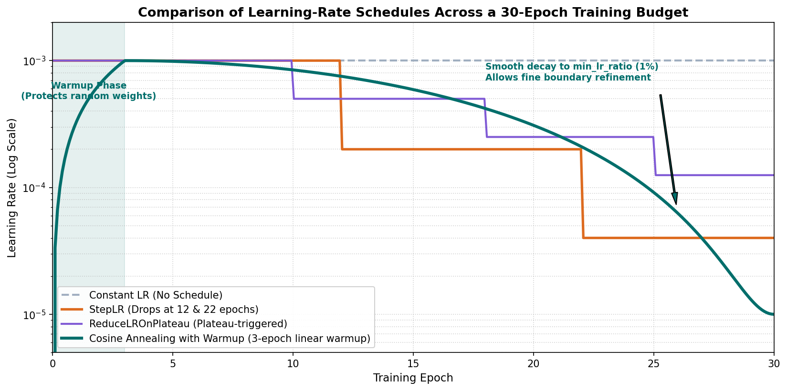

# Learning-Rate Schedulers and Warmup Strategies

In deep learning optimization, the **learning rate ($\eta$)** is universally recognized as the single most critical hyperparameter. It dictates the magnitude of parameter updates across the high-dimensional loss surface.

In industrial anomaly segmentation—where networks pair deep pretrained feature extractors with randomly initialized decoders to detect millimeter-thin defects—a static, constant learning rate is rarely sufficient. A learning rate aggressive enough to escape poor initial local minima early in training will cause weights to oscillate chaotically around the sharp, narrow ravines required to trace hairline defect boundaries later in training.

This guide explores the physical and geometric role of learning-rate dynamics, contrasts standard schedule archetypes, analyzes the stabilization mechanics of linear warmup, examines per-batch versus per-epoch stepping cadences, and provides a structured protocol for controlled schedule comparisons.

---

## 1. Observable Problem: Destabilization and Late-Stage Oscillation

Consider two diagnostic traces from segmentation runs using a constant learning rate $\eta = 10^{-3}$:

```text
Run A: Initial Destabilization (No Warmup)
Epoch 1: Train Loss = 0.842 | Gradient Norm = 142.8 | Val Foreground Dice = 0.08
Epoch 2: Train Loss = 1.620 | Gradient Norm = 380.2 | Val Foreground Dice = 0.00
Epoch 3: Train Loss = 0.910 | Gradient Norm = 95.4  | Val Foreground Dice = 0.12
Symptom: Large initial gradients from the random decoder shatter pretrained encoder weights,
causing loss spikes and unstable early representations.

Run B: Late-Stage Oscillation (Constant Learning Rate)
Epoch 15: Train Loss = 0.185 | Val Foreground Dice = 0.582
Epoch 20: Train Loss = 0.182 | Val Foreground Dice = 0.579
Epoch 25: Train Loss = 0.184 | Val Foreground Dice = 0.581
Epoch 30: Train Loss = 0.181 | Val Foreground Dice = 0.578
Symptom: Training loss and validation Dice plateau prematurely. The constant step size
overshoots the fine, sharp minima needed to resolve subtle scratch boundaries.
```

Both failure modes highlight the fundamental limitation of a fixed learning rate: **the optimal step size at the start of training is drastically different from the optimal step size near convergence**.

---

## 2. Optimization Mechanics: The Role of the Learning Rate

In stochastic gradient descent with momentum and AdamW, parameter updates follow the general form:
$$\theta_{t+1} = \theta_t - \eta_t \cdot \hat{m}_t$$
where $\theta_t$ represents the model weights at step $t$, $\eta_t$ is the instantaneous learning rate, and $\hat{m}_t$ is the bias-corrected gradient vector (or momentum-scaled directional estimate).

The optimization trajectory encounters three distinct phases during a training run:

```
Phase 1: Exploration & Alignment (Epochs 1 to 5)
• Gradients are large and noisy.
• Randomly initialized decoder weights must align with pretrained encoder features.
• Risk: Gradient explosions shattering pretrained representations.
• Need: Low, gradually increasing learning rate (Linear Warmup).

Phase 2: Active Traversal (Epochs 5 to 20)
• Model descends the primary valleys of the loss surface.
• Coarse defect patterns, class shapes, and major spatial features are learned.
• Need: High, sustained learning rate to make steady progress and escape saddle points.

Phase 3: Fine Boundary Annealing (Epochs 20 to 30)
• Coarse features are established; optimization focuses on sub-pixel boundary refinement.
• Minima for thin scratches (2–5 pixels wide) are steep and narrow.
• Need: Smooth decay to a fraction of the initial learning rate (1% to 5%) to settle into narrow minima.
```

---

## 3. Schedule Archetypes: Mathematical Formulation


*Figure 2.1: Comparison of learning-rate trajectories across a 30-epoch budget. Warmup followed by Cosine Annealing provides smooth, continuous decay down to the minimum learning-rate floor.*

### 1. Step Decay (`StepLR` / `MultiStepLR`)
Multiplies the learning rate by a fixed factor $\gamma \in (0, 1)$ at pre-determined epoch milestones:
$$\eta_t = \eta_0 \cdot \gamma^{\lfloor t / s \rfloor}$$
where $s$ is the step size (e.g., decay every 10 epochs by $\gamma = 0.2$).

- *Advantage*: Simple and intuitive.
- *Disadvantage*: Discontinuous drops introduce abrupt shocks to optimizer momentum buffers; requires manual tuning of step milestone epochs.

### 2. Cosine Annealing (`CosineAnnealingLR`)
Introduced by Loshchilov and Hutter (2016), cosine annealing smoothly decreases the learning rate following a half-cosine wave:
$$\eta_t = \eta_{\min} + \frac{1}{2} (\eta_{\max} - \eta_{\min}) \left( 1 + \cos\left( \frac{\pi t}{T_{\max}} \right) \right)$$
where:
- $\eta_{\max}$: Peak learning rate (e.g., $10^{-3}$).
- $\eta_{\min}$: Minimum learning rate floor (e.g., $10^{-5}$ or $0.01 \times \eta_{\max}$).
- $t$: Current optimization step or epoch.
- $T_{\max}$: Total number of steps or epochs in the training budget.

- *Advantage*: Smooth, non-discontinuous trajectory without hyperparameter milestones.
- *Physical Meaning*: The early derivative of cosine is near zero, allowing sustained exploration; the middle phase descends rapidly; the final tail flattens smoothly, granting ample time for delicate boundary annealing.

### 3. Validation-Driven Plateau Decay (`ReduceLROnPlateau`)
Instead of following a predetermined clock, this scheduler dynamically monitors a validation metric (such as validation loss or validation Foreground Dice):
$$\eta_{k+1} = \begin{cases}
\eta_k \cdot \gamma & \text{if validation metric has not improved by } \delta_{\min} \text{ for } p \text{ epochs} \\
\eta_k & \text{otherwise}
\end{cases}$$
where $p$ is patience (e.g., 3 epochs) and $\gamma$ is the reduction factor (e.g., 0.5).

- *Advantage*: Highly responsive to actual model progress; pauses decay if the model is still learning.
- *Disadvantage*: Sensitive to validation metric noise. If rare defect sampling causes validation Dice to fluctuate, the scheduler may prematurely drop the learning rate to zero.

---

## 4. The Critical Role of Linear Warmup

In modern segmentation architectures, the encoder backbone is typically pre-trained on ImageNet (millions of natural images), while the decoder, skip-connection projections, and segmentation head are initialized with random Gaussian noise.

If training commences immediately at a large learning rate (for example, $\eta_{\max} = 10^{-3}$):
1. The random decoder outputs wildly inaccurate predictions, generating massive loss values.
2. Backpropagating these massive initial losses produces violent gradient updates across all layers.
3. These updates can disrupt useful pretrained features; whether that happens depends on the model, data, optimizer and rate.

### The Linear Warmup Formulation:
Over a stated number of scheduler indices, define the warmup multiplier using the same index convention as the scheduler:
$$\eta_t = \eta_{\max} \cdot \frac{t}{T_{\text{warmup}}}, \quad \text{for } 0 \le t < T_{\text{warmup}}$$

Warmup reduces the scheduled learning rate early and increases it gradually. It does not rescale gradients themselves, guarantee stable BatchNorm statistics, or guarantee that a run will avoid divergence. In step-based code, `t` is the scheduler index; do not silently shift it by one when calculating a requested index.

---

## 5. Stepping Cadence: Per-Batch vs. Per-Epoch

A common source of confusion is whether `scheduler.step()` should be invoked after **every training mini-batch** or once at the **end of each epoch**.

```
Cadence A: Per-Epoch Stepping
• Scheduler is called once after all training batches in the epoch complete.
• Total schedule length: T_max = num_epochs (e.g., T_max = 30).
• Common for: StepLR, ReduceLROnPlateau, basic LambdaLR.

Cadence B: Per-Batch Stepping
• Scheduler is called after EVERY optimizer step (every batch or accumulation group).
• Total schedule length: T_max = num_epochs * steps_per_epoch.
  Example: 30 epochs * 285 batches = 8,550 total steps.
• Common for: OneCycleLR, fine-grained CosineAnnealingLR.
```

> [!CAUTION]
> **The Cadence Mismatch Trap**:
> If you configure `CosineAnnealingLR(optimizer, T_max=30)` intending it for 30 epochs, but accidentally call `scheduler.step()` inside your inner training loop after every batch, the scheduler will complete its entire 30-epoch decay in the **first 30 batches of Epoch 1**! The remaining 29 epochs will run at the flat minimum learning rate.

---

## 6. Implementation Pattern: AdamW with Warmup and Cosine Decay

Here is the clean, reproducible PyTorch implementation using `torch.optim.lr_scheduler.LambdaLR`:

```python
import math
import torch
import torch.nn as nn
from torch.optim import AdamW
from torch.optim.lr_scheduler import LambdaLR

def build_warmup_cosine_scheduler(
    optimizer: torch.optim.Optimizer,
    epochs: int,
    warmup_epochs: int = 3,
    min_lr_ratio: float = 0.01,
) -> LambdaLR:
    """Creates a per-epoch LambdaLR scheduler combining linear warmup with cosine decay.

    Args:
        optimizer: PyTorch optimizer (e.g. AdamW).
        epochs: Total training budget in epochs.
        warmup_epochs: Number of initial epochs dedicated to linear warmup.
        min_lr_ratio: Minimum LR floor expressed as a fraction of initial LR (e.g. 0.01 = 1%).
    """
    def lr_lambda(epoch: int) -> float:
        # Phase 1: Linear Warmup
        if epoch < warmup_epochs:
            return float(epoch + 1) / max(1, warmup_epochs)

        # Phase 2: Cosine Annealing Decay
        progress = float(epoch - warmup_epochs) / max(1, epochs - warmup_epochs - 1)
        progress = min(1.0, max(0.0, progress))
        cosine_decay = 0.5 * (1.0 + math.cos(math.pi * progress))

        return min_lr_ratio + (1.0 - min_lr_ratio) * cosine_decay

    return LambdaLR(optimizer, lr_lambda)
```

### Complete Training Step Loop Sequence:
```python
# Setup
optimizer = AdamW(model.parameters(), lr=1e-3, weight_decay=1e-4)
scheduler = build_warmup_cosine_scheduler(optimizer, epochs=30, warmup_epochs=3)

for epoch in range(30):
    model.train()
    for batch in train_loader:
        optimizer.zero_grad(set_to_none=True)
        images, masks = batch["image"].to(device), batch["mask"].to(device)

        loss = criterion(model(images), masks)
        loss.backward()

        torch.nn.utils.clip_grad_norm_(model.parameters(), max_norm=1.0)
        optimizer.step()  # Optimizer MUST step before scheduler

    # Validation step
    val_metrics = evaluate(model, val_loader)

    # Step per-epoch scheduler at epoch boundary
    scheduler.step()

    current_lr = optimizer.param_groups[0]["lr"]
    print(f"Epoch {epoch+1:02d} Complete | Val Foreground Dice: {val_metrics['fg_dice']:.4f} | Next LR: {current_lr:.2e}")
```

For a step-indexed schedule, move `scheduler.step()` to the optimizer-update boundary and count optimizer updates, not DataLoader microbatches. Under AMP, `GradScaler` may skip an optimizer update after detecting non-finite gradients. Advance an update-indexed schedule only when the optimizer actually stepped; otherwise the LR clock can move ahead of the parameter updates. A practical loop can compare the scale before and after `scaler.update()` (a decreased scale signals a skipped update), or use an explicit optimizer-step hook supported by the installed PyTorch version. With gradient accumulation, the scheduler belongs after the accumulation window, not after every microbatch.

### Applying the method to the assessment

For Question 4, evaluate the defined multiplier at the requested scheduler indices and multiply by the base LR. For its bug variant, the schedule's units remain optimizer steps while the code advances the scheduler only once per epoch; after eight calls, use scheduler index 8. Question 8 uses the same fixed schedule horizon even though its run stops earlier, so do not compress the cosine period to the shorter run.

---

## 7. Diagnostic Symptoms: Causes and Checks

| Observable Symptom in Logs | Underlying Root Cause | Verification Check | Recommended Next Step |
| :--- | :--- | :--- | :--- |
| Loss diverges to `NaN` in Epoch 1, especially when starting with pretrained backbone. | Gradient shattering: high initial LR applied to random decoder propagates unstable gradients into encoder. | Check `train/gradient_norm` in first 50 steps; inspect decoder weight initialization. | Add 3–5 epochs of linear warmup; verify initial learning rate $\le 10^{-3}$; add gradient clipping. |
| Learning rate drops to minimum floor before Epoch 1 finishes. | Cadence mismatch: per-epoch scheduler (`T_max = 30`) was stepped inside the per-batch inner loop. | Print `optimizer.param_groups[0]['lr']` at every batch; inspect scheduler call location. | Move `scheduler.step()` outside the batch loop to the epoch boundary. |
| Training loss continues descending smoothly, but validation Dice stops improving at epoch 12. | Overfitting on training distribution; model memorizing subtle texture patterns without generalizable boundary rules. | Compare training loss vs. validation loss curve; inspect validation error masks. | Introduce learning rate decay (cosine); add early stopping; increase data augmentations. |
| `ReduceLROnPlateau` drops learning rate prematurely on epoch 4 during noisy validation. | Patience window too short ($p = 1$), causing scheduler to react to normal validation mini-batch stochasticity. | Check validation Dice variance across consecutive epochs. | Increase patience to $p \ge 4$; enforce `min_delta` (e.g., $0.005$) to ignore minor noise. |

---

## Practice 8 · Schedule Selection Challenge

Review the following three project scenarios and determine which schedule configuration is most technically sound:

```text
Scenario A:
A student has a fixed budget of 30 epochs on Kaggle GPUs. They are using an EfficientNet-B2
backbone paired with a U-Net++ decoder. They want a smooth, predictable decay that spends
adequate time annealing boundary pixels in the final 10 epochs.

Scenario B:
A student has an open-ended training budget on a private workstation. They are uncertain
how many epochs the model will need to converge, and they want the learning rate to drop
only when validation loss demonstrably flattens for several consecutive evaluations.

Scenario C:
A student trains a model from scratch (randomly initialized encoder and decoder, no ImageNet
weights). They want to ramp up the learning rate immediately to 5e-3 on batch 1.
```

**Diagnostic Questions**:
1. For Scenario A, why is a Linear Warmup (3 epochs) + Cosine Annealing schedule preferable to StepLR?
2. For Scenario B, what monitored quantity and patience setting should be passed to `ReduceLROnPlateau` to avoid premature stopping?
3. For Scenario C, what will happen to the randomly initialized weights if warmup is omitted?

---

## 9. Authoritative References

- PyTorch [`torch.optim.lr_scheduler.LambdaLR`](https://pytorch.org/docs/stable/generated/torch.optim.lr_scheduler.LambdaLR.html)
- PyTorch [`torch.optim.lr_scheduler.CosineAnnealingLR`](https://pytorch.org/docs/stable/generated/torch.optim.lr_scheduler.CosineAnnealingLR.html)
- PyTorch [`torch.optim.lr_scheduler.ReduceLROnPlateau`](https://pytorch.org/docs/stable/generated/torch.optim.lr_scheduler.ReduceLROnPlateau.html)
- Loshchilov, I., & Hutter, F. (2016). *SGDR: Stochastic Gradient Descent with Warm Restarts*. ICLR. (Foundational cosine annealing reference).
- Goyal, P., et al. (2017). *Accurate, Large Minibatch SGD: Training ImageNet in 1 Hour*. arXiv:1706.02677. (Foundational linear warmup reference).
