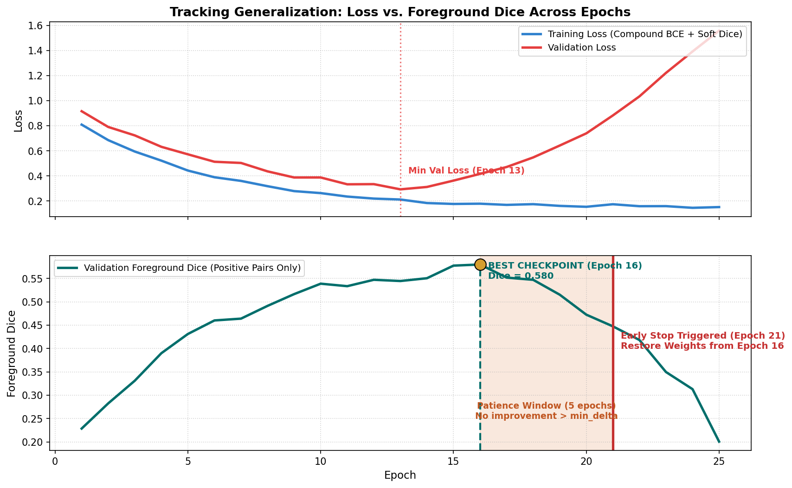

# Early Stopping, Checkpoint Governance, and Validation Drift

In an ideal theoretical world, training a neural network would proceed until the training loss reaches zero and the validation metric reaches a smooth, permanent plateau. In real-world industrial surface segmentation, however, the relationship between training loss, validation loss, and task-specific overlap metrics is far more complex.

Long training can overfit, but this is an observed curve pattern rather than an inevitable outcome. Conversely, stopping before useful improvement can leave a model underfit. Use the run's train and validation evidence to distinguish these cases.

This guide explores the mechanics of **early stopping**, establishes rigorous **checkpoint governance**, warns against the subtle hazard of **holdout overfitting (validation drift)**, and provides a framework for controlled model selection.

---

## 1. Observable Problem: The Checkpoint Dilemma

Consider the following validation history from a 30-epoch training run on a held-out validation fold:

```text
Training History Observation:
Epoch 05: Val Loss = 0.420 | Val Foreground Dice = 0.380
Epoch 10: Val Loss = 0.245 | Val Foreground Dice = 0.520
Epoch 14: Val Loss = 0.228 | Val Foreground Dice = 0.565  <-- Minimum Validation Loss!
Epoch 18: Val Loss = 0.235 | Val Foreground Dice = 0.610
Epoch 22: Val Loss = 0.248 | Val Foreground Dice = 0.638  <-- Maximum Foreground Dice!
Epoch 26: Val Loss = 0.285 | Val Foreground Dice = 0.615
Epoch 30: Val Loss = 0.330 | Val Foreground Dice = 0.582  <-- Final Checkpoint (Overfitted)
```

Notice the crucial divergences:
1. **Loss vs. Metric Divergence**: Validation loss reached its minimum at **Epoch 14**, but Foreground Dice continued climbing for another 8 epochs, peaking at **Epoch 22**!
2. **The "Last Checkpoint" Trap**: If the student deploys the weights from the final epoch (**Epoch 30**), their model has already degraded by 5.6 Dice points ($0.638 \to 0.582$).
3. **The "Premature Exit" Trap**: If the student stopped training as soon as validation loss ticked upward after Epoch 14, they would have missed the best segmentation checkpoint entirely.

To manage this, we must formalize early stopping as an explicit, rule-governed system.

---

## 2. Early Stopping Dynamics


*Figure 3.1: Annotated validation trajectory illustrating validation loss minimum versus foreground Dice peak, patience window tolerance, metric noise, and automatic rollback to the best checkpoint.*

Early stopping is governed by four core parameters:

### 1. The Monitored Quantity ($M$)
What signal determines whether the model is improving?
- **Validation Loss**: Standard deep learning default, but often misaligned with competition metrics due to well-calibrated background probability creep.
- **Validation Mean Dice (`dice_mean`)**: Dangerous due to the "clean-pair inflation trap" (see Guide 05).
- **Validation Foreground Dice (`foreground_dice`)**: Evaluates Dice overlap exclusively on ground-truth positive pairs. Highly recommended for checkpoint selection.
- **Competition Weighted Proxy Score**: Balances foreground Dice (70%), clean-image false positive penalty (20%), and empty-pair accuracy (10%).

### 2. Direction of Improvement (`mode`)
- `mode='min'`: For loss functions where lower is better ($M_{\text{current}} < M_{\text{best}}$).
- `mode='max'`: For Dice and accuracy metrics where higher is better ($M_{\text{current}} > M_{\text{best}}$).

### 3. Minimum Improvement Delta ($\delta_{\min}$)
Stochastic mini-batch gradient descent introduces natural variance into validation scores. A model whose Dice fluctuates from $0.6201$ to $0.6203$ has not meaningfully improved.
The parameter $\delta_{\min}$ (for example, $0.004$ or $0.007$ in a separate experiment) acts as a minimum-change rule:
$$\text{Improved if: } M_{\text{current}} > M_{\text{best}} + \delta_{\min} \quad (\text{for } \text{mode='max'})$$

### 4. Patience Window ($p$)
The number of consecutive epochs without improvement $> \delta_{\min}$ that training is allowed to continue before being stopped:
$$\text{Stale Counter: } s_{t+1} = \begin{cases}
0 & \text{if } M_t > M_{\text{best}} + \delta_{\min} \\
s_t + 1 & \text{otherwise}
\end{cases}$$
$$\text{Terminate if: } s_{t+1} \ge p$$

Patience is a protocol choice, not a universal constant. A short window may stop on ordinary validation variation; a long window spends more compute and may continue after the selected metric has stopped improving. Choose the rule before the run and record the exact stop condition.

---

## 3. Checkpoint Governance: The "Last" vs. "Best" Contract

A professional training loop maintains two distinct checkpoint files on disk:

```
checkpoints/fold0/
├── last.pt   # Contains state from the MOST RECENT completed epoch (e.g. Epoch 26)
└── best.pt   # Contains state from the HIGHEST SCORING epoch (e.g. Epoch 22)
```

### The State Dictionary Contract:
A complete checkpoint must contain more than just model weights. To allow seamless resumption and auditing, it must serialize:

```python
checkpoint = {
    "epoch": epoch,
    "best_score": best_score,
    "stale_epochs": stale_epochs,
    "selection_metric": "foreground_dice",
    "model_state_dict": model.state_dict(),
    "optimizer_state_dict": optimizer.state_dict(),
    "scheduler_state_dict": scheduler.state_dict(),
    "scaler_state_dict": scaler.state_dict(),  # AMP gradient scaler state
    "rng_state": torch.get_rng_state(),        # For deterministic resumption
    "config": cfg.snapshot(),
}
```

> [!IMPORTANT]
> **Atomic Saving Protocol**:
> Never overwrite `best.pt` directly. If your process runs out of disk space or is interrupted mid-write, `best.pt` will be corrupted. Always save to a temporary file (`best.pt.tmp`) and perform an atomic filesystem replacement:
> ```python
> torch.save(checkpoint, "best.pt.tmp")
> os.replace("best.pt.tmp", "best.pt")
> ```

---

## 4. The Holdout Overfitting Hazard (Validation Drift)

One of the most insidious traps in competitive machine learning is **overfitting to the validation holdout**.

### The Mechanism of Information Leakage:
1. You establish a clean $80/20$ train/validation split (Fold 0).
2. You run 50 experiments: tuning learning rates, testing schedulers, tweaking loss weights, adjusting early stopping patience, and sweeping post-processing thresholds.
3. In every experiment, you select the checkpoint that scores highest on Fold 0.
4. **The Consequence**: Even though model weights were updated only on training data, your *human decisions* (and early stopping decisions) were updated on Fold 0!
5. Over time, your pipeline selects models that happen to fit the statistical idiosyncrasies of that specific 20% holdout sample. When submitted to the private Kaggle test set, performance drops significantly.

### Defensive Governance:
1. **Multi-Fold Out-of-Fold (OOF) Validation**:
   When compute allows, compare decisions across several fixed folds. This can reduce dependence on one split, but repeated model selection across the same folds can still overfit the validation evidence; retain a final untouched evaluation set when possible.
2. **Fixed Protocol Invariants**:
   Decide your early stopping metric, threshold grid, and patience *before* running experiments. Do not tweak stopping rules post-hoc to retroactively favor a particular run.
3. **Record All Artifacts**:
   Store the exact checkpoint hash (`sha256`) and training log history with each saved model.

### Applying the method to the assessment

For Question 5, initialize the best score from the first epoch, then for each later epoch apply the strict comparison against `best + min_delta`. Record whether the epoch saved a checkpoint, update or increment the stale counter, and stop when the counter reaches patience. The restored checkpoint is the most recent saved best, not necessarily the stopping epoch. For Question 8, distinguish the minimum-loss epoch from the maximum official-score epoch; choose by the task score and describe the curve from both training and validation traces.

---

## 5. Diagnostic Symptoms: Causes and Checks

| Observable Symptom in Logs | Root Cause | Verification Check | Corrective Action |
| :--- | :--- | :--- | :--- |
| Training stops at Epoch 3, even though model has barely begun learning. | `mode` parameter inverted (e.g. `mode='min'` passed for Dice metric), or `min_delta` set excessively high ($0.10$). | Check early stopping initialization logs; verify score comparison logic. | Set `mode='max'` for Dice; set `min_delta` to a realistic value ($0.002$ to $0.005$). |
| Validation loss increases steadily while Foreground Dice continues climbing. | Expected phenomenon: probability calibration drift. The model becomes more confident on easy background pixels, causing BCE loss to rise slightly, but thresholded masks improve. | Inspect probability distributions; evaluate Dice vs. Loss curve divergence. | Monitor `foreground_dice` or the competition weighted proxy for checkpoint selection, not raw loss. |
| Model performance on Kaggle test set is far worse than the best validation checkpoint. | Holdout overfitting: early stopping selected a noisy outlier epoch that overfit specific validation images. | Check validation score standard deviation across folds (OOF); inspect validation predictions. | Evaluate 5-fold cross-validation; increase early stopping patience slightly ($p = 5$); increase regularizing augmentations. |
| Process crashes mid-save, leaving an unreadable zero-byte `best.pt`. | Non-atomic file write interrupted by GPU timeout or disk quota exhaustion. | Attempt `torch.load('best.pt')` to verify archive integrity. | Use the temporary write + `os.replace` atomic saving pattern. |

---

## 6. Implementation Pattern: Robust Early Stopping Class

Here is a complete, production-grade `EarlyStopping` implementation in PyTorch:

```python
import copy
import os
import torch
import torch.nn as nn

class EarlyStopping:
    """Manages early stopping logic, patience counting, and atomic checkpoint persistence."""

    def __init__(
        self,
        patience: int = 5,
        min_delta: float = 0.003,
        mode: str = "max",
        checkpoint_path: str = "best.pt",
    ):
        self.patience = patience
        self.min_delta = min_delta
        self.mode = mode
        self.checkpoint_path = checkpoint_path

        self.stale_epochs = 0
        self.best_score = None
        self.best_epoch = 0
        self.should_stop = False

    def step(
        self,
        current_score: float,
        epoch: int,
        model: nn.Module,
        checkpoint_payload: dict,
    ) -> bool:
        """Evaluates current epoch score. Saves checkpoint atomically if score improves."""
        if self.best_score is None:
            self._save_new_best(current_score, epoch, model, checkpoint_payload)
            return True

        if self.mode == "max":
            improved = current_score > (self.best_score + self.min_delta)
        else:
            improved = current_score < (self.best_score - self.min_delta)

        if improved:
            self._save_new_best(current_score, epoch, model, checkpoint_payload)
            self.stale_epochs = 0
            return True
        else:
            self.stale_epochs += 1
            if self.stale_epochs >= self.patience:
                self.should_stop = True
            return False

    def _save_new_best(self, score: float, epoch: int, model: nn.Module, payload: dict):
        self.best_score = score
        self.best_epoch = epoch

        # Inject model state into payload
        payload["model_state_dict"] = model.state_dict()
        payload["best_score"] = score
        payload["epoch"] = epoch

        # Atomic file write
        tmp_path = f"{self.checkpoint_path}.tmp"
        torch.save(payload, tmp_path)
        os.replace(tmp_path, self.checkpoint_path)
        print(f"-> [NEW BEST] Epoch {epoch:02d}: {score:.4f} saved to {self.checkpoint_path}")
```

---

## Practice 7 · Checkpoint Selection Analysis

Examine this fictional training run log:

```text
Monitored Metric: Validation Foreground Dice (mode='max')
Patience: 4 epochs | Min Delta: 0.004

Epoch 08: Score = 0.510 (Best: 0.510, Stale: 0) -> New Best
Epoch 09: Score = 0.518 (Best: 0.518, Stale: 0) -> New Best (+0.008 > 0.004)
Epoch 10: Score = 0.520 (Best: 0.518, Stale: 1) -> No significant gain (+0.002 < 0.004)
Epoch 11: Score = 0.517 (Best: 0.518, Stale: 2) -> Score dropped
Epoch 12: Score = 0.523 (Best: 0.523, Stale: 0) -> New Best (+0.005 > 0.004)
Epoch 13: Score = 0.525 (Best: 0.523, Stale: 1) -> No significant gain (+0.002 < 0.004)
Epoch 14: Score = 0.521 (Best: 0.523, Stale: 2)
Epoch 15: Score = 0.519 (Best: 0.523, Stale: 3)
Epoch 16: Score = 0.520 (Best: 0.523, Stale: 4) -> Early stopping triggered!
```

**Diagnostic Questions**:
1. At Epoch 10, the score rose from $0.518$ to $0.520$. Why did the stale counter increase from 0 to 1 instead of resetting?
2. Which epoch's model weights reside in `best.pt` when training terminates at Epoch 16?
3. If the student set `patience = 2`, at which epoch would training have been prematurely aborted, and what peak score would have been lost?

---

## 8. Authoritative References

- Prechelt, L. (1998). *Early Stopping — But When?* Neural Networks: Tricks of the Trade, Springer. (Seminal paper formalizing patience and stopping criteria).
- PyTorch [Checkpointing Tutorial](https://pytorch.org/tutorials/recipes/recipes/saving_and_loading_a_general_checkpoint.html)
- Hastie, T., Tibshirani, R., & Friedman, J. (2009). *The Elements of Statistical Learning*, Chapter 7: Model Assessment and Selection. (Information leakage and validation overfitting).
