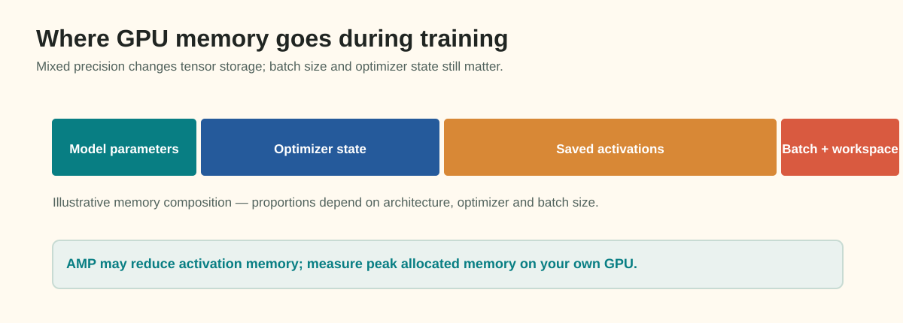
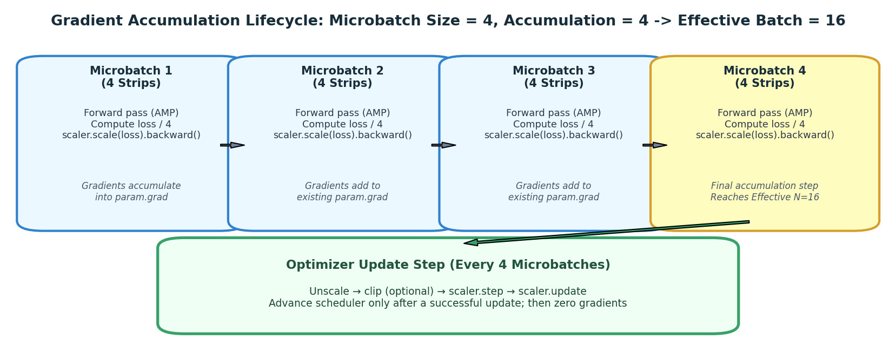

# Mixed Precision (AMP) and GPU Memory Optimization

Deep segmentation networks operating on high-resolution industrial strips ($128 \times 800$ pixels) place intense demands on GPU hardware. As your architectures advance from lightweight baselines to deep encoder-decoder variants with attention gates, GPU video memory (VRAM) rapidly becomes the primary engineering bottleneck.

An unoptimized pipeline will trigger abrupt `CUDA out of memory` (OOM) crashes, force you to train with artificially tiny batches, or waste hours waiting on memory-bandwidth-bound matrix multiplications.

This guide breaks down the physical anatomy of GPU memory, explains the numerical mechanics of **Automatic Mixed Precision (AMP)** in PyTorch 2.x, details dynamic gradient scaling, and demonstrates how to decouple physical memory constraints from optimization dynamics using **gradient accumulation**.

---

## 1. Observable Problem: The OOM Crash and the Throughput Bottleneck

Consider two common runtime errors encountered when expanding segmentation training:

```text
Crash 1: The Out-Of-Memory Abortion
RuntimeError: CUDA out of memory. Tried to allocate 400.00 MiB (GPU 0; 15.78 GiB total capacity;
14.92 GiB already allocated; 312.50 MiB free; 15.10 GiB reserved in total by PyTorch)
Symptom: The training loop crashes abruptly mid-epoch when trying to allocate intermediate activation
tensors for a high-resolution skip connection.

Bottleneck 2: The Underutilized GPU
Batch Size: 2 | GPU Allocation: 3.2 GiB / 16 GiB | GPU Compute Utilization: 22%
Epoch Time: 18 minutes (Throughput: 10.5 samples/second)
Symptom: Memory is kept small to avoid OOM, but the GPU's Tensor Cores sit idle, waiting on memory-bandwidth
transfers of standard 32-bit floating-point tensors.
```

To resolve both challenges, we must understand exactly where GPU bytes are spent during forward and backward passes.

---

## 2. Anatomy of GPU Memory: Where Do the Gigabytes Go?


*Figure 4.1: The main categories of training memory. The widths are illustrative, not measured proportions; profile your own model and batch size.*

GPU memory during training is partitioned into five distinct categories:

### 1. Model Parameters (Weights)
For a network with $M$ parameters stored in standard single-precision float32 (4 bytes per parameter):
$$\text{Memory}_{\text{weights}} = M \times 4\text{ bytes}$$
- A 10-million parameter U-Net requires $10^7 \times 4 = 40\text{ MB}$.
- An 80-million parameter modern backbone requires $80 \times 10^6 \times 4 = 320\text{ MB}$.
- *Takeaway*: Contrary to popular belief, raw model parameters occupy a relatively modest portion of modern GPU memory.

### 2. Parameter Gradients
During the backward pass, PyTorch computes a partial derivative $\frac{\partial \mathcal{L}}{\partial \theta}$ for every trainable parameter $\theta$:
$$\text{Memory}_{\text{gradients}} = M \times 4\text{ bytes}$$
- Matches parameter memory exactly: a 10M parameter model requires another $40\text{ MB}$.

### 3. Optimizer State (The Silent Memory Consumer)
Adaptive optimizers like **AdamW** maintain two internal running averages for every single parameter:
1. First moment vector $m_t$ (momentum): $M \times 4\text{ bytes}$.
2. Second moment vector $v_t$ (uncentered variance): $M \times 4\text{ bytes}$.
$$\text{Memory}_{\text{AdamW}} = 2 \times M \times 4 = 8 \times M\text{ bytes}$$
- For a 10M parameter model, AdamW consumes **$80\text{ MB}$** of VRAM—twice the size of the model itself!
- For a 50M parameter model, AdamW consumes **$400\text{ MB}$** purely for its momentum tracking buffers.

### 4. Activations (The Dominant Memory Consumer in Segmentation)
During the forward pass, PyTorch must store the intermediate feature maps output by every convolutional and normalization layer so they can be referenced during backpropagation.
The activation footprint scales with:
$$\text{Memory}_{\text{activations}} \propto \text{Batch Size } (B) \times \text{Height } (H) \times \text{Width } (W) \times \text{Channels } (C) \times \text{Depth}$$
- On an industrial line-scan strip ($128 \times 800 = 102,400\text{ pixels}$), an early encoder feature map with 64 channels stores:
  $$8 \text{ images} \times 64 \text{ channels} \times 128 \times 800 \times 4\text{ bytes} \approx 209.7\text{ MB}$$
  for just **one** convolution layer!
- Summed across 40+ layers in a full U-Net, activations easily consume **4 to 10 GiB** of VRAM.

### 5. Workspace and CUDA Context
CUDA driver kernels, PyTorch internal memory allocator caches, and cuDNN workspace buffers typically reserve an overhead of **$500\text{ MB}$ to $1.2\text{ GiB}$**.

---

## 3. Automatic Mixed Precision (AMP): Mechanics and Formats

Standard deep learning computations represent real numbers using **IEEE 754 Single Precision (FP32)**:
- 1 sign bit, 8 exponent bits, 23 mantissa (fraction) bits (4 bytes).
- Dynamic range: $\approx 10^{-38}$ to $10^{38}$.

Modern GPU architectures (NVIDIA Volta, Turing, Ampere, Ada, Hopper) include dedicated hardware units called **Tensor Cores**. Tensor Cores perform matrix multiplications at $2\times$ to $4\times$ higher throughput when tensors are represented in 16-bit formats:

### Floating-Point 16-bit Formats:
1. **FP16 (Half Precision)**:
   - 1 sign bit, 5 exponent bits, 10 mantissa bits (2 bytes).
   - Dynamic range: $\approx 6 \times 10^{-5}$ to $65,504$.
   - *Limitation*: Because it has only 5 exponent bits, numbers smaller than $6 \times 10^{-5}$ underflow to zero.
2. **BF16 (Bfloat16 / Brain Floating Point)**:
   - 1 sign bit, 8 exponent bits, 7 mantissa bits (2 bytes).
   - Dynamic range: identical to FP32 ($\approx 10^{-38}$ to $10^{38}$), but lower precision.
   - Supported natively on Ampere+ (A100, RTX 3000/4000) and modern CPUs.

### What AMP Does Automatically:
PyTorch's Automatic Mixed Precision (`torch.amp`) automatically converts operations:
- **Fast 16-bit operations**: $3 \times 3$ convolutions, $1 \times 1$ projections, matrix multiplications, and linear layers are executed in FP16/BF16 on Tensor Cores.
- **Protected 32-bit operations**: Numerically sensitive operations that require wide dynamic range—such as Batch Normalization statistics, Softmax denominators, and Loss reductions—are automatically retained in FP32.

---

## 4. Dynamic Gradient Scaling (`GradScaler`)

In FP16, the minimum representable positive number before underflow is $\approx 6 \times 10^{-5}$.
During backpropagation through a deep segmentation network, gradients in early convolutional layers are often very small (e.g., $10^{-6}$ or $10^{-7}$). If backpropagated in raw FP16, these gradients **underflow to absolute zero**, completely halting weight updates in early encoder layers!

To prevent underflow, PyTorch utilizes a **Dynamic Gradient Scaler (`torch.amp.GradScaler`)**:

```
Forward Pass:
1. Inputs converted to FP16 inside torch.amp.autocast.
2. Loss computed in FP32 for numerical stability.

Backward Pass:
3. Loss is multiplied by a large scale factor S (e.g., S = 65,536.0):
   Scaled Loss = Loss * S
4. Backpropagation runs on Scaled Loss. All gradients are scaled up by S:
   Scaled Gradients = Gradients * S  (Safe from underflow!)

Optimizer Step:
5. Scaler UNSCALES gradients before the optimizer steps:
   True Gradients = Scaled Gradients / S
6. If any gradient contains Inf or NaN (overflow occurred):
   -> Optimizer step is SKIPPED entirely.
   -> Scale factor S is halved (e.g. 65,536 -> 32,768).
7. If no overflow occurs for N consecutive steps:
   -> Scale factor S is doubled.
```

---

## 5. Microbatch Sizing and Gradient Accumulation

What if your model still exceeds VRAM even with AMP enabled?
Do not immediately resize your images to $256 \times 256$ (which destroys the $6.25:1$ industrial aspect ratio) or shrink your model capacity. Instead, decouple your **hardware microbatch size** from your **effective optimization batch size** using **gradient accumulation**.


*Figure 4.2: Step-by-step lifecycle of gradient accumulation. Gradients from 4 microbatches of size 4 accumulate into parameter buffers, achieving an effective batch size of 16 before a single optimizer step is executed.*

### Definitions:
- **Microbatch Size ($B_{\text{micro}}$)**: The number of images fed into the GPU in a single `forward()` pass (constrained by physical VRAM).
- **Accumulation Steps ($K_{\text{accum}}$)**: The number of microbatches evaluated before calling `optimizer.step()`.
- **Effective Batch Size ($B_{\text{eff}}$)**:
  $$B_{\text{eff}} = B_{\text{micro}} \times K_{\text{accum}}$$

### The Loss Scaling Requirement:
Because PyTorch's `loss.backward()` *accumulates* (sums) gradients into `.grad` buffers, you must divide the loss by $K_{\text{accum}}$:
$$\mathcal{L}_{\text{scaled}} = \frac{\mathcal{L}}{K_{\text{accum}}}$$
If you forget this division, your accumulated gradients will be $K_{\text{accum}}$ times too large, acting like an unintended $K\times$ spike in your learning rate!

---

## 6. Implementation Pattern: PyTorch 2.x Modern AMP Syntax

In this repository, we run **PyTorch 2.8.0**. Modern PyTorch 2.x standardizes mixed precision under the `torch.amp` namespace rather than the legacy `torch.cuda.amp` module.

```python
import torch
import torch.nn as nn
from torch.optim import AdamW

# 1. Device and Scaler Initialization
device = torch.device("cuda" if torch.cuda.is_available() else "cpu")
amp_enabled = (device.type == "cuda")

# PyTorch 2.x GradScaler constructor takes device_type as first argument
scaler = torch.amp.GradScaler(device.type, enabled=amp_enabled)
optimizer = AdamW(model.parameters(), lr=1e-3, weight_decay=1e-4)

# Batch parameters
microbatch_size = 4
accumulation_steps = 4  # Effective batch = 16

optimizer.zero_grad(set_to_none=True)

for step, batch in enumerate(train_loader):
    images = batch["image"].to(device, non_blocking=True)
    masks = batch["mask"].to(device, non_blocking=True)

    # 2. Forward pass inside autocast context
    with torch.amp.autocast(device_type=device.type, enabled=amp_enabled):
        logits = model(images)
        loss = criterion(logits, masks)
        # Scale loss by accumulation steps
        scaled_loss = loss / accumulation_steps

    # 3. Scaled backward pass
    scaler.scale(scaled_loss).backward()

    # 4. Optimizer update every `accumulation_steps`
    if (step + 1) % accumulation_steps == 0 or (step + 1) == len(train_loader):
        # A. Unscale gradients before clipping norms
        scaler.unscale_(optimizer)

        # B. Clip gradients
        torch.nn.utils.clip_grad_norm_(model.parameters(), max_norm=1.0)

        # C. Step optimizer through scaler
        scaler.step(optimizer)

        # D. Update scaler factor
        scaler.update()

        # E. Zero gradients using set_to_none=True to release memory
        optimizer.zero_grad(set_to_none=True)
```

> [!CAUTION]
> **The Unscaling Ordering Rule**:
> You **MUST** call `scaler.unscale_(optimizer)` **BEFORE** calling `torch.nn.utils.clip_grad_norm_()`. If you clip gradients before unscaling, PyTorch will evaluate gradient norms on the scaled values ($G \times S$), misinterpreting healthy gradients as massive explosions and artificially shrinking your updates to zero!

---

## 7. Diagnostic Symptoms: Causes and Checks

| Observable Symptom in Logs | Underlying Mechanism | Diagnostic Check | Corrective Action |
| :--- | :--- | :--- | :--- |
| `RuntimeError: CUDA out of memory` during validation or test inference. | Memory retained by computation graph; or validation run with gradient tracking enabled. | Check if validation loop is wrapped in `@torch.inference_mode()` or `with torch.no_grad():`. | Use `@torch.inference_mode()`; delete large probability tensors when finished; call `torch.cuda.empty_cache()`. |
| Loss suddenly becomes `NaN` or `Inf` on step 15, and never recovers. | Numerical underflow/overflow in loss calculation or logit exponentiation. | Print min/max logits; check loss function head consistency. | Verify loss calculates BCE on raw logits (not sigmoided probabilities); verify `GradScaler` is active. |
| Optimizer step appears to be skipped repeatedly; model parameters do not change. | GradScaler repeatedly encountering Inf/NaN, triggering automatic step abortion. | Inspect `scaler.get_scale()`; if scale factor drops below 1.0, severe numerical overflow is occurring. | Clamp loss weights; reduce learning rate; check for zero-division in custom loss denominators. |
| Training runs $3\times$ slower with AMP enabled than expected. | Excessive host-to-device synchronization calls inside the training loop. | Search code for `.item()`, `.cpu()`, or `print(loss)` inside the per-batch inner loop. | Remove intermediate `.item()` calls from GPU; accumulate metrics as tensors and synchronize once per epoch. |

---

## Practice 8 · Memory Footprint Estimation

A student proposes training a U-Net with a **ResNet-34 encoder** (21.3 million parameters) on a GPU with **16 GiB VRAM**.

**System Parameters**:
- Model parameters ($M$): $21.3 \times 10^6$
- Optimizer: AdamW
- Image resolution: $128 \times 800$ pixels (single-channel grayscale input, 4 output mask channels)
- Hardware Microbatch Size: $B = 8$

**Questions to Calculate**:
1. How much memory do the model parameters and gradients occupy in FP32?
2. How much memory does the AdamW optimizer state occupy in FP32?
3. If each strip requires approximately $120\text{ MB}$ of intermediate activations across all U-Net layers during forward propagation at $B=1$, what is the activation memory footprint at $B=8$ in pure FP32?
4. How does enabling PyTorch AMP reduce the activation memory footprint, and how many microbatches of size 4 would be needed to simulate an effective batch size of 16?

---

## 9. Authoritative References

- PyTorch [`torch.amp`](https://pytorch.org/docs/stable/amp.html) (PyTorch 2.x unified mixed-precision documentation).
- Micikevicius, P., et al. (2018). *Mixed Precision Training*. International Conference on Learning Representations (ICLR). (Foundational paper on loss scaling and half precision).
- NVIDIA [Tensor Cores Architecture Overview](https://www.nvidia.com/en-us/data-center/tensor-cores/).
