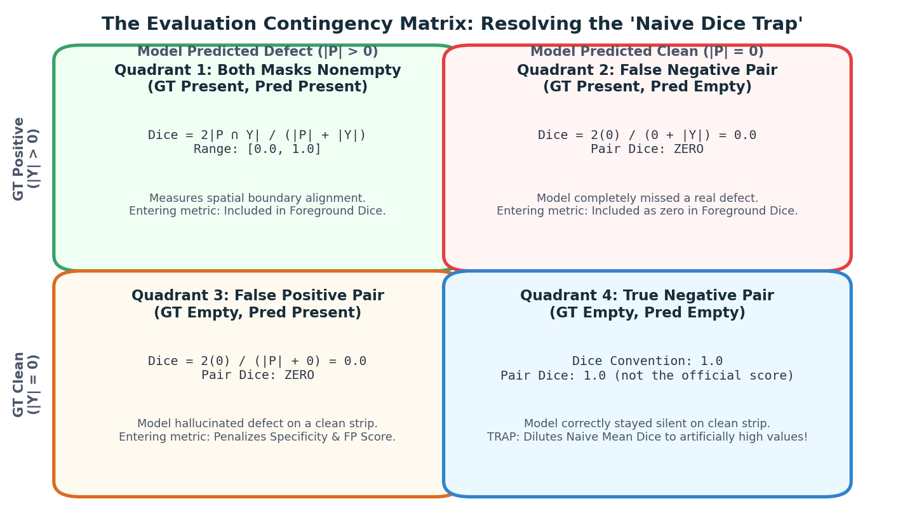
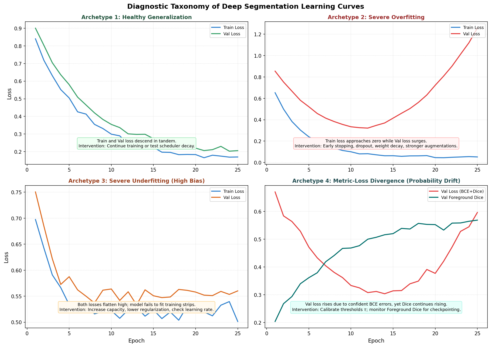

# Metric Governance: Validation Dice, Empty Pairs, and Overfitting

Segmentation datasets can contain many empty image-class pairs. When a metric assigns a perfect score to an empty target and empty prediction, averaging Dice over every pair can hide poor foreground detection. The remedy is to report foreground overlap and empty-pair behavior separately.

This guide unravels the "Naive Dice Trap," decomposes the 70/20/10 competition evaluation formula, maps out six diagnostic learning curve archetypes, and establishes strict metric governance to detect overfitting before submitting.

---

## 1. Observable Problem: The "Naive Dice Trap"

Use a small fictional validation set to see why denominators matter. Suppose 12 image-class pairs contain two positive targets and ten empty targets. A predictor that returns empty masks everywhere has zero Dice on the two positive pairs and Dice one on the ten empty-empty pairs.

```
Pair convention: Dice(empty, empty) = 1; Dice(empty, nonempty) = 0.
Two positive pairs: prediction empty -> Dice 0 on each.
Ten empty pairs: prediction empty -> Dice 1 on each.
Naive mean across all pairs = mean of twelve pair scores.
```

> [!CAUTION]
> **The Naive Dice Trap:** the mean rewards the predictor for empty-empty pairs, even though it missed every positive pair. Always report the positive-target subset separately.

---

## 2. Deconstructing the Evaluation Metric: The 2×2 Contingency Grid

To prevent this distortion, we must examine the **contingency grid of image-class pairs**:


*Figure 5.1: The 2×2 contingency matrix of image-class pairs. When both ground truth and predictions are empty (Quadrant 4), the score convention assigns 1.0, diluting naive averages. True segmentation capability lives in Quadrant 1 and Quadrant 2.*

For any individual image $i$ and defect channel $c$:
$$\text{Dice}(P, Y) = \begin{cases}
1.0 & \text{if } |P| = 0 \text{ and } |Y| = 0 \text{ (True Negative Clean Pair)} \\
0.0 & \text{if } |P| > 0 \text{ and } |Y| = 0 \text{ (False Positive Pair)} \\
0.0 & \text{if } |P| = 0 \text{ and } |Y| > 0 \text{ (False Negative Missed Defect)} \\
\frac{2 \sum (P \cap Y)}{\sum P + \sum Y} & \text{if } |P| > 0 \text{ and } |Y| > 0 \text{ (True Positive Overlap)}
\end{cases}$$

### The Three True Operational Metrics:
Instead of relying on a single naive average, professional segmentation pipelines track three separate quantities:

#### 1. Foreground Dice (`foreground_dice`)
Evaluates Dice overlap **exclusively on ground-truth positive pairs** ($|Y| > 0$):
$$\text{Dice}_{\text{FG}} = \frac{1}{|\mathcal{P}|} \sum_{(i, c) \in \mathcal{P}} \text{Dice}(P_{i, c}, Y_{i, c})$$
where $\mathcal{P} = \{ (i, c) \mid |Y_{i, c}| > 0 \}$ is the set of positive pairs.
- On an all-empty predictor, foreground Dice is zero whenever positive target pairs are present.

#### 2. Empty-Pair Specificity (`empty_pair_accuracy`)
Evaluates the model's ability to stay completely silent on clean material ($|Y| = 0$):
$$\text{Spec}_{\text{empty}} = \frac{1}{|\mathcal{E}|} \sum_{(i, c) \in \mathcal{E}} \mathbb{I}(|P_{i, c}| = 0)$$
where $\mathcal{E} = \{ (i, c) \mid |Y_{i, c}| = 0 \}$ is the set of empty pairs.

#### 3. False-Positive Pixel Penalty (`false_positive_pixel_score`)
Penalizes the total canvas area of hallucinated defect pixels on clean material:
$$\text{Score}_{\text{FP-pixels}} = 1.0 - \frac{1}{|\mathcal{E}|} \sum_{(i, c) \in \mathcal{E}} \frac{|P_{i, c}|}{\text{Canvas Pixels}}$$
where $\text{Canvas Pixels} = 128 \times 800 = 102,400$.

---

## 3. The Official 70/20/10 Competition Score Architecture

The official competition leaderboard score balances detection overlap against false alarm suppression using a weighted composite formula:

$$\text{Competition Score} = 0.70 \times \text{Foreground Dice} + 0.20 \times \text{False-Positive Pixel Score} + 0.10 \times \text{Empty-Pair Accuracy}$$

For any model, compute each component on its stated subset first, then apply its coefficient. An all-empty predictor has perfect empty-pair accuracy and no false-positive pixels, but foreground Dice zero; do not replace this component calculation with the naive mean.

### Decision Threshold Trade-offs ($\tau$)
Continuous sigmoid probabilities $P \in [0, 1]$ are converted to binary masks via a decision threshold $\tau$:
$$\hat{Y}_{i, c} = \mathbb{I}(P_{i, c} \ge \tau)$$

- **Lowering $\tau$ (e.g. $\tau = 0.3$)**: Increases sensitivity. Catches faint, low-contrast scratches (raising $\text{Dice}_{\text{FG}}$), but causes minor surface noise to be classified as defects, devastating $\text{Spec}_{\text{empty}}$ and $\text{Score}_{\text{FP}}$.
- **Raising $\tau$ (e.g. $\tau = 0.7$)**: Increases specificity. Suppresses false alarms on clean material, but misses faint longitudinal micro-cracks.

A separate post-processing study may calibrate $\tau$ against the composite score on held-out data. Questions 8 and 10 instead require the fixed threshold 0.5 and no area filtering; preserve that operating point for their comparisons.

Keep the components conceptually separate: foreground Dice averages only positive target pairs; empty accuracy counts empty pairs with no predicted pixels; false-positive pixel score averages predicted canvas fraction over empty pairs and subtracts it from one. An empty pair with a small false blob can still count as incorrect for empty accuracy while incurring only a small pixel penalty.

### Applying the method to the assessment

For Question 7, first count positive and empty pairs. An all-empty prediction has zero overlap on each positive pair and Dice one on each empty-empty pair, so its naive mean is governed by the pair counts. Separately compute the three official components using their own denominators. In the toy part, average the false-pixel fraction over empty pairs, count empty predictions for empty accuracy, and use the given foreground Dice; do not substitute the naive Dice for foreground Dice.

---

## 4. Learning Curve Taxonomy: Diagnosing Model Health

The following values and curves are hypothetical teaching examples, not measurements from the competition data.


*Figure 5.2: Diagnostic taxonomy of deep segmentation learning curves across 25 training epochs, contrasting healthy generalization against overfitting, underfitting, and metric-loss divergence.*

When monitoring your training and validation curves, watch for these distinct archetypes:

### Archetype 1: Healthy Generalization
- **Symptom**: Training loss descends steadily. Validation loss descends in tandem, flattening around Epoch 18. Validation Foreground Dice rises smoothly from $0.20$ to $0.64$.
- **Possible interpretation**: The model may be learning features that transfer to held-out images. A smooth curve alone does not establish which features it learned or whether the split is representative.
- **Action**: Check if a learning-rate scheduler decay can anneal boundaries further; prepare checkpoint for post-processing calibration.

### Archetype 2: Severe Overfitting
- **Symptom**: Training loss plummets toward near-zero ($0.04$), while validation loss reaches a minimum at Epoch 8 and surges upward ($0.22 \to 0.45$). Validation Dice degrades from $0.62$ down to $0.51$.
- **Possible interpretation**: The model may be fitting training-specific patterns, but this curve alone cannot identify the cause. Inspect held-out errors, split support, and run variance before choosing a remedy.
- **Action**: Save the best task-metric checkpoint and test one regularization or data change in a controlled comparison.

### Archetype 3: Severe Underfitting (High Bias)
- **Symptom**: Both training loss and validation loss flatten early at high values ($0.55$). Validation Dice remains stagnant below $0.25$.
- **Possible interpretation**: The model may be underfitting, the optimization may be stalled, or the data/loss pipeline may be incorrect.
- **Action**: Verify data loading and target normalization; verify that skip connections are intact; switch to a more expressive backbone; verify loss function heads.

### Archetype 4: Metric-Loss Divergence (Probability Calibration Drift)
- **Symptom**: Training loss and validation loss both increase slightly, yet Validation Foreground Dice continues rising!
- **Possible interpretation**: Loss and thresholded scores respond to different aspects of predictions. Calibration drift is one possibility; inspect probability histograms and masks to distinguish it from other causes.
- **Action**: Do not select a checkpoint from loss alone when the target is a thresholded score. Track the task metric and its components.

---

## 5. Diagnostic Symptoms: Causes and Checks

| Observable Symptom in Logs | Root Mechanism | Concrete Measurement | Next Step |
| :--- | :--- | :--- | :--- |
| Naive validation Dice seems strong while positive-pair performance is weak. | Empty-empty pairs may be inflating the all-pairs mean. | Compute `foreground_dice` on positive pairs only; evaluate empty-pair false alarms. | Report the 70/20/10 components beside the naive mean. |
| Training loss improves while validation foreground score plateaus. | Possible overfitting, optimization mismatch, or a data/metric issue; the curve alone does not identify which. | Compare train/validation curves and inspect matched validation predictions. | Form one diagnostic hypothesis and test one change. |
| Validation curves oscillate from epoch to epoch. | Sampling noise or a small validation subset may contribute, among other possibilities. | Check class support, evaluation determinism, and several runs or folds if feasible. | Report variability and avoid reacting to one epoch without a predeclared rule. |
| Best epoch identified by validation loss is completely different from best epoch identified by Dice. | BCE loss evaluates soft uncalibrated probabilities, while Dice evaluates thresholded binary decisions. | Compare correlation between validation loss and `foreground_dice` across all epochs. | Select checkpoints using `foreground_dice` or `score_pair_proxy`; loss is an optimization proxy, not the competition goal. |

---

## 6. Implementation Pattern: Logging Comprehensive Validation Metrics

Here is how to structure a leak-free validation evaluation function in PyTorch:

```python
import numpy as np
import torch

@torch.inference_mode()
def evaluate_validation_run(
    model: torch.nn.Module,
    val_loader: torch.utils.data.DataLoader,
    threshold: float = 0.5,
    device: torch.device = torch.device("cuda"),
) -> dict[str, float]:
    """Computes transparent, leak-free metrics decomposed across positive and clean pairs."""
    model.eval()

    all_dices = []
    all_pred_areas = []
    all_gt_areas = []

    for batch in val_loader:
        images = batch["image"].to(device)
        targets = batch["mask"].cpu().numpy().astype(bool)  # [B, 4, 128, 800]

        logits = model(images)
        probs = torch.sigmoid(logits).cpu().numpy()
        preds = (probs >= threshold)  # [B, 4, 128, 800]

        # Calculate intersection and areas across spatial dimensions (axis 2, 3)
        tp = np.logical_and(preds, targets).sum(axis=(-2, -1))
        pa = preds.sum(axis=(-2, -1))
        ya = targets.sum(axis=(-2, -1))

        total = pa + ya
        # Compute Dice with empty-pair convention = 1.0
        dice = np.divide(2.0 * tp, total, out=np.ones_like(total, dtype=float), where=(total > 0))

        all_dices.append(dice)
        all_pred_areas.append(pa)
        all_gt_areas.append(ya)

    dices = np.concatenate(all_dices, axis=0)       # [N, 4]
    pred_areas = np.concatenate(all_pred_areas, axis=0)
    gt_areas = np.concatenate(all_gt_areas, axis=0)

    # Positive pairs vs. Empty pairs
    is_positive = (gt_areas > 0)
    is_empty = (gt_areas == 0)

    # 1. Naive Mean Dice (For diagnostic awareness only!)
    dice_naive = float(dices.mean())

    # 2. Foreground Dice (Only on positive pairs)
    dice_fg = float(dices[is_positive].mean()) if is_positive.any() else 0.0

    # 3. Clean-Image Specificity (Empty accuracy)
    empty_acc = float((pred_areas[is_empty] == 0).mean()) if is_empty.any() else 1.0

    # 4. FP Pixel Score
    canvas_pixels = 128 * 800
    fp_pixel_score = float(1.0 - (pred_areas[is_empty] / canvas_pixels).mean()) if is_empty.any() else 1.0

    # 5. Official score under the assessment definition
    competition_proxy = (0.70 * dice_fg) + (0.20 * fp_pixel_score) + (0.10 * empty_acc)

    return {
        "val/naive_mean_dice": dice_naive,
        "val/foreground_dice": dice_fg,
        "val/empty_pair_accuracy": empty_acc,
        "val/fp_pixel_score": fp_pixel_score,
        "val/official_score": competition_proxy,
    }
```

---

## Practice 7 · Interpreting a Metric Report

A student shares the following metric table from their latest validation evaluation:

```text
Validation Report:
• Naive Mean Dice: 0.8842
• Foreground Dice: 0.4120
• Empty-Pair Accuracy (Specificity): 0.9650
• False-Positive Pixel Score: 0.9980
• Official score under the assessment definition: 0.5845
```

**Diagnostic Questions**:
1. Why is `Naive Mean Dice` ($0.8842$) more than double the `Foreground Dice` ($0.4120$)?
2. If this student changes post-processing thresholds and observes that `Foreground Dice` rises to $0.5200$, but `Empty-Pair Accuracy` drops to $0.8100$, and the false-positive pixel score stays at 0.9980, what is the new official score?
3. Did the threshold change represent a genuine overall improvement according to the competition objective?

---

## Practice and audit check · extracting evidence for Q8

Create one epoch table from your own run with `epoch`, training loss, validation loss, official score, and learning rate. Find the minimum validation-loss epoch and maximum official-score epoch independently; retain full precision when selecting, then round for reporting. Compute the final-epoch gap as validation loss minus training loss. A gap alone cannot prove overfitting: inspect its trajectory, score components, and whether training and validation losses use the same reduction and comparable augmentation conditions.

Practice with this invented three-epoch record:

| Epoch | Train loss | Validation loss | Official score |
|---|---:|---:|---:|
| 1 | 0.48 | 0.51 | 0.41 |
| 2 | 0.35 | 0.43 | 0.49 |
| 3 | 0.27 | 0.46 | 0.52 |

Identify both candidate epochs, compute the final gap, and explain which candidate matches the declared checkpoint objective. Then state one extra measurement you need before diagnosing overfitting. **Audit:** verify the checkpoint epoch against the saved metadata and the W&B record, rather than relying on the filename or the last epoch in memory.

## 8. Authoritative References

- Dice, L. R. (1945). *Measures of the Amount of Ecologic Association Between Species*. Ecology, 26(3), 297–302.
- Sørensen, T. (1948). *A method of establishing groups of equal amplitude in plant sociology*. Kongelige Danske Videnskabernes Selskab.
- Taha, A. A., & Hanbury, A. (2015). *Metrics for evaluating 3D medical image segmentation: analysis, selection, and tool*. BMC Medical Imaging. (Comprehensive review of overlap metrics, empty set conventions, and precision-recall trade-offs).
