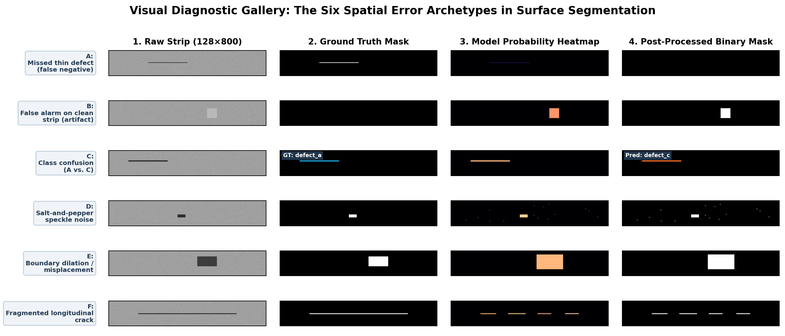

# Validation Error Analysis and Spatial Defect Diagnostics

A single scalar metric—whether it is a validation loss of $0.18$ or a Foreground Dice of $0.56$—is a summary statistic. It tells you *how much* your model succeeded on average, but it tells you **nothing about why or how it failed**.

Did your model achieve a low score because it completely missed hairline scratches? Because it hallucinated spurious defect blobs on clean steel strips? Because it confused surface inclusions (`defect_c`) with micro-cracks (`defect_b`)? Or because it correctly located every defect but dilated boundaries by 10 pixels?

Each of these failure modes points toward a completely different engineering remedy. Tuning loss weights will not fix an encoder that downsampled thin cracks out of existence, and increasing training epochs will not eliminate speckle noise that requires connected-component filtering.

This guide establishes a disciplined, repeatable methodology for **visual and quantitative validation error analysis**, categorizes the **six spatial error archetypes**, introduces **defect size binning**, and teaches students how to formulate testable diagnostic hypotheses.

---

## 1. Observable Problem: The Ambiguity of Aggregate Scores

Consider two models trained on the same validation fold, both reporting an identical aggregate metric:

```text
Validation Summary Comparison:
Model Alpha:  Val Foreground Dice = 0.520
Model Beta:   Val Foreground Dice = 0.520

Looking deeper into the error decomposition:
Model Alpha Error Profile:
• Complete Defect Miss Rate: 48% (Misses almost half of all defects completely!)
• When Defect is Detected: Boundary Dice = 0.88 (Sub-pixel boundary precision!)
• Clean Strip False Alarms: 0.8% (Almost never hallucinates on clean material)
Diagnosis: High precision, severe recall failure. Model is overly conservative.

Model Beta Error Profile:
• Complete Defect Miss Rate: 4% (Detects 96% of all defects!)
• When Defect is Detected: Boundary Dice = 0.54 (Bloated, noisy, poorly localized borders)
• Clean Strip False Alarms: 32.4% (Floods clean material with spurious speckles)
Diagnosis: High recall, abysmal precision. Model is trigger-happy and noisy.
```

Treating Model Alpha and Model Beta identically because their aggregate Dice score is $0.520$ would be a critical mistake. Model Alpha needs threshold lowering and rare-class loss weighting; Model Beta needs minimum area filtering and stronger background regularization.

---

## 2. The 4-View Visual Audit Workflow

To diagnose a model's spatial behavior, you must inspect validation predictions across four aligned visual channels simultaneously:

```
View 1: Raw Grayscale Strip (128 x 800)
• The unaugmented input image.
• Check: Is the defect visible to the human eye? Are there surface artifacts or lighting gradients?

View 2: Ground-Truth Mask (Binary 0 or 1)
• The annotated reference label for the target defect channel.
• Check: What is the defect geometry (thin scratch, clustered inclusion, diffuse patch)?

View 3: Continuous Probability Heatmap (P in [0, 1])
• The raw output of torch.sigmoid(logits) or softmax probabilities.
• Check: Is the model confident (P > 0.9), uncertain (P ≈ 0.4), or completely blind (P < 0.05)?
• Crucial: Distinguishes thresholding failures from representation failures.

View 4: Post-Processed Binary Mask (P >= tau and Area >= A_min)
• The final binary mask after thresholding and connected-component area filtering.
• Check: Does this prediction match the ground truth in Quadrant 1 overlap?
```

---

## 3. The Six Spatial Error Archetypes


*Figure 6.1: Visual gallery of the six spatial error archetypes on synthetic line-scan strips ($128 \times 800$), showing the raw image, ground truth, continuous heatmap, and thresholded prediction.*

### Archetype A: The Completely Missed Defect (False Negative)
- **Visual Appearance**: Ground truth shows a clear, thin longitudinal scratch; probability heatmap is completely dark ($P < 0.10$ everywhere); binary prediction is blank.
- **Quantitative Signature**: Ground-truth positive ($|Y| > 0$), Prediction area zero ($|P| = 0$), $\text{Dice} = 0.0$.
- **Plausible Hypotheses**:
  1. *Downsampling Elimination*: If the encoder downsampled the image by $16\times$ ($128 \to 8$, $800 \to 50$) and skip connections are broken or missing, a 2-pixel wide scratch vanished from the feature maps.
  2. *Class Starvation*: If the defect is rare `defect_b`, the optimizer received virtually zero gradient updates for this class.
  3. *Excessive Area Filtering*: The model predicted the scratch, but connected-component post-processing discarded it because its total pixel area was below $A_{\min}$.

### Archetype B: False Alarm on Clean Material (Spurious Artifact)
- **Visual Appearance**: Ground truth is completely blank; raw strip shows benign roller marks, oil droplets, or illumination falloff; probability heatmap shows high confidence ($P > 0.75$).
- **Quantitative Signature**: Ground-truth empty ($|Y| = 0$), Prediction area positive ($|P| > 0$), Specificity penalty.
- **Plausible Hypotheses**:
  1. *Oversampling Prior Shift*: Training set was oversampled too aggressively with rare defect strips, teaching the model that defects are ubiquitous.
  2. *Deficient Training Augmentation*: The model memorized specific camera lighting gradients because contrast jitter or CLAHE was omitted.
  3. *Threshold Too Permissive*: Decision threshold $\tau$ set too low (e.g. $\tau = 0.20$).

### Archetype C: Channel / Class Confusion
- **Visual Appearance**: A physical scratch is clearly present; the model outputs a confident prediction, but on the **wrong defect channel** (e.g., predicted on `defect_c` instead of `defect_a`).
- **Quantitative Signature**: On channel A: False Negative ($\text{Dice} = 0$). On channel C: False Positive ($\text{Dice} = 0$).
- **Plausible Hypotheses**:
  1. *Channel Conflict in Sigmoid Head*: Independent sigmoid channels allow multiple classes to claim the same pixel; abundant class C dominates rare class A.
  2. *Feature Ambiguity*: The receptive field of the network is too narrow to distinguish between an isolated inclusion and a short longitudinal scratch.

### Archetype D: Salt-and-Pepper Speckle Noise
- **Visual Appearance**: Scattered across the strip are dozens of tiny 1-to-5 pixel isolated activation islands.
- **Quantitative Signature**: Prediction area is non-trivial ($|P| = 150\text{ px}$), but intersection with ground truth is near zero.
- **Plausible Hypotheses**:
  1. *High-Frequency Sensor Noise Sensitivity*: The model's stem convolutions are reacting to high-frequency image grain.
  2. *Absence of Connected-Component Filtering*: Post-processing pipeline lacks minimum area filtering ($A_{\min} = 0$).

### Archetype E: Boundary Dilation / Erosion / Misplacement
- **Visual Appearance**: The model successfully identifies the defect location, but the predicted mask is bloated ($2\times$ wider than ground truth) or shifted by several pixels.
- **Quantitative Signature**: True positive overlap exists ($|P \cap Y| > 0$), but Dice is mediocre ($0.40$ to $0.60$).
- **Plausible Hypotheses**:
  1. *Receptive Field / Decoder Blur*: Bilinear upsampling without fine skip-connection refinement causes blurry, diffuse activation borders.
  2. *Decision Threshold Misalignment*: Threshold $\tau = 0.50$ is cutting the probability sigmoid at the wrong slope point.
  3. *Loss Function Imbalance*: Excessive `pos_weight` in BCE penalizes false negatives so heavily that the model expands borders outward to avoid missing edge pixels.

### Archetype F: Fragmented or Bridged Defect Components
- **Visual Appearance**: A continuous 300-pixel longitudinal crack is predicted as 5 disjoint islands with small 2-pixel gaps between them.
- **Quantitative Signature**: Component count in prediction is high ($N_{\text{components}} = 5$) while ground truth has $N_{\text{components}} = 1$.
- **Plausible Hypotheses**:
  1. *Lack of Longitudinal Context*: Convolutions lack wide horizontal receptive fields (dilated convolutions or horizontal pooling) to bridge gaps along the rolling direction ($800\text{ px}$).

---

## 4. Quantitative Diagnostics: Beyond Aggregate Dice

To make error analysis systematic across thousands of validation images, compute these four structural metrics:

```
Metric 1: Presence Detection Recall
• Formula: P(|P| > 0 | |Y| > 0)
• Measures: Did the model flag ANY pixels when a defect existed?
• Isolates: Pure detection sensitivity, independent of boundary shape.

Metric 2: Overlap Detection Recall
• Formula: P(|P ∩ Y| > 0 | |Y| > 0)
• Measures: Did the model actually intersect the true defect?
• Isolates: Distinguishes touching the defect from predicting somewhere else on the strip!

Metric 3: Conditional Overlap Dice
• Formula: Mean Dice evaluated ONLY on pairs where |P ∩ Y| > 0.
• Measures: When the model touches the defect, how well does it trace its borders?
• Isolates: Boundary segmentation quality from presence detection capability.

Metric 4: Defect Size Binning
• Group ground-truth defects into area tiers:
  - Small:    1 to 100 pixels
  - Medium: 101 to 500 pixels
  - Large:   > 500 pixels
• Measures: Overlap recall and Dice independently per size tier.
```

### The Power of Defect Size Binning:
In a fictional audit, suppose Dice is much higher on large than small defects. That pattern may point to lost fine detail during downsampling, but it does not isolate the cause by itself; thresholding, annotation ambiguity, class mix, or contrast may also vary with size.

That diagnosis is a hypothesis, not proof: annotation noise, contrast, class mix, and thresholding can also correlate with size. Check representative examples and change one factor at a time. Pair counts and pixel totals answer different questions: expected missed pairs in bin $b$ is $N_b(1-r_b)$, while the fraction of pixels in the largest bin is its ground-truth pixel total divided by the sum across bins.

### Applying the method to the assessment

For Question 9, define one record per positive image-class pair and bin its entire mask area, pooling all four classes. Count records per bin before applying the hypothetical presence recall. For the pixel percentage, sum mask areas instead of counting records. Presence means any predicted pixel; overlap-hit recall instead asks whether any predicted pixel intersects the ground truth. Do not use one as a substitute for the other.

---

## 5. Fair Sampling: The "Cherry-Picking Trap"

When conducting visual error reviews, students naturally tend to sort errors by lowest Dice and inspect the 10 worst images.

> [!WARNING]
> **The Cherry-Picking Trap**:
> Reviewing only the "top-10 worst" images distorts your engineering priorities. The worst images are often annotation anomalies, ambiguous borderline samples, or extreme outliers. If you redesign your pipeline based on 5 extreme outliers, you may degrade performance across the remaining 2,000 normal validation images.

### The Disciplined Stratified Audit Protocol:
Instead of inspecting only the worst cases, sample **30 validation images** according to an explicit stratified grid:

```
The 30-Image Stratified Audit Grid:
• 6 Clean Material Strips: Sampled at random from true-negative images.
  -> Check: Is the model staying completely silent? Are roller marks causing false alarms?
• 6 High-Performing Strips (Dice > 0.75):
  -> Check: What defect textures does the model handle effortlessly?
• 6 Boundary-Error Strips (Overlap hit, but Dice between 0.30 and 0.60):
  -> Check: Are boundaries dilated, eroded, or shifted?
• 6 Complete Misses (GT positive, Pred area = 0):
  -> Check: What size and class are the missed defects? Faint hairline cracks?
• 6 Rare Class Strips (Defect B):
  -> Check: Are rare defects detected, confused with other classes, or ignored?
```

---

## 6. Diagnostic Symptoms to Experimental Hypotheses

| Error Pattern Observed in Audit | Plausible Root Causes | Distinguishing Observation | Formulated Testable Hypothesis |
| :--- | :--- | :--- | :--- |
| Small defects ($<100\text{ px}$) have $0\%$ recall, while large defects have $85\%$ recall. | A. Encoder downsamples too aggressively.<br>B. Post-processing area filter ($A_{\min}$) is discarding small defects. | Inspect raw probability heatmap before area filtering. If $P > 0.5$ exists before filtering, cause is B; if heatmap is dark, cause is A. | "Lowering $A_{\min}$ for class A from 100 to 30 will increase small defect recall without sacrificing clean specificity." |
| Defect presence is detected ($P > 0.7$), but predicted mask is $3\times$ thicker than ground truth. | A. `pos_weight` in BCE is too high.<br>B. Decision threshold $\tau$ is too low.<br>C. Blur from decoder upsampling. | Inspect sigmoid probability contour lines. If probabilities taper gradually over 15 pixels, cause is C; if sharp but thresholded at 0.2, cause is B. | "Increasing decision threshold $\tau$ from 0.35 to 0.55 will trim dilated boundaries and increase overlap Dice." |
| Continuous longitudinal scratches appear fragmented into 4 disjoint islands. | Convolutions lack sufficient horizontal receptive field along the 800-pixel rolling axis. | Measure gap distance between islands. Gaps are typically 2–5 pixels of slightly lower contrast. | "Adding horizontal dilation or applying morphological closing with a $1 \times 5$ horizontal kernel will bridge fragmented components." |
| Model predicts `defect_c` at the exact location of a ground-truth `defect_a` scratch. | Channel confusion in multi-label head; class C has higher training prior than class A. | Compare raw logits of channel A vs channel C on the defect pixels. | "Switching from independent sigmoid channels to a mutually exclusive 5-way softmax head will force channels to compete explicitly." |

---

## Practice 7 · Error Analysis Case Study

Review this audit log of 4 validation images from a student's pipeline:

```text
Image STRIP_0104 (Clean Material):
• Ground Truth: All channels empty (0 px)
• Model Output: Channel C predicts 3 small blobs (12 px, 8 px, 18 px)
• Probability in Blobs: P ≈ 0.62

Image STRIP_0412 (Defect A Scratch):
• Ground Truth: Defect A scratch of 140 pixels (Height 2 px, Width 70 px)
• Model Output: Channel A predicts 0 pixels
• Continuous Heatmap: Peak probability along scratch is P = 0.38

Image STRIP_0821 (Defect D Patch):
• Ground Truth: Defect D patch of 650 pixels
• Model Output: Channel D predicts 1,420 pixels (Dice = 0.52)
• Continuous Heatmap: Bloated probability halo around true boundary

Image STRIP_1105 (Defect B Micro-crack):
• Ground Truth: Defect B crack of 85 pixels
• Model Output: Channel B predicts 0 pixels; Channel C predicts 80 pixels
• Continuous Heatmap: Channel C probability is P = 0.82; Channel B is P = 0.04
```

**Diagnostic Questions**:
1. For `STRIP_0104`, what post-processing technique would eliminate the 3 tiny false alarm blobs without changing model weights?
2. For `STRIP_0412`, why was the scratch missed if the heatmap showed $P = 0.38$? What would happen if threshold $\tau$ was lowered to $0.35$?
3. For `STRIP_1105`, what error archetype occurred, and why did the model favor Channel C over Channel B?

---

## 8. Authoritative References

- Hoiem, D., Chodpathumwan, Y., & Dai, Q. (2012). *Diagnosing Error in Object Detectors*. European Conference on Computer Vision (ECCV). (Foundational framework for categorized spatial error analysis).
- OpenCV [Connected Components with Stats (`cv2.connectedComponentsWithStats`)](https://docs.opencv.org/4.x/d3/dc0/group__imgproc__shape.html#ga107a78bf7cd25dec05fb4dfc5c9e765f).
- Ronneberger, O., et al. (2015). *U-Net: Convolutional Networks for Biomedical Image Segmentation*. MICCAI. (Receptive fields and skip connection mechanics).
