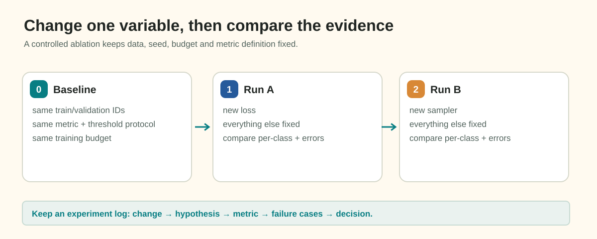

# Controlled Experimentation and Scientific Iteration

When several settings change in one run, a score difference cannot identify which change caused it. A disciplined comparison uses the same data split, code, budget, and metric, then varies one planned factor at a time. A separate repeat with a changed seed estimates how much the outcome may vary without the intervention.

This guide develops the One-Factor-At-A-Time (OFAT) protocol, invariant baselines, ablation methodology, and an experiment audit matrix. A toy comparison teaches attribution; it does not predict which intervention will help this task.

## 1. Observable Problem: The Multi-Change Confusion

Consider two explicitly hypothetical runs:

```text
Run A: fixed baseline configuration
Run B: changed backbone, schedule, sampler, loss and augmentation together
Observation: the score changed
Conclusion: the combined recipe changed the result; the contribution of each change is unidentified
```

An aggregate gain can hide both helpful and harmful components. To learn which component matters, compare separate runs against one defined anchor.

## 2. The Four Principles of Controlled Experimentation


*Figure 7.1: The scientific iteration cycle in deep learning. Every experiment isolates a single factor, tests an explicit falsifiable hypothesis against a frozen baseline anchor, and reaches a definitive audit decision.*

To achieve scientific attribution, adhere strictly to these four rules:

### Principle 1: The One-Factor-At-A-Time (OFAT) Rule
In any individual experiment run, **change exactly one independent variable** relative to your established baseline anchor:
- Change the learning-rate schedule, OR
- Change the loss formulation, OR
- Change the sampling rule, OR
- Change the encoder architecture.
**Never change two simultaneously.** If an experiment changes both the optimizer and the dataset sampling, you cannot attribute the resulting score to either factor.

### Principle 2: Freeze Invariant Foundations
Every experiment in a series must share an identical foundation:
1. **Identical Validation Split**: Always evaluate against the exact same combination-stratified fold (e.g. Fold 0). Never compare a Fold 0 score to a Fold 1 score or a random split.
2. **Identical Preprocessing & Dimensions**: Grayscale loading, standard normalization, and native $128 \times 800$ resolution must remain fixed.
3. **Identical Evaluation Protocol**: The metric computation code, threshold evaluation grid, and minimum area filters must be identical.
4. **Controlled randomness**: Use the same seed and data order for paired comparisons when isolating a model change. A separate seed-repeat run is useful for estimating variability, but is not part of the same-seed treatment comparison.

### Principle 3: Formulate a Falsifiable Hypothesis
Before launching an experiment, write down an explicit hypothesis stating **why** the change should help and **what specific measurement** will confirm or refute it:
- *Poor Hypothesis*: "I want to try cosine decay to see if it improves things."
- *Rigorous Scientific Hypothesis*: "Because our baseline oscillates in narrow minima during the final 10 epochs, switching from constant LR to Cosine Annealing with a 3-epoch warmup will reduce late-stage loss variance and increase validation Foreground Dice on thin defects by at least $+0.02$."

### Principle 4: Distinguish Signal from Stochastic Noise
Every deep learning run contains random variance from mini-batch shuffling and weight initialization.
- A small change may reflect ordinary run-to-run variation. Do not declare victory without a decision rule or uncertainty estimate.
- There is no universal score-difference threshold that proves an improvement; define a decision rule before inspecting results and examine uncertainty and error distributions.
- When feasible, repeat runs across multiple seeds; a single seed comparison only gives a rough noise estimate.

---

## 3. The Experiment Audit Matrix

Maintain a structured experiment tracking matrix (in Weights & Biases or a markdown table) that records every run:

### A comparison matrix

| Run | Changed factor | Split / seed | Budget | Primary score | Other diagnostics | Decision
|---|---|---|---|---|---|---|
| Anchor | none | fixed | fixed | record measured value | record clean false alarms and class/size diagnostics | retain as reference |
| Schedule | schedule only | same | same | measured value | epoch curves | compare with anchor |
| Sampler | sampling only | same | same | measured value | class exposure and clean false alarms | compare with anchor |
| Seed repeat | seed only | changed by design | same | measured value | same metrics | estimate run-to-run variation |

The table contains no scores because they must come from actual runs. Preserve checkpoints and configs for every row, including rejected experiments.

---

## 4. The Anatomy of an Ablation Study

An **ablation study** is the inverse of iterative optimization: you take a defined pipeline and systematically **remove or disable one component at a time** to test whether that component contributes under the stated protocol.

```
Full pipeline: [model] + [schedule] + [sampler] + [post-processing]

Ablation 1: disable one component and keep the other settings fixed.
Record the score difference and component-level diagnostics.

Ablation 2: restore the anchor, then disable a different component.
Repeat until each planned component has an independent comparison.
```

If removing a component produces no measurable change, that is evidence it may not help under the tested conditions. Check measurement precision and uncertainty before removing it from a production pipeline.

---

## 5. Common Experimentation Anti-Patterns

1. **The "Kaggle Leaderboard Overfitting" Anti-Pattern**:
   - Submitting every single training run to the public leaderboard and using the public score to guide hyperparameter decisions.
   - *Why it fails*: The public leaderboard represents a small subset of the test set. Over-tuning to it causes public overfitting, leading to massive leaderboard shakeup on the private test set. Trust your local combination-stratified validation fold!
2. **The "Comparing Uncalibrated Models" Anti-Pattern**:
   - Comparing Model X at threshold $\tau = 0.50$ against Model Y at threshold $\tau = 0.50$, when Model X's optimal threshold is $0.35$ and Model Y's optimal threshold is $0.65$.
   - *Audit*: Declare whether the comparison measures a fixed operating point or independently calibrated pipelines. For this milestone keep threshold 0.5 and no area filtering, as required; introducing calibration would change the experiment. In a later calibration study, use an agreed search budget and separate evaluation evidence.
3. **The "Changing Seeds to Find a Lucky Run" Anti-Pattern**:
   - Re-running the identical model with seeds 41, 42, 43, 44, and 45 until one seed achieves a slightly higher score, then claiming an improvement.
   - *Why it fails*: This is statistical noise, not architectural progress.

---

## Practice 6 · Design an Experiment Plan

Imagine a baseline audit suggests a rare class is often missed, while clean-image false alarms are already low. Treat this as a hypothetical diagnosis, not a report of competition data.

You have a research budget of **4 experiments**.

**Task**: Formulate a sequential 4-step experimental plan:
1. What single factor will you test in Experiment 1? State your hypothesis.
2. If Experiment 1 succeeds, what factor will you test in Experiment 2?
3. What negative symptom will you monitor in your experiment logs to ensure that clean-material performance is not sacrificed?

---

### Applying the method to the assessment

Question 10 defines four runs. Treat the same-seed baseline as the anchor; the seed-7 repeat changes only the seed and supplies the stipulated noise band. Compare the schedule-only and sampler-only runs against the anchor, then check whether each isolated gain exceeds the stated multiple of that band. For clean false-alarm rates, use each run's best checkpoint, the same threshold, and only empty validation pairs. A multi-change run could assess a combined recipe but could not attribute its result to an individual component.

## Practice and audit check · gains versus a noise band

For a distinct toy experiment, suppose the anchor scores 0.54, its seed repeat 0.53, the schedule-only run 0.56, and sampler-only run 0.58. Compute the absolute seed difference and each signed gain. Apply the strict `gain > 2 × noise` rule, including the equality case; do not round before comparison. What can one seed repeat tell you, and what can it not establish?

This rule is the assessment's decision heuristic, not a confidence interval or a statistical significance test. Extra matched seeds would be needed for a stronger uncertainty estimate. For false alarms use `100 × empty pairs with any predicted pixel / all empty pairs`; do not divide by images or all pairs. A change after sampling is consistent with prior/calibration shift, but does not establish that mechanism by itself.

## 7. Authoritative References

- Sculley, D., et al. (2015). *Hidden Technical Debt in Machine Learning Systems*. Advances in Neural Information Processing Systems (NeurIPS). (Foundational reference on pipeline complexity, dead code, and ablation discipline).
- Bouthillier, X., et al. (2021). *Accounting for variance in machine learning benchmarks*. Proceedings of Machine Learning and Systems (MLSys). (Empirical variance and seed significance).
- Weights & Biases [Experiment Tracking Best Practices](https://docs.wandb.ai/guides/track).
