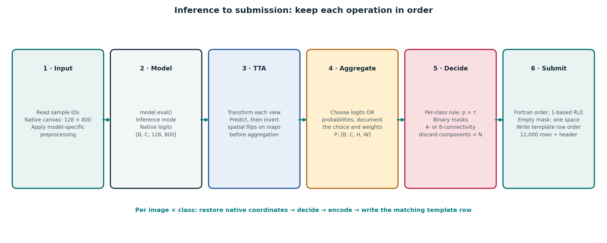

# Milestone 5 Student Study Guides
## Post-Processing & Ensembling

Welcome to Milestone 5 of the **DLGenAI-26T3 Industrial Surface Anomaly Segmentation** curriculum!

In earlier milestones, you explored the dataset geometry ($800 \times 128$), analyzed class imbalance, constructed multi-label data pipelines, implemented baseline and modern segmentation architectures (U-Net, FPN), established cross-validation splits, and tracked loss convergence in Weights & Biases.

In **Milestone 5**, you build a reproducible inference pipeline that turns model outputs into masks and submission rows. Thresholds, connected components, test-time augmentation, ensembling, memory budgets, and RLE each change predictions or execution cost, so measure them separately on held-out validation data.

---

## 1. Prerequisites from Earlier Milestones

Before beginning Milestone 5, ensure you are thoroughly grounded in the core concepts established in Milestones 1–4:

1. **Aspect Ratio & Canvas Geometry**: Industrial line-scan images are $800 \times 128$ pixels ($6.25:1$ ratio). You understand why any transformation or rescaling must be restored to native $(128, 800)$ coordinates before evaluation.
2. **The 4 Defect Classes**: You know the four segmentation channels (`defect_a`, `defect_b`, `defect_c`, `defect_d`) and that image-class pairs are evaluated separately.
3. **The Competition Evaluation Contract**: You understand that the final leaderboard score combines **70% Foreground Dice** (on positive pairs), **20% False Positive Score** (penalizing false alarms on clean pairs), and **10% Empty Accuracy**.
4. **Trained Checkpoint Artifacts**: You have trained one or more segmentation models and saved their weights (`best.pt`) along with configuration metadata.

---

## 2. The Complete Inference & Post-Processing Pipeline

The seven Milestone 5 study guides fit into a single, cohesive inference sequence:

```
┌─────────────────┐       ┌─────────────────┐       ┌─────────────────┐       ┌─────────────────┐       ┌─────────────────┐
│ 1. Test Images  │ ────► │ 2. Inference    │ ────► │ 3. Probability  │ ────► │ 4. Threshold &  │ ────► │ 5. Streaming    │
│  800 × 128      │       │    & TTA        │       │    Ensembling   │       │    Morphology   │       │    RLE & CSV    │
│  Batches (B=16) │       │  H/V Flips &    │       │  Weighted Soft  │       │  Per-Class τ &  │       │  1-based Fortran│
│  Native Canvas  │       │  Inversions     │       │  Average Maps   │       │  8-Conn CC Amin │       │  " " Sentinels  │
└─────────────────┘       └─────────────────┘       └─────────────────┘       └─────────────────┘       └─────────────────┘
     [Guide 05]                [Guide 03]                [Guide 04]             [Guides 01 & 02]          [Guide 06 & 07]
```


*Figure 0.1: The end-to-end inference and post-processing pipeline architecture, tracing test images from raw batches to submission rows.*

---

## 3. Curriculum Map: Milestone 5 Topics & Guides

The core Milestone 5 requirements are structured into seven focused, progressive study guides:

| Milestone 5 Core Topic | Primary Study Guide | Theoretical Foundations | Practical Implementation Focus |
| :--- | :--- | :--- | :--- |
| **1. Threshold Calibration** | [Guide 01: Probability Maps to Binary Masks](topics/01_thresholding_and_probability_calibration.md) · Q1–2 | Sigmoid vs 5-way softmax activations, strict $p>T$ decisions, precision–recall trade-offs and score decomposition. | Precompute validation probabilities and calibrate per-class thresholds. |
| **2. Morphological Filtering** | [Guide 02: Connected Components & Min-Area](topics/02_connected_components_and_minimum_area_filtering.md) · Q3–5 | 4- vs 8-connectivity, component area and image-class-pair recall ceiling. | Implement 8-connected analysis and evaluate per-class area rules. |
| **3. Test-Time Augmentation** | [Guide 03: Test-Time Augmentation (TTA)](topics/03_test_time_augmentation_mechanics_and_inversion.md) · Q6 | Flip dimensions for $(B,C,H,W)$, exact spatial inverses and probability aggregation. | Invert every map to native coordinates and check asymmetric landmarks. |
| **4. Model Ensembling** | [Guide 04: Ensembling Models & Checkpoints](topics/04_ensembling_models_and_checkpoints.md) · Q7 | Probability averaging vs hard voting; probability vs logit averaging. | Blend aligned probability maps with explicit weights summing to one. |
| **5. Scalable Inference** | [Guide 05: Scalable Inference Architecture](topics/05_scalable_inference_architecture_and_memory.md) · Q8 | Probability-map memory, bounded accumulators, forward-pass counts and time estimates. | Stream a batch at a time; measure actual runtime and peak memory. |
| **6. Submission Integrity** | [Guide 06: Submission Integrity & Contract](topics/06_submission_integrity_and_the_competition_contract.md) · Q9 | 12,000 data rows plus header; 1-indexed column-major Fortran RLE; exact single-space sentinel (`" "`). | Validate template order, schema, run bounds and empty fields. |
| **7. Experiment Discipline** | [Guide 07: Experimentation & Ablation Ladders](topics/07_inference_experimentation_discipline_and_ablation_ladders.md) · Q9 | Causal attribution, holdout overfitting and operational checks. | Change one component at a time; retain validation, time and memory evidence. |

---

## 4. Recommended Reading & Implementation Sequence

Follow this progressive path through the curriculum:

1. **Start with Post-Processing Optimization**: Read **[Guide 01](topics/01_thresholding_and_probability_calibration.md)** and **[Guide 02](topics/02_connected_components_and_minimum_area_filtering.md)**. Learn how to convert your single best model’s continuous outputs into discrete masks and eliminate sensor noise speckles without erasing valid defects.
2. **Add Variance Reduction**: Read **[Guide 03](topics/03_test_time_augmentation_mechanics_and_inversion.md)** to implement Test-Time Augmentation. Verify that your spatial inversions are pixel-accurate before running full validation sweeps.
3. **Combine Diverse Hypotheses**: Read **[Guide 04](topics/04_ensembling_models_and_checkpoints.md)** to blend complementary backbones or fold checkpoints via soft probability averaging.
4. **Engineer Bounded Execution**: Read **[Guide 05](topics/05_scalable_inference_architecture_and_memory.md)** to reason from the resource limits stated in your target notebook or assessment, then profile the actual pipeline.
5. **Lock Down the Submission Contract**: Read **[Guide 06](topics/06_submission_integrity_and_the_competition_contract.md)** to verify your Fortran RLE encoding, single-space empty sentinels, and 12,000 data rows plus one header line.
6. **Climb the Ablation Ladder**: Read **[Guide 07](topics/07_inference_experimentation_discipline_and_ablation_ladders.md)** to conduct disciplined inference ablations and select your two final submission candidates based on solid local validation evidence.

---

## 5. Standalone Code Examples & Synthetic Walkthrough

To support hands-on experimentation without disclosing private training benchmarks, this curriculum includes complete, self-contained educational resources built on **100% synthetic data**:

### 1. Interactive Walkthrough Notebook
- **Jupyter Notebook**: [`notebooks/synthetic_inference_pipeline.ipynb`](notebooks/synthetic_inference_pipeline.ipynb)
- **Paired Python Script**: [`notebooks/synthetic_inference_pipeline.py`](notebooks/synthetic_inference_pipeline.py)
- **Notebook Setup Guide**: [`notebooks/README.md`](notebooks/README.md)

This walkthrough runs on CPU in under 2 seconds and demonstrates every stage of the pipeline from synthetic strip generation to multi-model inference, TTA inversion, thresholding, area filtering, RLE streaming, and pre-flight validation.

### 2. Standalone Diagnostic Scripts
- **Threshold Calibration**: [`examples/toy_threshold_search.py`](examples/toy_threshold_search.py)
  Sweeps decision thresholds $\tau$ and demonstrates metric divergence between naive mean Dice and the competition score.
- **8-Connected Component Filtering**: [`examples/toy_component_filtering.py`](examples/toy_component_filtering.py)
  Demonstrates OpenCV connected-component labeling on a synthetic mask with known component sizes.
- **TTA Spatial Inversion**: [`examples/toy_tta_inversion.py`](examples/toy_tta_inversion.py)
  Demonstrates the forward-predict-invert-aggregate cycle and proves why un-inverted TTA completely destroys spatial localization.
- **Ensemble Blending**: [`examples/toy_ensemble_blending.py`](examples/toy_ensemble_blending.py)
  Contrasts soft probability averaging against hard binary mask voting on borderline ambiguous pixels.
- **Streaming Submission Generator**: [`examples/toy_submission_streamer.py`](examples/toy_submission_streamer.py)
  Demonstrates batch-at-a-time inference and row validation on synthetic data. Its in-memory CSV buffer is pedagogical, not a production direct-to-disk implementation.

---

## 6. Teaching Philosophy and Boundaries

These study guides provide engineering principles, mathematical formulations, diagnostic tools, and failure mode analyses:
- They explain **why** operations succeed or fail, and give you the tools to test hypotheses scientifically.
- They do **not** provide pre-selected competition thresholds, fixed area cutoffs, chosen ensemble weights, or a finished submission file.
- They do **not** reveal internal exploratory findings or private leaderboard results from internal project runs.
- There are **no assessment tasks or grading rubrics** in Milestone 5; you will build, calibrate, and validate your own final inference notebook.
