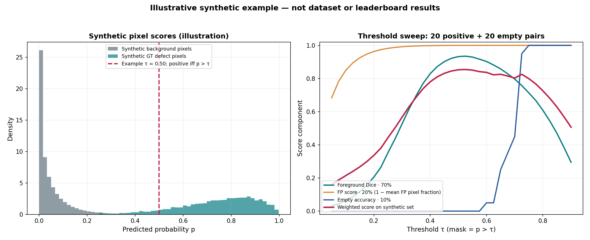
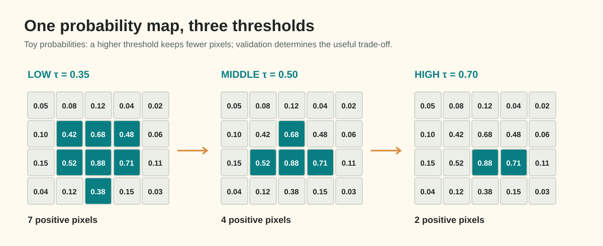

# Guide 01: Probability Maps to Binary Masks: Calibration & Class Thresholds

At the conclusion of neural network training, your segmentation model emits continuous, real-valued tensors known as **logits**:
$$\mathbf{Z} \in \mathbb{R}^{B \times C \times H \times W}$$

Where $B$ is batch size, $C$ is the number of defect channels, $H = 128$, and $W = 800$.

However, downstream factory quality controllers and Kaggle's evaluation engine cannot score raw floating-point numbers. They require a discrete, binary decision at every pixel: *Is pixel $(y, x)$ an active surface flaw, or is it clean metal?*

Converting continuous predictions into discrete decisions is the first post-processing step. Applying an uncalibrated default threshold (such as $\tau = 0.5$) may miss faint defects or predict isolated false alarms. Under the assessment's metric, a few false-positive pixels slightly lower the empty-pair pixel score, while any nonempty prediction also makes that pair incorrect for empty accuracy; these are separate terms.

In this guide, you will trace logits through model activations, understand the precision–recall trade-off across the threshold spectrum, formulate per-class threshold vectors $\boldsymbol{\tau}$, and calibrate decisions strictly using held-out validation predictions against the competition's weighted evaluation metric.

---

## 1. Concrete Failure Case: The Uncalibrated Threshold Trap

Consider an industrial line-scan camera inspecting a fast-moving cold-rolled steel strip.

Suppose a model inspects a clean, defect-free strip (ground truth $Y=\mathbf{0}$). A synthetic fluctuation produces logit $z=+0.1$ over a few pixels.

If you apply a low threshold $\tau = 0.35$ ($\sigma(z) \approx 0.525 > 0.35$):
- Ground truth is empty and the prediction contains those pixels.
- Foreground Dice is averaged over positive pairs only. For an empty pair the false-positive term is $1-|P|/102{,}400$ and empty accuracy is 0 because the prediction is nonempty.

Now consider the inverse failure case on a sheet with a faint, thin scratch (`defect_a`, Ground Truth $|Y| = 80\text{ px}$). Because the scratch is shallow, the model's confidence hovers around $p \approx 0.42$. If you apply an aggressive default threshold $\tau = 0.50$:
- Ground Truth: $|Y| = 80$ pixels.
- Predicted Mask: $|\hat{X}| = 0$ pixels ($\text{since } 0.42 < 0.50$).
- Foreground Dice:
  $$\text{Dice} = \frac{2 |\hat{X} \cap Y|}{|\hat{X}| + |Y|} = \frac{0}{0 + 80} = 0.0$$
The defect is entirely missed, destroying Foreground Dice (which commands $70\%$ of the competition metric).

The default threshold $\tau = 0.50$ assumes symmetric costs and calibrated probabilities. In industrial anomaly detection, neither assumption holds.

---

## 2. Mathematical Formulation: From Logits to Binary Decisions

The transformation pipeline from model activations to binary masks follows a deterministic mathematical flow:


*Figure 1.1: (Left) Empirical probability distributions for clean background vs true defect pixels. (Right) Metric divergence across the threshold spectrum: notice how the competition score peak differs from naive mean Dice.*

### Sigmoid vs. Softmax Head Mechanics

Depending on the output head architecture selected during training, continuous probabilities $\hat{P}$ are computed differently:

#### A. Multi-Label Sigmoid Head (4 Output Channels)
When the model outputs 4 independent logits $\mathbf{Z} \in \mathbb{R}^{4 \times 128 \times 800}$, each channel corresponds directly to a defect class ($c \in \{0, 1, 2, 3\}$ for `defect_a` through `defect_d`). Probabilities are computed via the standard logistic sigmoid function:

$$\hat{P}(c, y, x) = \sigma(z(c, y, x)) = \frac{1}{1 + e^{-z(c, y, x)}}$$

Under this formulation, channels are mathematically independent: pixel $(y, x)$ can theoretically predict probabilities $> 0.5$ for both `defect_a` and `defect_c` simultaneously.

#### B. 5-Way Categorical Softmax Head (5 Output Channels)
When the model outputs 5 logits representing `[background, defect_a, defect_b, defect_c, defect_d]`, probabilities are normalized across channels at every pixel:

$$\hat{P}(c, y, x) = \frac{e^{z(c, y, x)}}{\sum_{k=0}^{4} e^{z(k, y, x)}}, \quad \sum_{k=0}^{4} \hat{P}(k, y, x) = 1.0$$

Where $c = 0$ is background, and $c \in \{1, 2, 3, 4\}$ correspond to the 4 defect classes. This structure enforces pixel exclusivity: increasing the probability of `defect_a` automatically decreases the probability of all other defects and background.

### The Decision Rule

Given predicted probability $\hat{P}(c, y, x) \in [0, 1]$ and class threshold $\tau_c \in (0, 1)$:

$$\hat{M}(c, y, x) = \begin{cases} 1 & \text{if } \hat{P}(c, y, x) > \tau_c \\ 0 & \text{if } \hat{P}(c, y, x) \le \tau_c \end{cases}$$

This curriculum and the assessment use the **strict** rule $p>\tau$. A probability exactly equal to the threshold is negative. The equivalent logit boundary for a sigmoid channel is $z_\tau=\log(\tau/(1-\tau))$; equality to that logit is also negative under the strict rule.

For a 5-way softmax head, students may combine a categorical argmax filter with a foreground confidence threshold:
$$\hat{M}(c, y, x) = \begin{cases} 1 & \text{if } \operatorname{argmax}_{k} \hat{P}(k, y, x) = c \quad \text{and} \quad \hat{P}(c, y, x) > \tau_c \\ 0 & \text{otherwise} \end{cases}$$

---

## 3. Worked Numerical Example: The Toy Grid




To observe how thresholding alters mask geometry, examine this fictional $4 \times 5$ probability grid $\hat{P}$ for a single defect channel near a strip boundary:

```
Row / Col     Col 0    Col 1    Col 2    Col 3    Col 4
Row 0        [ 0.05     0.08     0.12     0.04     0.02 ]
Row 1        [ 0.10     0.42     0.68     0.48     0.06 ]
Row 2        [ 0.15     0.52     0.88     0.71     0.11 ]
Row 3        [ 0.04     0.12     0.38     0.15     0.03 ]
```

Let us evaluate the resulting binary mask $\hat{M}$ at three distinct thresholds: $\tau = 0.35$, $\tau = 0.50$, and $\tau = 0.70$.

### Threshold Evaluation Comparison

```
At τ = 0.35 (Permissive / High Recall):
[ 0  0  0  0  0 ]
[ 0  1  1  1  0 ]  --> 7 active pixels: captures weak boundary pixels (0.42, 0.48, 0.38).
[ 0  1  1  1  0 ]      High recall, but boundary expansion may add false positive pixels.
[ 0  0  1  0  0 ]

At τ = 0.50 (Standard Default):
[ 0  0  0  0  0 ]
[ 0  0  1  0  0 ]  --> 4 active pixels: (Row 1, Col 2=0.68), (Row 2, Col 1=0.52), (Row 2, Col 2=0.88), (Row 2, Col 3=0.71).
[ 0  1  1  1  0 ]      Boundary pixel (0.42) and tail pixel (0.38) are zeroed out.
[ 0  0  0  0  0 ]

At τ = 0.70 (Conservative / High Precision):
[ 0  0  0  0  0 ]
[ 0  0  0  0  0 ]  --> 2 active pixels: only high-confidence core pixels (0.88, 0.71) survive.
[ 0  0  1  1  0 ]      High specificity, but much of the labeled defect is missed.
[ 0  0  0  0  0 ]
```

### Worked Dice Calculation Against Ground Truth
Suppose the true defect mask $Y$ consists of the 4 pixels:
$$Y = \{(1, 1), (1, 2), (2, 1), (2, 2)\}, \quad |Y| = 4$$

Let us compute Foreground Dice for each threshold:

1. **At $\tau = 0.35$**:
   - Predicted $|\hat{X}| = 7$.
   - Intersection $|\hat{X} \cap Y| = 4$ (all true pixels detected, plus 3 false positive pixels at $(1, 3)$, $(2, 3)$, and $(3, 2)$).
   $$\text{Dice}_{\tau=0.35} = \frac{2 \times 4}{7 + 4} = \frac{8}{11} \approx \mathbf{0.727}$$

2. **At $\tau = 0.50$**:
   - Predicted $|\hat{X}| = 4$: $\{(1, 2), (2, 1), (2, 2), (2, 3)\}$.
   - Intersection $|\hat{X} \cap Y| = 3$ (missed $(1, 1)$, added false positive $(2, 3)$).
   $$\text{Dice}_{\tau=0.50} = \frac{2 \times 3}{4 + 4} = \frac{6}{8} = \mathbf{0.750}$$

3. **At $\tau = 0.70$**:
   - Predicted $|\hat{X}| = 2$: $\{(2, 2), (2, 3)\}$.
   - Intersection $|\hat{X} \cap Y| = 1$ (only $(2, 2)$ matches).
   $$\text{Dice}_{\tau=0.70} = \frac{2 \times 1}{2 + 4} = \frac{2}{6} = \mathbf{0.333}$$

On this toy defect, $\tau = 0.50$ achieves the highest Dice ($0.750$). The lower threshold captures one more true boundary pixel, but it also adds enough false-positive area to reduce Dice. That balance must be measured on held-out data.

---

## 4. Tensor Shapes and Data Types

Trace the tensor transformations through every operation in the decision step:

| Stage | Variable Name | Shape | Data Type | Value Range | Memory for Batch $B=16$ |
| :--- | :--- | :--- | :--- | :--- | :--- |
| Model Raw Output | `logits` | `(16, 4, 128, 800)` | `torch.float32` | $(-\infty, +\infty)$ | $26.21\text{ MB}$ |
| Non-Linear Activation | `probs` | `(16, 4, 128, 800)` | `torch.float32` | $[0.0, 1.0]$ | $26.21\text{ MB}$ |
| Canvas Rescaling (if scaled) | `probs_native` | `(16, 4, 128, 800)` | `torch.float32` | $[0.0, 1.0]$ | $26.21\text{ MB}$ |
| Threshold Comparison | `raw_mask` | `(16, 4, 128, 800)` | `torch.bool` | `True` / `False` | $6.55\text{ MB}$ |
| NumPy Representation | `mask_uint8` | `(128, 800)` | `np.uint8` | $\{0, 1\}$ | $0.10\text{ MB / image-class}$ |

> [!IMPORTANT]
> If your model forward pass uses a scaled input resolution (such as $256 \times 1600$), you must interpolate the continuous logits or probability maps back to the native industrial dimensions $(128, 800)$ **before** thresholding. Interpolating binary masks introduces jagged stair-stepping and boundary dilation artifacts.

---

## 5. Threshold Calibration Protocol: The Search Strategy

Never adjust thresholds using public leaderboard feedback. Public leaderboard feedback provides a single noisy number across an unknown subset of test data, leading directly to leaderboard overfitting.

Thresholds must be calibrated strictly using **held-out validation predictions**:

### Step 1: Precompute Validation Probabilities
Do not rerun model forward passes for every candidate threshold! Evaluate your validation set once with your trained checkpoint, caching the predicted probability arrays:
$$\mathbf{P}_{\text{val}} \in [0, 1]^{N_{\text{val}} \times 4 \times 128 \times 800}$$

### Step 2: Define the Search Resolution
Define a discrete search grid for candidate thresholds:
$$\mathcal{T} = \{0.20, 0.25, 0.30, 0.35, 0.40, 0.45, 0.50, 0.55, 0.60, 0.65, 0.70, 0.75, 0.80\}$$
Searching with a step size finer than $0.02$ yields negligible metric differences and risks fitting validation noise.

### Step 3: Optimize the True Metric Objective
Do **not** optimize naive mean Dice across all pairs. The supplied assessment defines this three-part score:
$$\text{Score} = 0.70 \times \text{ForegroundDice} + 0.20 \times \text{FalsePositiveScore} + 0.10 \times \text{EmptyAccuracy}$$

For one class, average Foreground Dice over positive image-class pairs. Over empty pairs, define $\text{FalsePositiveScore}=1-\operatorname{mean}(|P|/102{,}400)$ and EmptyAccuracy as the fraction whose prediction is entirely empty. Apply the formula to those three aggregate components; do not replace pixel-rate false positives with a binary clean-pair pass/fail.

```python
# Minimal validation sweep snippet
import numpy as np

def sweep_class_threshold(val_probs: np.ndarray, val_gts: np.ndarray, grid: list[float]) -> tuple[float, float]:
    """Find the threshold tau that maximizes the competition composite score for one defect class."""
    best_score = -1.0
    best_tau = 0.50

    for tau in grid:
        fg_dices = []
        empty_fp_pixel_rates = []
        empty_correct = 0
        total_empty = 0

        for p, y in zip(val_probs, val_gts):
            m = (p > tau).astype(np.uint8)
            y_sum = y.sum()
            m_sum = m.sum()
            inter = (m * y).sum()

            if y_sum > 0:
                # Positive ground truth pair: evaluate foreground Dice
                dice = (2.0 * inter) / (m_sum + y_sum)
                fg_dices.append(dice)
            else:
                # Empty ground truth pair
                total_empty += 1
                if m_sum == 0:
                    empty_correct += 1
                empty_fp_pixel_rates.append(float(m_sum) / float(y.size))

        mean_fg = float(np.mean(fg_dices)) if fg_dices else 0.0
        mean_fp = 1.0 - float(np.mean(empty_fp_pixel_rates)) if empty_fp_pixel_rates else 1.0
        empty_acc = float(empty_correct / total_empty) if total_empty > 0 else 1.0

        comp_score = 0.70 * mean_fg + 0.20 * mean_fp + 0.10 * empty_acc

        if comp_score > best_score:
            best_score = comp_score
            best_tau = tau

    return best_tau, best_score
```

### Per-Class vs. Global Shared Thresholds
Different defect classes exhibit vastly different prevalence and contrast:
- `defect_a`: Thin scratches often benefit from moderate thresholds ($\tau \approx 0.40 - 0.50$) to maintain edge connectivity.
- `defect_b`: Extremely rare defect. Setting $\tau$ too high risks erasing entire instances, dropping Foreground Dice to zero.
- `defect_c`: Dense, high-contrast oxide scale; models often achieve high confidence, supporting higher thresholds ($\tau \approx 0.55 - 0.65$) to suppress boundary noise.

Calibrate a 4-element threshold vector $\boldsymbol{\tau} = [\tau_a, \tau_b, \tau_c, \tau_d]$ rather than enforcing a single global threshold.

---

## 6. Decision Analysis: Benefits, Costs, and Risks

| Strategy | Primary Benefit | Computational Cost | Underlying Assumption | Primary Risk / Failure Mode |
| :--- | :--- | :--- | :--- | :--- |
| **Default $\tau = 0.50$ Global** | Zero tuning; simplest possible code. | None ($O(1)$). | Probabilities are well-calibrated; costs of FP and FN are equal. | Suboptimal on both thin faint defects and clean sheet false alarms. |
| **Shared Tuned $\tau$** | Simple 1D sweep; boosts validation metric by $0.01 - 0.03$. | Low (sweep 10 values). | All 4 defect classes share similar confidence profiles. | Under-predicts rare defects or over-predicts noisy classes. |
| **Per-Class Tuned $\boldsymbol{\tau}$ (Recommended)** | Tailors precision–recall balance to the physical morphology of each defect. | Moderate (sweep 10 values $\times$ 4 classes). | Validation set has sufficient class support to prevent overfitting. | Overfitting validation holdout on extremely rare classes (e.g. `defect_b`). |

---

## 7. Diagnostic Checklist: Has Thresholding Helped?

When you complete your threshold search, evaluate these diagnostics before locking in your settings:

1. **Class-Wise Foreground Dice Breakdown**: Did the optimal $\tau$ increase Foreground Dice on positive pairs without collapsing recall on rare defects?
2. **False Positive Rate on Clean Strips**: Check how many clean validation images predict active pixels at your chosen $\tau$. If more than $5\%$ of clean strips trigger detections, your threshold is too permissive.
3. **Distribution of Borderline Probabilities**: Plot a histogram of predicted probabilities in the interval $[0.3, 0.7]$. If the model is confident, most values will lie near $0.0$ and $1.0$. A large mass between $0.4$ and $0.6$ indicates model uncertainty that post-processing alone cannot fix.

---

## Practice 8 · Predict the Metric Impact

Review the following diagnostic output from a student's threshold sweep on `defect_b`:

```text
Threshold τ     Positive Pair Dice    Clean Pair Accuracy    False Alarms (px)
τ = 0.30        0.582                 0.810                  1,420
τ = 0.45        0.564                 0.930                  310
τ = 0.60        0.510                 0.985                  45
τ = 0.75        0.180                 0.998                  2
```

**Questions to consider:**
1. Why does Positive Pair Dice collapse so dramatically between $\tau = 0.60$ and $\tau = 0.75$?
2. Given that Foreground Dice commands $70\%$ of the competition score while Empty Accuracy commands $10\%$, which threshold would you hypothesize yields the highest composite score?
3. What risk does the student run if they choose $\tau = 0.75$ to maximize clean-pair accuracy?

*(Hint: Verify that `defect_b` instances are sparse. If an entire defect instance fails to exceed 0.75, its Dice score becomes 0.0, dragging down the average across positive pairs.)*

---

## 9. Authoritative Framework & Competition References

- **Scikit-Learn Documentation**: [Precision-Recall and Threshold Tuning](https://scikit-learn.org/stable/auto_examples/model_selection/plot_precision_recall.html)
- **PyTorch Documentation**: [`torch.sigmoid`](https://pytorch.org/docs/stable/generated/torch.sigmoid.html) and [`torch.nn.functional.softmax`](https://pytorch.org/docs/stable/generated/torch.nn.functional.softmax.html)
- **Kaggle Evaluation Overview**: Industrial Surface Defect Detection Competition Evaluation Metric specification.

## Assessment Crosswalk · Questions 1–2

- **Q1 (logits and the strict boundary):** For a sigmoid output, convert the probability boundary with $z_T=\ln(T/(1-T))$. For every pixel, compare probability to the threshold using strict $p>T$; a tie is negative. To answer the separate $p\ge T$ count, include ties only in that count. Compute hard Dice from $2TP/(|P|+|Y|)$ using the ground-truth positives in the question. Keep intermediate probabilities unrounded.
- **Q2 (selecting a sweep row):** Multiply the three supplied aggregate components by their stated weights and sum. The row with the highest Foreground Dice need not maximize the weighted score: compare how its FalsePositiveScore and EmptyAccuracy differ from another candidate. Do not infer score components from $T$ or $N$; use the table.

### Practice with separate data

For a sigmoid threshold $T=0.4$, use $z_T=\ln(0.4/0.6)$. If a pixel has probability exactly 0.4, record it as negative for the strict rule and positive for a non-strict comparator. This boundary check is deliberately separate from Q1's values.
