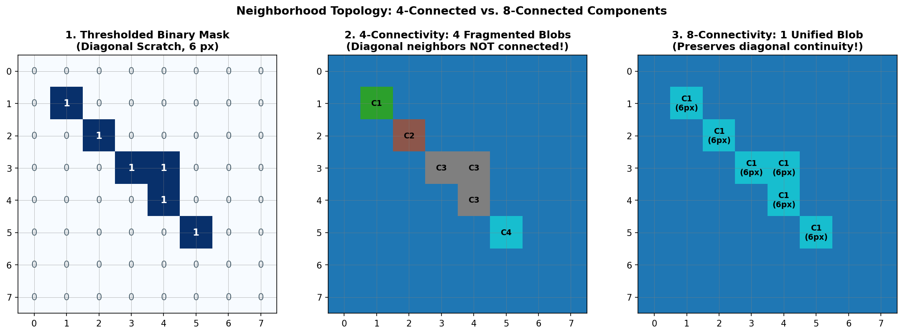
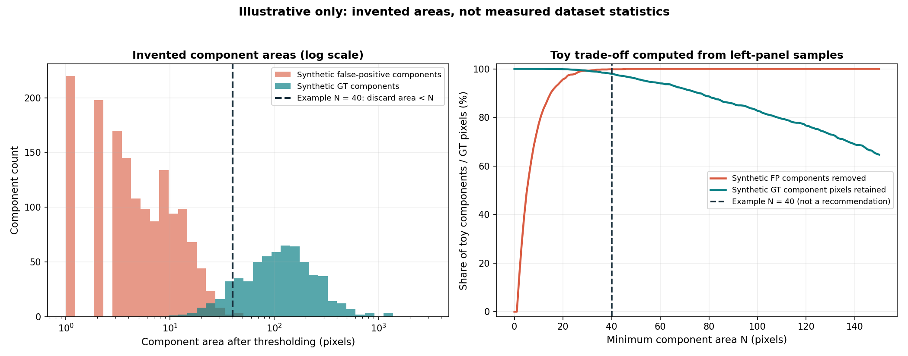

# Guide 02: Morphological Filtering: Connected Components & Minimum Area

Thresholding a continuous probability map converts real-valued scores into discrete binary masks. However, pixel-level thresholding evaluates each coordinate in isolation. It cannot distinguish between a coherent physical surface flaw and isolated high-frequency sensor noise.

In automated industrial optical inspection, line-scan sensors operate under intense strobe illumination and high conveyor speeds. Microscopic dust motes, specular reflections, or localized optical sensor shot noise regularly cause convolutional neural networks to predict tiny clusters of 1 to 5 active pixels on completely pristine metal.

On clean material, a stray 3-pixel prediction is catastrophic: it triggers a false-positive penalty that drops the empty pair's metric contribution from $1.0$ down to $0.0$. Conversely, an excessively aggressive area filter will obliterate genuine, faint scratches.

In this guide, you will master **morphological post-processing via Connected Component Analysis (CCA)**, understand the topological distinction between 4- and 8-connectivity, establish per-class minimum area cutoffs $\mathbf{A}_{\min}$, and balance false-positive reduction against lost recall.

---

## 1. Concrete Failure Case: The Speckle Penalty vs. The Erased Scratch

To understand the sensitivity of area filtering, examine two opposite failure cases encountered during post-processing:

### Failure Case A: The Clean-Sheet Speckle Penalty
A line-scan camera records a clean steel strip ($Y = \mathbf{0}$). A dust particle reflecting strobe light produces a localized logit spike. At threshold $\tau = 0.50$, three adjacent pixels are predicted as `defect_c`:
- Ground Truth: $|Y| = 0$ pixels.
- Predicted Mask: $|\hat{X}| = 3$ pixels.
- Ground truth is empty, so the model has committed a false detection on clean material. The false-positive penalty is applied, and the empty accuracy score drops to $0$. An entire image-pair score is destroyed by just 3 stray pixels.

### Failure Case B: The Erased Scratch (Over-Filtering)
On another strip, a real structural scratch (`defect_a`) spans 35 pixels along the rolling direction. The student configures a blunt, global minimum area filter $A_{\min} = 50\text{ px}$:
- Ground Truth: $|Y| = 35$ pixels.
- Predicted Component Area: $35\text{ px} < A_{\min} (50\text{ px})$.
- Filter Action: The entire component is zeroed out ($|\hat{X}| \to 0$).
- Resulting Foreground Dice:
  $$\text{Dice} = \frac{2 |\hat{X} \cap Y|}{|\hat{X}| + |Y|} = \frac{0}{0 + 35} = 0.0$$
The model successfully recognized the defect, but post-processing wiped it from the submission!

A minimum area threshold is a double-edged sword: it removes false-alarm speckles, but it also creates an **absolute recall ceiling** for genuine defects smaller than the cutoff.

---

## 2. Topological Foundations: 4-Connectivity vs. 8-Connectivity

A binary mask $\hat{M} \in \{0, 1\}^{H \times W}$ is a discrete 2D grid. Before we can measure the area of a defect "blob," we must define which neighboring pixels belong to the same physical object.

```
      4-Neighborhood (Cross)                 8-Neighborhood (Full 3x3)
           [   (y-1, x)   ]              [(y-1, x-1) (y-1, x) (y-1, x+1)]
[(y, x-1)      (y, x)     (y, x+1)]      [ (y, x-1)   (y, x)   (y, x+1) ]
           [   (y+1, x)   ]              [(y+1, x-1) (y+1, x) (y+1, x+1)]
```

### The Adjacency Rules

- **4-Connectivity**: Two active pixels $p$ and $q$ are connected if and only if they share a horizontal or vertical edge. Diagonally adjacent pixels are considered disconnected.
- **8-Connectivity**: Two active pixels $p$ and $q$ are connected if they share an edge **or** a diagonal vertex.


*Figure 2.1: The impact of neighborhood topology on a diagonal defect scratch. (1) Binary mask. (2) 4-connectivity breaks the continuous defect into fragmented 1-pixel components. (3) 8-connectivity preserves the unified physical defect blob.*

### The Worked Numbered Toy Grid

Examine this fictional $6 \times 6$ binary mask containing a diagonal surface fissure and an isolated sensor speckle:

```
Row / Col     Col 0    Col 1    Col 2    Col 3    Col 4    Col 5
Row 0        [  0        0        0        0        1        0  ]  <-- Isolated Speckle (1 px)
Row 1        [  0        0        0        0        0        0  ]
Row 2        [  0        1        0        0        0        0  ]  <-- Start of diagonal scratch
Row 3        [  0        0        1        0        0        0  ]  <-- Diagonal neighbor
Row 4        [  0        0        0        1        1        0  ]  <-- Diagonal + horizontal
Row 5        [  0        0        0        0        1        0  ]  <-- Vertical neighbor
```

Let us trace connected component labeling under both topologies:

#### A. Under 4-Connectivity:
- The speckle at $(0, 4)$ is an isolated component of size $1$.
- The pixel at $(2, 1)$ has no horizontal or vertical neighbors $\to$ Component of size $1$.
- The pixel at $(3, 2)$ has no horizontal or vertical neighbors $\to$ Component of size $1$.
- Pixels at $(4, 3), (4, 4), (5, 4)$ share edges $\to$ Component of size $3$.
- **Result**: 4 separate components of sizes $\{1, 1, 1, 3\}$.
- If you apply $A_{\min} = 4$, **all pixels are erased**, including the genuine scratch!

#### B. Under 8-Connectivity:
- The speckle at $(0, 4)$ is an isolated component of size $1$.
- Pixels $(2, 1), (3, 2), (4, 3), (4, 4), (5, 4)$ are mutually 8-connected through diagonal and orthogonal paths $\to$ **1 unified component of size $5$**.
- **Result**: 2 components: Component 1 (speckle, size $1$) and Component 2 (scratch, size $5$).
- If you apply $A_{\min} = 4$, Component 1 is erased, and Component 2 survives completely intact!

> [!IMPORTANT]
> Always use `connectivity=8` for industrial defect segmentation. Longitudinal scratches and shear cracks run diagonally across sensor rasters. 4-connectivity fragments them into tiny disconnected pieces that get erroneously purged by area filters.

---

## 3. Implementation with OpenCV: `cv2.connectedComponentsWithStats`

OpenCV provides a highly optimized C++ implementation for 8-connected component analysis.

```python
import cv2
import numpy as np

def filter_small_components(mask: np.ndarray, min_area: int) -> np.ndarray:
    """Zero out 8-connected components whose area is strictly less than min_area pixels.

    Args:
        mask: 2D binary numpy array of shape (H, W), dtype uint8 or bool.
        min_area: Integer pixel area threshold. Blobs with area < min_area are removed.

    Returns:
        clean_mask: 2D numpy array of shape (H, W), dtype uint8 containing surviving blobs.
    """
    if min_area <= 0 or mask.sum() == 0:
        return mask.astype(np.uint8)

    mask_uint8 = mask.astype(np.uint8)

    # num_labels: Total components found including background (label 0)
    # labels: 2D array of same shape where each pixel contains its component ID
    # stats: Matrix of shape (num_labels, 5) containing CC_STAT_LEFT, CC_STAT_TOP,
    #        CC_STAT_WIDTH, CC_STAT_HEIGHT, CC_STAT_AREA
    num_labels, labels, stats, _ = cv2.connectedComponentsWithStats(
        mask_uint8, connectivity=8
    )

    clean_mask = np.zeros_like(mask_uint8)

    # Label 0 is the background; iterate through defect components 1 .. num_labels - 1
    for label_id in range(1, num_labels):
        area = stats[label_id, cv2.CC_STAT_AREA]
        if area >= min_area:
            clean_mask[labels == label_id] = 1

    return clean_mask
```

---

## 4. Sequence of Operations: Why Order Matters

A frequent architectural question is: *Can we filter small areas before thresholding, or must thresholding precede connected component analysis?*

```
CORRECT ORDER:
Probability Map P ∈ [0, 1] ──► Thresholding at τ ──► Binary Mask M ∈ {0, 1} ──► 8-Conn CC Filter ──► Clean Mask
```

Why the order cannot be inverted:
1. **Connected Component Analysis Requires Binary Support**: Connected component algorithms rely on discrete graph connectivity: a pixel either belongs to the foreground set or it does not. Continuous probability fields have non-zero values across the entire canvas; CC analysis cannot group floating-point numbers without prior binarization.
2. **Thresholding Changes Component Area**: Increasing $\tau$ shrinks the spatial footprint of defect blobs. A 60-pixel blob at $\tau = 0.40$ might shrink to 40 pixels at $\tau = 0.60$. Therefore, **connected component area filtering is conditioned on the chosen threshold $\tau$**.

---

## 5. Tensor Shapes, Memory, and Native Coordinates

Trace the data structures during component filtering:

| Step | Variable | Shape | Data Type | Meaning |
| :--- | :--- | :--- | :--- | :--- |
| Thresholded Mask | `raw_mask` | `(128, 800)` | `np.uint8` | Binary pixels before filtering |
| Label Map | `labels` | `(128, 800)` | `np.int32` | Integer component ID for each pixel |
| Statistics Table | `stats` | `(K, 5)` | `np.int32` | Bounding box coordinates and pixel area |
| Filtered Mask | `clean_mask` | `(128, 800)` | `np.uint8` | Clean binary mask ready for RLE |

### Critical Canvas Rule: Measure Area in Native Coordinates
If your pipeline uses an enlarged or patched input tensor (e.g. $256 \times 1600$), **always interpolate logits back to the native $128 \times 800$ canvas before thresholding and filtering**.
- A 30-pixel flaw on a $128 \times 800$ strip covers $120$ pixels at $2 \times$ scale ($256 \times 1600$).
- If you apply an area cutoff $A_{\min} = 40$ on the enlarged canvas, you are effectively filtering out 10-pixel flaws at native scale!
- Standardize all area cutoffs $A_{\min}$ strictly to **native $128 \times 800$ pixel units**.

---

## 6. The Recall Ceiling vs. False Positive Reduction Trade-off


*Figure 2.2: (Left) Component area distribution: isolated sensor speckles cluster below 20 px, whereas genuine physical defects span larger areas. (Right) The trade-off curve: increasing $A_{\min}$ purges false positives rapidly, but setting it too high risks erasing genuine defect instances.*

### Mathematical Trade-off Formulation

Let $\mathcal{C}_{\text{noise}}$ denote the set of false-positive noise components on clean strips, and $\mathcal{C}_{\text{true}}$ denote the set of genuine defect instances.

The false-positive reduction rate $\Phi_{\text{FP}}(A_{\min})$ is:
$$\Phi_{\text{FP}}(A_{\min}) = \frac{\sum_{c \in \mathcal{C}_{\text{noise}}} \mathbb{I}(\text{Area}(c) < A_{\min})}{|\mathcal{C}_{\text{noise}}|}$$

The lost foreground defect recall $\Lambda_{\text{FN}}(A_{\min})$ is:
$$\Lambda_{\text{FN}}(A_{\min}) = \frac{\sum_{c \in \mathcal{C}_{\text{true}}} \text{Area}(c) \cdot \mathbb{I}(\text{Area}(c) < A_{\min})}{\sum_{c \in \mathcal{C}_{\text{true}}} \text{Area}(c)}$$

As $A_{\min}$ increases:
1. $\Phi_{\text{FP}}(A_{\min}) \to 1.0$: Clean-strip false alarms are eradicated, increasing the False Positive Score (20% weight) and Empty Accuracy (10% weight).
2. $\Lambda_{\text{FN}}(A_{\min})$ increases: Smaller genuine flaws are erased, causing Foreground Dice (70% weight) to drop.

### Class-Specific Policies Are Hypotheses

Different classes may have different component-size distributions, but a class name alone does not justify a cutoff. Measure prediction components and validation effects per class. Treat every proposed $A_{\min,c}$ as a hypothesis; report how many positive pairs become empty and how the score components change.

---

## 7. Decision Matrix: Choosing Component Filtering Rules

| Strategy | Advantages | Disadvantages | When to Use |
| :--- | :--- | :--- | :--- |
| **No Area Filtering ($A_{\min} = 0$)** | 100% theoretical recall; no defect is ever erased. | Highly vulnerable to sensor noise; stray speckles destroy clean sheet scores. | Baseline sanity runs or debugging recall. |
| **Global Fixed Cutoff (e.g. $A_{\min} = 50$)** | Eliminates dust speckles across all channels with one parameter. | Ignores physical differences between thin scratches and large scale patches. | Initial quick prototype. |
| **Per-Class Calibrated $\mathbf{A}_{\min}$ (Recommended)** | Tailors filtering threshold to class morphology and rarity. | Requires sweeping an area grid per class on validation data. | Production competition inference pipelines. |

---

## 8. Diagnostic Checklist: Verifying Your Area Filter

Run these checks on validation predictions before choosing an area rule:

1. **Component-size distributions**: Extract 8-connected component areas from each ground-truth pair and from predictions. A prediction can be fragmented even when ground truth is not.
2. **Pair-level recall ceiling**: For each positive ground-truth image-class pair, ask whether it contains at least one 8-connected component of area $\ge N$. Under perfect component-aligned prediction, only those pairs could remain nonempty after discarding components smaller than $N$. Report the retained-pair fraction by class. Also report the share of ground-truth pixels lying in components of area $\ge N$ as a separate pixel-retention bound.
3. **Validation effect**: Compare positive-pair Dice, empty-pair false-positive pixel score, empty accuracy, and the stated weighted score before and after filtering. Do not assume a fixed minimum recall or false-alarm reduction is universally acceptable.

---

## Practice 9 · Calculate the Lost-Pixel Consequence

Consider this fictional validation result for a student testing $A_{\min}$ values on 10 positive validation images of `defect_a`:

```text
Ground Truth Defect Blob Areas (pixels):
Image 1: 42 px     Image 4: 120 px    Image 7: 85 px     Image 10: 210 px
Image 2: 38 px     Image 5: 310 px    Image 8: 62 px
Image 3: 54 px     Image 6: 180 px    Image 9: 95 px

Total Ground Truth Pixels = 1,196 px
```

**Tasks:**
1. If the student sets $A_{\min} = 50\text{ px}$, which images will have their defect completely eliminated?
2. What percentage of total ground truth defect pixels are irrevocably lost?
3. Calculate the new theoretical upper bound on Foreground Dice if Image 1 and Image 2 are completely zeroed out.

---

## 10. Authoritative Documentation & References

## Assessment Crosswalk · Questions 3–5

These questions use related terms at different levels. Keep **component count**, **foreground-pixel count after filtering**, and **image-class-pair recall ceiling** separate.

- **Q3, a small binary grid:** Choose the neighborhood first. Under 4-connectivity only orthogonal neighbors join; under 8-connectivity diagonal neighbors also join. Label the foreground, ignore background label 0, and obtain each component's pixel area. A rule that discards area $<N$ keeps equality: retain precisely components with area $\ge N$.
- **Q4, a score ledger:** First separate positive pairs from empty pairs. Average Dice only across the positive pairs. On each empty pair compute $1-|P|/102{,}400$; average those values for FalsePositiveScore. EmptyAccuracy is the share of empty pairs for which $|P|=0$. Apply the supplied 70/20/10 weights to the three aggregates before and after filtering. An area-filtered positive pair whose prediction becomes empty contributes zero positive-pair Dice.
- **Q5, a ground-truth self-mask diagnostic:** For every positive image-class pair and each class, run 8-connected CCA on the decoded native mask. Count a pair as wiped at cutoff $N$ if every GT component has area $<N$; this answers the assessment's stated ground-truth-component calculation. Interpret its “recall ceiling” under the assumption that predicted geometry matches the GT components. It is not a universal upper bound for arbitrary models: a model could predict a larger or connected region that survives the filter even when small GT components would not. Keep overlapping classes as distinct image-class pairs.

### Practice with separate data (not assessment values)

On the grid below, compare both connectivities, then keep components with area at least 2:

```text
1 0 0 0 0
0 1 0 0 1
0 0 0 0 1
0 0 1 1 0
0 0 0 0 0
```

Under 8-connectivity the diagonal top-left pixels join, while under 4-connectivity they remain separate. Verify the component areas before applying the cutoff. For a GT self-mask exercise, use hypothetical component areas 1, 2, 4 in one pair and 1, 5 in another; compare cutoffs $N=2$ and $N=5$ by counting pairs with at least one component surviving. State that this assumes the prediction preserves GT component geometry. This practice uses different grid and area values from the assessment.

- **OpenCV Documentation**: [`cv2.connectedComponentsWithStats` C++/Python API](https://docs.opencv.org/4.x/d3/dc0/group__imgproc__shape.html#ga107a78bf7cd25dec05fb4dfc5c9e765f)
- **Rosenfeld & Pfaltz (1966)**: *Sequential Operations in Digital Picture Processing*, Journal of the ACM (foundational connected-component labeling algorithm).
- **Haralick & Shapiro (1992)**: *Computer and Robot Vision*, Chapter 2: Binary Machine Vision & Morphological Neighborhoods.
