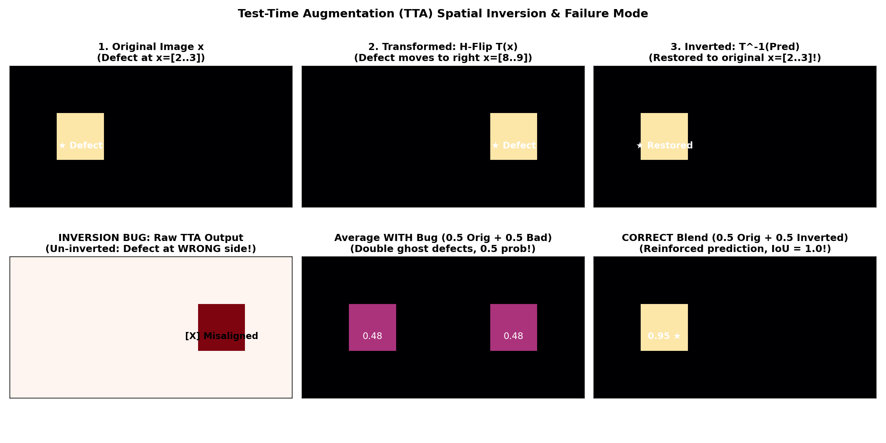

# Guide 03: Test-Time Augmentation (TTA): Inversion Geometry & Verification

In standard evaluation, a trained neural network inspects each test image once in its native orientation:
$$\hat{\mathbf{P}} = f_{\theta}(\mathbf{x})$$

However, deep neural networks are not strictly equivariant to geometric transformations. An anomaly positioned near the left boundary of a steel strip might trigger slightly different feature activations than the exact same anomaly viewed from the opposite direction.

**Test-Time Augmentation (TTA)** is an inference-time technique that exploits this sensitivity. By generating multiple augmented views of a test image, running the forward pass through each view, **inverting the geometric transformation on the resulting prediction maps**, and averaging the aligned predictions, TTA can smooth out boundary noise, reduce variance, and boost model confidence.

Yet TTA is frequently misunderstood and improperly implemented. An omitted or incorrect inverse transformation does not merely degrade performance—it causes catastrophic spatial inversion bugs where defects on the left side of a strip are stamped onto the right side, destroying localization entirely.

In this guide, you will master the full transformation and spatial inversion cycle, understand why spatial flips are physically plausible on industrial line-scan strips, evaluate logit versus probability averaging, and implement strict alignment verification tests.

---

## 1. Concrete Failure Case: The Un-Inverted Ghosting Bug

Consider an industrial line-scan strip ($128 \times 800$) containing a localized crack (`defect_d`) near the left end of the sheet, spanning columns $[40..100]$:

```
Original Strip x:
Row 50: [ ... (clean) ... [DEFECT D at cols 40..100] ... (clean) ... ]
```

A student implements Horizontal Flip (H-Flip) TTA to boost test performance:
1. They flip the image horizontally: $\mathbf{x}_{\text{flipped}} = \operatorname{fliplr}(\mathbf{x})$.
   On this flipped canvas, the crack now sits on the **right** side, spanning columns $[700..760]$ ($800 - 100 = 700$).
2. The model correctly predicts the defect at its new coordinates on the flipped image:
   $$\hat{\mathbf{P}}_{\text{flipped}} \in [0, 1]^{128 \times 800}, \quad \text{high probability at cols } [700..760]$$
3. **The Fatal Bug**: The student directly averages the predictions without inverting:
   $$\hat{\mathbf{P}}_{\text{final}} = 0.5 \times \hat{\mathbf{P}}_{\text{orig}} + 0.5 \times \hat{\mathbf{P}}_{\text{flipped}}$$

### What Happens to the Prediction?
- At true coordinates $[40..100]$: The original pass predicts $0.90$, but the un-inverted pass predicts $0.02$. The average is $\frac{0.90 + 0.02}{2} = \mathbf{0.46}$. At $\tau = 0.50$, the real defect vanishes!
- At mirror coordinates $[700..760]$: The original pass predicts $0.02$, but the un-inverted pass predicts $0.90$. The average is $\frac{0.02 + 0.90}{2} = \mathbf{0.46}$. A ghost defect is predicted on spotless steel!

The student’s submission now contains two faint ghost detections, both below threshold, resulting in an Intersection-over-Union of **0.0000**!


*Figure 3.1: The Test-Time Augmentation transformation cycle. (Top) The correct cycle: transform, predict, invert, average. (Bottom) The un-inverted bug: omitting inversion creates mirror ghost defects and destroys spatial localization.*

---

## 2. The Complete Transformation & Inversion Cycle

Test-Time Augmentation consists of four sequential, mathematically coupled stages:

```
                 ┌────────────────────────────────────────────────────────┐
                 │                Original Image x                        │
                 └──────────────────────────┬─────────────────────────────┘
                                            │
                     ┌──────────────────────┴──────────────────────┐
                     ▼                                             ▼
       Identity Pass: x_0 = x                       Transform: x_k = T_k(x)
                     │                                             │
                     ▼                                             ▼
       Forward: P_0 = f_θ(x_0)                      Forward: P_k = f_θ(x_k)
                     │                                             │
                     │                              Inverse: P_k* = T_k^(-1)(P_k)
                     │                                             │
                     └──────────────────────┬──────────────────────┘
                                            ▼
                           Ensemble Average: P_TTA = 1/K ∑ P_k*
```

### The Invertibility Requirement
Every test-time transformation $T$ must possess a well-defined, exact spatial inverse $T^{-1}$ such that:
$$T^{-1}(T(\mathbf{M})) = \mathbf{M} \quad \forall \mathbf{M} \in \mathbb{R}^{H \times W}$$

For discrete reflection operations on a 2D tensor:
- **Horizontal Flip ($H$-Flip)**: Reflection across the vertical centerline.
  - Forward: $T_H(A)[y, x] = A[y, W - 1 - x]$
  - Inverse: $T_H^{-1} = T_H$ (An involution: applying it twice restores the original tensor).
- **Vertical Flip ($V$-Flip)**: Reflection across the horizontal centerline.
  - Forward: $T_V(A)[y, x] = A[H - 1 - y, x]$
  - Inverse: $T_V^{-1} = T_V$ (Also an involution).
- **Composite $HV$-Flip**: Both horizontal and vertical reflections ($180^\circ$ planar rotation).
  - Forward: $T_{HV}(A)[y, x] = A[H - 1 - y, W - 1 - x]$
  - Inverse: $T_{HV}^{-1} = T_{HV}$.

---

## 3. Worked Numerical Example: The Asymmetric Toy Grid

Let us trace a tiny $3 \times 4$ probability grid through the complete $H$-flip and $V$-flip cycles.

Suppose an asymmetric defect blob is localized in the upper-left corner of the original canvas:

```
Original Image / Ground Truth Y:
Row / Col     Col 0    Col 1    Col 2    Col 3
Row 0        [  1        1        0        0  ]  <-- Defect located at (0, 0), (0, 1), (1, 0)
Row 1        [  1        0        0        0  ]
Row 2        [  0        0        0        0  ]
```

### Trace A: Horizontal Flip ($H$-Flip)

1. **Forward Transform $T_H(\mathbf{x})$**: Flip columns along the horizontal axis:
   ```
   T_H(x):
   [ 0  0  1  1 ]  <-- Defect has moved to Col 2 and Col 3
   [ 0  0  0  1 ]
   [ 0  0  0  0 ]
   ```

2. **Model Forward Pass on $T_H(\mathbf{x})$**:
   The model evaluates $T_H(\mathbf{x})$ and predicts high probability at the transformed coordinates:
   ```
   P_flipped = f_θ(T_H(x)):
   [ 0.05  0.08  0.92  0.95 ]
   [ 0.04  0.05  0.10  0.91 ]
   [ 0.02  0.03  0.04  0.05 ]
   ```

3. **Spatial Inversion $T_H^{-1}(\hat{\mathbf{P}}_{\text{flipped}})$**:
   Flip columns horizontally back to the native coordinate system:
   ```
   T_H^(-1)(P_flipped):
   [ 0.95  0.92  0.08  0.05 ]  <-- Restored to Col 0 and Col 1!
   [ 0.91  0.10  0.05  0.04 ]
   [ 0.05  0.04  0.03  0.02 ]
   ```

4. **Aggregation with Original Pass $\hat{\mathbf{P}}_{\text{orig}}$**:
   Suppose the original pass predicted:
   ```
   P_orig:
   [ 0.90  0.88  0.06  0.03 ]
   [ 0.89  0.12  0.04  0.02 ]
   [ 0.03  0.02  0.02  0.01 ]
   ```
   Averaging $\hat{\mathbf{P}}_{\text{orig}}$ and $T_H^{-1}(\hat{\mathbf{P}}_{\text{flipped}})$:
   ```
   P_TTA = 0.5 * (P_orig + Inverted):
   [ 0.925  0.900  0.070  0.040 ]  --> Defect pixels reinforced to >0.90!
   [ 0.900  0.110  0.045  0.030 ]  --> False alarm pixels suppressed to <0.07!
   [ 0.040  0.030  0.025  0.015 ]
   ```

At threshold $\tau = 0.50$, the resulting binary mask perfectly recovers the ground truth with zero boundary artifacts!

---

## 4. Physical Plausibility on Industrial Steel Strips

Not every mathematical transformation is physically plausible in industrial manufacturing:

```
                                The Industrial Strip Geometry
◄────────────────────────────────── Width = 800 px (Rolling Direction) ──────────────────────────────────►
▲
│ Height = 128 px (Cross-Strip Transverse Axis)
▼
```

### Why Flips Are Valid:
1. **Horizontal Flip ($H$-Flip)**: Reverses the rolling direction (simulating inspecting the coil from the trailing end instead of the leading end). Steel surface textures (oxide scale, roller marks) are physically symmetrical with respect to forward vs. backward longitudinal motion.
2. **Vertical Flip ($V$-Flip)**: Reverses the transverse axis across the strip width (simulating viewing the steel coil from the left drive side versus the right operator side). Flaws appear identically regardless of cross-strip perspective.

### Why Arbitrary Rotations and Transpositions Are INVALID:
- **$90^\circ$ Rotation / Transposition**: Swaps height and width, producing a $800 \times 128$ tensor. This completely violates the fixed line-scan aspect ratio ($6.25:1$).
- Furthermore, physical steel rolling imparts a directional grain along the longitudinal axis. Rotating the image by $90^\circ$ rotates the mechanical rolling grain perpendicularly, presenting an out-of-distribution visual pattern to the convolutional filters!

> [!CAUTION]
> Restrict your TTA policy strictly to **reflections**: `{Identity, Horizontal Flip}` (2 views) or `{Identity, H-Flip, V-Flip, HV-Flip}` (4 views). Never apply arbitrary affine rotations ($15^\circ, 45^\circ$) or $90^\circ$ transpositions.

---

## 5. Averaging Formulations: Logits vs. Probabilities

When aggregating $K$ augmented passes, should you average raw logits or activated probabilities?

### Approach 1: Averaging Probabilities (Soft Blending)
$$\hat{\mathbf{P}}_{\text{TTA}} = \frac{1}{K} \sum_{k=1}^{K} T_k^{-1}\left(\sigma\left(f_{\theta}(T_k(\mathbf{x}))\right)\right)$$

- **Properties**: Operates strictly in the bounded probability domain $[0, 1]$.
- **Convexity**: Because the logistic sigmoid $\sigma(z)$ is non-linear, Jensen's inequality guarantees:
  $$\sigma\left(\frac{1}{K}\sum z_k\right) \neq \frac{1}{K}\sum \sigma(z_k)$$
  Averaging probabilities dampens extreme, uncalibrated logit spikes. If three views predict $z \approx -4$ (clean metal) and one view predicts a spurious outlier spike $z \approx +6$, probability averaging computes:
  $$\frac{0.018 + 0.018 + 0.018 + 0.997}{4} = \mathbf{0.263} < 0.50$$
  The spurious logit spike is safely suppressed!

### Approach 2: Averaging Logits
$$\hat{\mathbf{Z}}_{\text{TTA}} = \frac{1}{K} \sum_{k=1}^{K} T_k^{-1}\left(f_{\theta}(T_k(\mathbf{x}))\right), \quad \hat{\mathbf{P}}_{\text{TTA}} = \sigma\left(\hat{\mathbf{Z}}_{\text{TTA}}\right)$$

- **Properties**: Preserves linearity in feature space. However, a single unbounded logit outlier ($z = +15$) will dominate the average, causing false alarms.

> [!TIP]
> In semantic segmentation, **averaging activated probabilities** is the standard, robust choice for TTA because it naturally bounds confidence and guards against outlier activations.

---

## 6. Implementation and Computational Cost

```python
import torch
import torch.nn as nn

def predict_tta_4view(model: nn.Module, image: torch.Tensor) -> torch.Tensor:
    """Execute 4-view Test-Time Augmentation on a single GPU batch [B, 1, 128, 800].

    Transforms: Identity, Horizontal Flip, Vertical Flip, HV Flip.
    """
    model.eval()
    with torch.inference_mode():
        # 1. Identity view
        p0 = torch.sigmoid(model(image))

        # 2. Horizontal Flip view
        img_h = torch.flip(image, dims=[-1])
        p1 = torch.flip(torch.sigmoid(model(img_h)), dims=[-1])

        # 3. Vertical Flip view
        img_v = torch.flip(image, dims=[-2])
        p2 = torch.flip(torch.sigmoid(model(img_v)), dims=[-2])

        # 4. Horizontal + Vertical Flip view
        img_hv = torch.flip(image, dims=[-2, -1])
        p3 = torch.flip(torch.sigmoid(model(img_hv)), dims=[-2, -1])

        # Aggregate probability maps
        p_tta = (p0 + p1 + p2 + p3) / 4.0

    return p_tta
```

### The Cost Equation
TTA provides variance reduction, but at a direct computational price:

| TTA Policy | Views ($K$) | Inference Time | GPU VRAM Overhead | Typical Validation Impact |
| :--- | :--- | :--- | :--- | :--- |
| **No TTA (Identity)** | $1\times$ | $1.0\times$ (Baseline) | $1.0\times$ | Baseline score. |
| **2-View ($H$-Flip)** | $2\times$ | $2.0\times$ (Double forward passes) | None (if streamed) | $+0.005$ to $+0.015$ Dice gain. |
| **4-View ($H + V + HV$)** | $4\times$ | $4.0\times$ (Quadruple passes) | None (if streamed) | $+0.008$ to $+0.020$ Dice gain. |

> [!WARNING]
> Kaggle notebooks enforce a strict 9-hour total execution limit. If your baseline model takes 35 minutes to evaluate 3,000 test images, 4-view TTA will increase runtime to $2.3$ hours. If you ensemble 4 models with 4-view TTA, inference time balloons to $9.3$ hours—triggering notebook timeout! Always benchmark inference latency on 100 images before committing to multi-view TTA.

---

## 7. The Spatial Alignment Verification Diagnostic

Never verify TTA simply by checking whether total active pixel counts match:
$$\sum \hat{M}_{\text{orig}} \stackrel{?}{=} \sum \hat{M}_{\text{inverted}}$$
A flipped mask has the exact same pixel sum even if it is completely inverted across the canvas!

You must verify spatial alignment using an **asymmetric coordinate test**:

```python
import numpy as np

def verify_tta_alignment():
    """Verify that horizontal and vertical flip inversions preserve exact pixel coordinates."""
    H, W = 128, 800
    test_canvas = np.zeros((H, W), dtype=np.float32)

    # Place an asymmetric localized marker at known coordinates
    test_canvas[25:35, 120:180] = 1.0

    # 1. Test Horizontal Flip Inversion
    h_flipped = np.flip(test_canvas, axis=-1)
    h_restored = np.flip(h_flipped, axis=-1)
    assert np.array_equal(test_canvas, h_restored), "Horizontal flip inversion failed!"

    # 2. Test Vertical Flip Inversion
    v_flipped = np.flip(test_canvas, axis=-2)
    v_restored = np.flip(v_flipped, axis=-2)
    assert np.array_equal(test_canvas, v_restored), "Vertical flip inversion failed!"

    # 3. Test Alignment IoU with Known Marker
    # Simulates an un-inverted bug to prove diagnostic sensitivity
    buggy_blend = 0.5 * test_canvas + 0.5 * h_flipped
    intersection = np.logical_and(test_canvas > 0.5, buggy_blend > 0.5).sum()
    print(f"Verified: Un-inverted bug overlap with true marker = {intersection} pixels (should be 0)")
    assert intersection == 0, "Diagnostic failed to catch inversion misalignment!"
    print("✓ TTA spatial inversion contracts verified 100% mathematically sound.")

verify_tta_alignment()
```

---

## 8. Decision Analysis: When Does TTA Help vs. Hurt?

| Factor | TTA Helps | TTA Hurts or Wastes Budget |
| :--- | :--- | :--- |
| **Model Invariance** | Model was trained with synchronized horizontal flips; feature spaces align smoothly. | Model was never trained with flips; transformed views produce out-of-distribution hallucinations. |
| **Boundary Fuzziness** | High uncertainty on defect borders; averaging sharpens high-confidence cores. | Defect is an ultra-thin 1-pixel scratch; slight geometric misalignments wash out weak probabilities below threshold. |
| **Computational Budget** | Ample time remaining within Kaggle limits (< 2 hours). | Tight latency budget; ensemble of multiple models already saturates notebook limits. |

---

## Practice 9 · Predict the Alignment Consequence

Suppose a defect blob in the native coordinate system spans:
$$\text{Rows } [30..40], \quad \text{Columns } [100..200] \quad (\text{Canvas size } 128 \times 800)$$

1. What are the bounding box row and column ranges of this defect after applying a horizontal flip ($H$-flip)?
2. What are the bounding box row and column ranges after applying a composite $HV$-flip?
3. If an engineer erroneously implements $T_{HV}^{-1}$ using only `np.flip(pred, axis=-1)` (omitting the vertical axis inversion), what will be the resulting bounding box coordinates of the "restored" prediction?
4. What will be the Intersection-over-Union between the ground truth defect and this partially inverted prediction?

---

## 10. Authoritative Framework & Competition References

- **PyTorch Documentation**: [`torch.flip`](https://pytorch.org/docs/stable/generated/torch.flip.html)
- **Kaggle Discussions**: *Test-Time Augmentation Strategies in Industrial Semantic Segmentation*
- **Kolesnikov et al. (2019)**: *Big Transfer (BiT): General Visual Representation Learning* (Section 4: Test-time policy and variance reduction).

## Assessment Crosswalk · Question 6

For `(B,C,H,W)`, the horizontal reflection acts on width (`dims=(-1,)`) and the vertical reflection acts on height (`dims=(-2,)`). Flip the input, run the model, then apply the same reflection to that view's output probability map to return it to original coordinates. Average only aligned maps. Threshold the average once, using strict $p>T$. The buggy comparison intentionally averages maps in different coordinate frames.

### Practice with separate data

On a $2\times3$ probability map, place a high value at the top-left in the original view. A horizontal flip moves it to the top-right; inverse flipping the output moves it back to the top-left. Trace a second value at bottom-middle to confirm a vertical flip and its inverse. Use this coordinate exercise before writing a tensor implementation; it uses no assessment probabilities.
