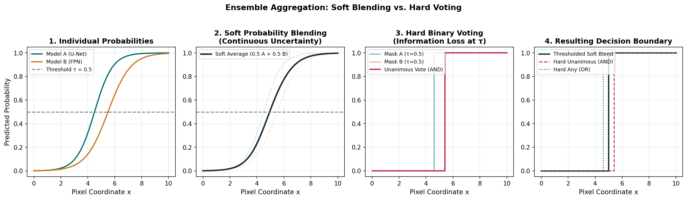

# Guide 04: Ensembling Models & Checkpoints: Probability Blending & Decision Fusion

In competitive machine learning, no single model architecture or training run captures the entire complexity of the underlying data distribution. One architecture (such as U-Net with a ResNet backbone) may excel at capturing fine, high-frequency spatial boundaries on thin scratches, while another (such as a Feature Pyramid Network with an EfficientNet backbone) may demonstrate superior semantic context on diffuse, irregular oxide inclusions.

**Ensembling** is the principled combination of multiple model hypotheses into a unified consensus prediction. When individual models commit errors that are partially uncorrelated, combining their outputs cancels out individual idiosyncrasies and produces a prediction that is more accurate and robust than any constituent model.

However, ensembling is not a magic wand. Combining models with mismatched preprocessing, unaligned class indices, or highly correlated errors adds significant inference latency and GPU memory overhead with zero performance gain.

In this guide, you will evaluate the three tiers of ensembling, contrast soft probability blending against hard binary mask voting, establish the strict technical prerequisites for combining predictions, analyze error diversity, and design a leakage-free validation protocol for ensemble weight selection.

---

## 1. Concrete Failure Case: The Incompatible Ensemble

Consider a student who trains two models:
- **Model A**: U-Net with ResNet34 backbone, trained on grayscale images normalized with per-image z-score standard normalization ($\mu = 0, \sigma = 1$).
- **Model B**: FPN with EfficientNet-B2 backbone, trained on images normalized with ImageNet 3-channel mean and standard deviation.

During inference, the student writes an ensemble loop:
```python
# FATAL FLAW: Mismatched preprocessing!
for batch_images in test_loader:
    # batch_images is normalized with per-image z-score
    prob_a = model_a(batch_images).sigmoid()
    prob_b = model_b(batch_images).sigmoid()  # Model B expects ImageNet stats!

    ensemble_prob = 0.5 * prob_a + 0.5 * prob_b
```

### What Went Wrong?
Because Model B receives inputs normalized with statistics completely different from its training distribution, its feature activations saturate. It emits uncalibrated, noisy probabilities hovering between $0.4$ and $0.6$ everywhere.

When averaged with Model A’s sharp predictions:
- Model A predicts a high-confidence defect ($p = 0.92$).
- Model B predicts uncalibrated noise ($p = 0.20$).
- The average is $\frac{0.92 + 0.20}{2} = \mathbf{0.56}$. A high-confidence detection is diluted to near-threshold ambiguity!
- On clean sheets, Model B’s noise ($p \approx 0.45$) inflates background probabilities, triggering false alarms.

Instead of outperforming the best individual checkpoint, the broken ensemble performs **worse than Model A alone**, while doubling execution time!

---

## 2. The Three Tiers of Ensembling

Before combining disparate neural networks, understand the three fundamental tiers of model aggregation:

```
┌────────────────────────────────────────────────────────────────────────────────────────┐
│                                 The Ensembling Spectrum                                │
├────────────────────────────┬────────────────────────────┬──────────────────────────────┤
│  Tier 1: Weight Averaging  │ Tier 2: Checkpoint Blend   │ Tier 3: Multi-Model Ensemble │
│  (EMA / SWA)               │ (Snapshots within 1 run)   │ (Diverse Backbones & Folds)  │
├────────────────────────────┼────────────────────────────┼──────────────────────────────┤
│ • Averages parameter       │ • Blends predictions of    │ • Blends predictions across  │
│   weights θ = α θ_1 + ...  │   best.pt and last.pt      │   distinct architectures     │
│ • Single forward pass!     │ • 2 forward passes         │ • N forward passes           │
│ • Zero inference latency   │ • Moderate diversity       │ • High diversity             │
└────────────────────────────┴────────────────────────────┴──────────────────────────────┘
```

### Tier 1: Parameter Weight Averaging (EMA / SWA)
- **Mechanism**: A running exponential moving average (EMA) or Stochastic Weight Averaging (SWA) of model parameters is maintained during training:
  $$\boldsymbol{\theta}_{\text{EMA}} \leftarrow \beta \boldsymbol{\theta}_{\text{EMA}} + (1 - \beta) \boldsymbol{\theta}_{\text{current}}, \quad \beta \approx 0.999$$
- **Inference Cost**: Exactly $1.0\times$ (identical to a single model).
- **Benefit**: Smooths loss landscape geometry, preventing convergence into sharp, brittle local minima.

### Tier 2: Multi-Checkpoint Blending (Within One Training Run)
- **Mechanism**: Averaging predictions from the epoch with the best validation score (`best.pt`) and the final epoch (`last.pt`), or across multiple cyclical learning rate snapshots.
- **Inference Cost**: $K\times$ forward passes.
- **Limitation**: Weights share identical initialization and training trajectories; error diversity is relatively low.

### Tier 3: Multi-Architecture / Multi-Fold Ensembles (Across Runs)
- **Mechanism**: Combining independently trained models with different encoder backbones (e.g. EfficientNet + ResNet + ConvNeXt) or cross-validation folds (e.g. Fold 0 + Fold 1).
- **Inference Cost**: $M\times$ forward passes and $M\times$ model weight storage.
- **Benefit**: Maximum error decorrelation. Backbones with different receptive fields and attention mechanisms make distinct errors, maximizing ensemble gain.

---

## 3. Probability Blending (Soft) vs. Mask Voting (Hard)

Once multiple models are evaluated on a test strip, how should their outputs be combined?


*Figure 4.1: Soft probability blending vs hard binary mask voting. (1) Individual model probabilities. (2) Soft probability blend preserves continuous uncertainty. (3) Hard voting discretizes prematurely at $\tau=0.5$. (4) The resulting decision boundaries: notice how soft blending smooths borderline ambiguity.*

### Method A: Soft Probability Blending (Recommended)
Compute a convex combination of continuous predicted probability maps before applying any decision threshold:

$$\hat{\mathbf{P}}_{\text{ensemble}} = \sum_{m=1}^{M} w_m \hat{\mathbf{P}}_m, \quad \sum_{m=1}^{M} w_m = 1.0, \quad w_m \ge 0$$

Then apply the decision threshold and minimum area filter to the blended probability map:
$$\hat{\mathbf{M}}_{\text{ensemble}} = \operatorname{FilterArea}\left(\mathbb{I}\left(\hat{\mathbf{P}}_{\text{ensemble}} > \boldsymbol{\tau}\right), \mathbf{A}_{\min}\right)$$

### Method B: Hard Binary Mask Voting
Binarize each model's prediction independently using threshold $\tau$, then vote across binary masks:

$$\hat{\mathbf{M}}_m = \mathbb{I}(\hat{\mathbf{P}}_m > \tau), \quad \hat{\mathbf{M}}_{\text{vote}} = \mathbb{I}\left(\sum_{m=1}^{M} \hat{\mathbf{M}}_m \ge K_{\text{vote}}\right)$$

Where $K_{\text{vote}}$ is a voting rule (e.g. Unanimous $K=M$, Majority $K = \lceil M/2 \rceil$, or Any $K=1$).

### The Worked Numerical Example: Borderline Disagreement

Examine five pixels along a defect boundary evaluated by two models:

```
Pixel Description          P(Model 1)    P(Model 2)    Soft Blend (0.5+0.5)    Hard Mask 1 (τ=0.5)    Hard Mask 2 (τ=0.5)    Hard AND    Hard OR
Pixel 1 (Clear BG)         0.05          0.08          0.06                    0                      0                      0           0
Pixel 2 (Low Border)       0.35          0.42          0.38                    0                      0                      0           0
Pixel 3 (Disagreement)     0.46          0.62          0.54                    0                      1                      0           1
Pixel 4 (High Border)      0.68          0.74          0.71                    1                      1                      1           1
Pixel 5 (Clear Defect)     0.94          0.96          0.95                    1                      1                      1           1
```

#### Why Soft Blending Outperforms Hard Voting:
- Look at **Pixel 3**: Model 1 is slightly unconvinced ($0.46 < 0.50$), but Model 2 is confident ($0.62 \ge 0.50$).
  - In **Hard AND voting**: The detection is discarded ($0 \land 1 = 0$), causing false negatives on boundary pixels.
  - In **Hard OR voting**: Any spurious noise speckle from either model is accepted ($0 \lor 1 = 1$), causing false alarms on clean sheets.
  - In **Soft Blending**: The average is $0.54$. Because Model 2’s confidence ($+0.12$ above threshold) outweighs Model 1’s hesitation ($-0.04$ below threshold), the blended probability correctly crosses $\tau = 0.50$.
- **Crucial Advantage**: Soft blending keeps the probability continuous, allowing you to optimize post-processing thresholds $\boldsymbol{\tau}$ and minimum area filters $\mathbf{A}_{\min}$ **on the aggregated ensemble output**.

---

## 4. The 5 Prerequisites for Valid Ensembling

Before writing an ensemble script, verify that your models satisfy every contract on this checklist:

| Prerequisite | Specification | Failure Consequence if Violated |
| :--- | :--- | :--- |
| **1. Identical Coordinate Space** | All models output predictions on native $128 \times 800$ canvas coordinates. | Predictions are spatially shifted or distorted. |
| **2. Identical Class Index Order** | Channel 0 is `defect_a`, Channel 1 is `defect_b`, Channel 2 is `defect_c`, Channel 3 is `defect_d`. | Catastrophic cross-contamination: scratch probabilities blended with oxide scale. |
| **3. Compatible Output Semantics** | Both models emit probability maps in $[0.0, 1.0]$ (not raw un-activated logits). | Model with larger logit magnitude completely hijacks the ensemble. |
| **4. Consistent Input Preprocessing** | Each model receives images preprocessed with its own exact training pipeline (e.g. CLAHE, z-score, or ImageNet normalization). | Severe distribution shift, feature saturation, noisy predictions. |
| **5. Calibrated Score Scales** | Both models have comparable confidence calibration. | One overconfident model overrides a better-calibrated model. |

---

## 5. Error Correlation and the Diversity Dividend

Ensembling succeeds because of **error diversity**.

Let the prediction error of model $m$ at a given pixel be $\epsilon_m = \hat{P}_m - P^*$, with variance $\sigma^2 = \mathbb{E}[\epsilon_m^2]$ and pairwise correlation coefficient $\rho = \operatorname{Corr}(\epsilon_i, \epsilon_j)$.

The expected error variance of a simple average ensemble of $M$ models is:

$$\sigma_{\text{ensemble}}^2 = \rho \sigma^2 + \frac{1 - \rho}{M} \sigma^2$$

### The Two Limiting Cases:
1. **Perfect Correlation ($\rho = 1.0$)**:
   $$\sigma_{\text{ensemble}}^2 = 1.0 \times \sigma^2 + 0 = \sigma^2$$
   If two models always make identical mistakes (e.g. two checkpoints from the same epoch with different random seeds), **there is zero variance reduction**. You double inference time for zero score gain.
2. **Completely Uncorrelated Errors ($\rho = 0.0$)**:
   $$\sigma_{\text{ensemble}}^2 = \frac{\sigma^2}{M}$$
   Error variance decreases linearly with the number of models $M$.

> [!NOTE]
> To maximize diversity, combine models with different inductive biases:
> - Architecture Diversity: U-Net (local spatial detail) + FPN or DeepLabV3+ (multi-scale receptive field).
> - Backbone Diversity: Convolutional (ResNet, EfficientNet) + Attention / Modern Conv (ConvNeXt).
> - Input Representation: Grayscale native + CLAHE contrast-enhanced.

---

## 6. How to Select Ensemble Weights Without Data Leakage

Ensemble weights $\mathbf{w} = [w_1, w_2, \dots, w_M]$ must be selected through a sound local validation protocol:

```python
import numpy as np

def evaluate_weighted_ensemble(
    val_probs_m1: np.ndarray,
    val_probs_m2: np.ndarray,
    val_gts: np.ndarray,
    weight_m1_candidates: list[float]
) -> tuple[float, float]:
    """Find optimal blending weights across held-out validation predictions."""
    best_weight = 0.50
    best_score = -1.0

    for w1 in weight_m1_candidates:
        w2 = 1.0 - w1
        blended_probs = w1 * val_probs_m1 + w2 * val_probs_m2

        # Evaluate competition metric on blended predictions at baseline tau=0.5
        # (Replace with your competition evaluation metric function)
        score = evaluate_competition_metric(blended_probs, val_gts, tau=0.50)

        if score > best_score:
            best_score = score
            best_weight = w1

    return best_weight, best_score
```

### The Golden Rules of Ensemble Validation:
1. **Never Evaluate a Model on Its Own Training Fold**: If Model 1 was trained on Fold 0, you cannot evaluate its ensemble weight on Fold 0 validation data. It will display artificially high confidence, biassing the weight selection.
2. **Use Out-of-Fold (OOF) Blends**: Evaluate ensemble weights across complete Out-of-Fold predictions where every sample was held out during the training of the respective models.
3. **Prefer Simple Equal Weighting ($1/M$) as Baseline**: A simple unweighted average ($\mathbf{w} = [1/M, \dots, 1/M]$) is surprisingly difficult to beat and strongly guards against overfitting validation variance. Only use non-equal weights if validation evidence demonstrates a substantial, consistent difference in model quality.
4. **Never Tune Weights on the Public Leaderboard**: Submitting five weight variants to Kaggle to pick the best score fits the private test set's random sampling noise, resulting in leaderboard shakeup.

---

## 7. Decision Matrix: Trade-Off Analysis

| Ensemble Strategy | Expected Metric Gain | Latency Multiplier | Storage Overhead | Implementation Complexity |
| :--- | :--- | :--- | :--- | :--- |
| **Single Best Checkpoint** | Baseline ($0.0$) | $1.0\times$ (Fastest) | $1\times$ checkpoint ($~100\text{ MB}$) | Low (Standard pipeline) |
| **2-Model Blend (Diverse Backbones)** | $+0.015$ to $+0.030$ | $2.0\times$ | $2\times$ checkpoints ($~200\text{ MB}$) | Moderate (Multi-model forward) |
| **5-Fold Cross-Validation Ensemble** | $+0.020$ to $+0.035$ | $5.0\times$ | $5\times$ checkpoints ($~500\text{ MB}$) | High (Fold artifact management) |
| **Complex 10-Model Stacking** | $+0.025$ to $+0.040$ | $10.0\times$ (High OOM risk!) | $>1\text{ GB}$ | Extreme (Exceeds Kaggle budgets) |

---

## 8. Diagnostic Checklist: Verifying Your Ensemble

1. **Standalone Benchmark Sanity**: Did each individual model achieve a solid validation score on its own? Never add a weak, failing model to an ensemble in the hope that it will "add diversity"—it will only corrupt confident predictions.
2. **Prediction Correlation Matrix**: Compute the Pearson correlation coefficient between the probability maps of Model 1 and Model 2 on validation strips:
   $$r = \operatorname{Corr}(\hat{\mathbf{P}}_1, \hat{\mathbf{P}}_2)$$
   If $r > 0.98$, the models are nearly identical; consider keeping only the faster one. If $0.80 < r < 0.92$, healthy diversity exists.
3. **Inference Latency Benchmark**: Time the ensemble forward pass on 50 images in a Kaggle notebook environment. Extrapolate to 3,000 images:
   $$\text{Total Time} = 3000 \times \frac{\text{Time}_{50}}{50} < 7.0\text{ hours}$$
   Ensure you maintain at least a 2-hour buffer below Kaggle’s 9-hour limit.

---

## Practice 9 · Predict the Ensemble Behavior

Review the following fictional scenario:
- Model A (U-Net) detects an inclusion cluster with predicted probability $p_A = 0.70$.
- Model B (FPN) misses the inclusion cluster completely with predicted probability $p_B = 0.10$.

**Questions:**
1. Under an equal-weighted soft blend ($w_A = 0.5, w_B = 0.5$), what is the blended probability $p_{\text{blend}}$?
2. At a decision threshold $\tau = 0.50$, does the ensemble detect or miss the defect?
3. What happens if the student configures unequal weights $w_A = 0.7, w_B = 0.3$?
4. In what situation would Model B's low probability ($0.10$) represent a beneficial correction of a false alarm, and in what situation would it represent a harmful dilution of a genuine defect?

---

## 10. Authoritative Documentation & References

- **Dietterich (2000)**: *Ensemble Methods in Machine Learning*, Multiple Classifier Systems (statistical, computational, and representational reasons for ensembling).
- **Kaggle Grandmaster Playbook**: *Model Ensembling & Blending Strategies in Competitive Computer Vision*.
- **Scikit-Learn Documentation**: [Ensemble Methods: Voting Classifier & Blending](https://scikit-learn.org/stable/modules/ensemble.html)

## Assessment Crosswalk · Question 7

- **Soft ensemble:** average each pixel's model probabilities (or use the explicitly supplied nonnegative weights), then make one strict $p>T$ decision and compute Dice against the given truth.
- **Hard vote:** threshold each model separately with strict $p>T$, count positive votes, and apply the stated majority-of-three rule. It is not the same as thresholding the mean.
- **Snapshot averaging:** for logits $z_m$, probability averaging is $\frac1M\sum_m\sigma(z_m)$; logit averaging is $\sigma(\frac1M\sum_m z_m)$. Since sigmoid is nonlinear, these can differ. Apply the final threshold to the resulting probability.

### Practice with separate data

Two models give probabilities 0.20 and 0.80 at a pixel, with threshold 0.50. Compare the soft mean to a unanimous hard vote. For a different logit-space example, average logits +2 and −1 before sigmoid, then compare with averaging their sigmoid probabilities. Write the two formulas first; do not treat the operations as interchangeable.
