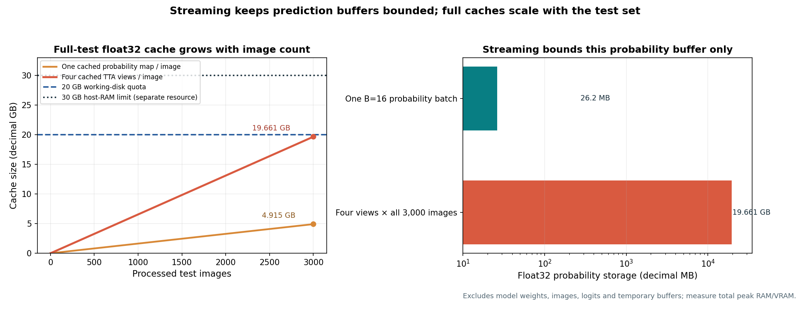

# Guide 05: Scalable Inference Architecture: Streaming, Memory & Kaggle Constraints

Building a competitive segmentation model on a local workstation or development machine is only half the engineering challenge. To submit predictions to Kaggle, your entire inference pipeline must execute autonomously within a **restricted, time-bounded, and memory-constrained Kaggle notebook container**.

Notebook hardware and execution quotas vary by competition and session. Use the limits supplied for the target environment; the 16 GB and 30-minute figures in the assessment are hypothetical inputs to its calculation, not universal Kaggle guarantees.

In this guide, you will learn how to design an inference pipeline as a **bounded streaming sequence**, prevent fatal memory leaks, use PyTorch’s optimal inference primitives, profile batch throughput, and build resilient inference loops that reliably finish within the target session’s stated resource envelope.

---

## 1. Concrete Failure Case: The Monolithic Cache OOM

Consider a student who implements inference by storing all intermediate predictions in a global NumPy array:

```python
# FATAL FLAW: Monolithic full-test memory allocation!
all_probs = np.zeros((3000, 4, 128, 800), dtype=np.float32)

for i, image_id in enumerate(test_image_ids):
    image = load_image(image_id)
    # Forward pass + TTA + Ensemble
    probs = run_ensemble(image)  # Shape: (4, 128, 800), float32
    all_probs[i] = probs         # Store in monolithic array
```

Let us calculate the memory footprint of this single array:
$$\text{Memory} = 3000 \times 4 \times 128 \times 800 \times 4\text{ bytes} = 4{,}915{,}200{,}000\text{ bytes} = 4.9152\text{ GB} \approx 4.58\text{ GiB}$$

Now suppose the student implements a 4-fold ensemble or caches predictions for multiple TTA views:
$$4\text{ full prediction sets} = 19.6608\text{ GB} \approx 18.31\text{ GiB}$$

This large cache leaves little space on a nominal 20 GB working disk for other artifacts. Whether it exceeds a particular RAM or disk cap depends on the environment and other allocations; measure the complete run rather than assuming a crash threshold.


```text
The kernel appeared to die unexpectedly. It has been restarted. (Error Code: 137 - OOM)
```

A cache near 19.7 decimal GB does not by itself prove a 20 GB decimal quota is exceeded, but leaves little headroom for weights, temporary files, or output.


*Figure 5.1: Illustrative memory profiles. Streaming bounds prediction memory with respect to test-set size; the active batch, models, decoder, and output buffers still consume memory.*

---

## 2. The Streaming Architecture: $O(1)$ Bounded Memory

The solution to memory exhaustion is the **streaming inference architecture**.

Instead of retaining probability maps across all 3,000 test images, you process the test set in small, bounded minibatches ($B = 16$). As each batch completes inference, its probability maps are immediately thresholded, area-filtered, encoded into Run-Length Encoded (RLE) strings, appended directly to the output CSV file, and purged from memory:

```
┌────────────────────────────────────────────────────────────────────────────────────────┐
│                        The Bounded Streaming Pipeline (per Batch)                      │
├────────────────────────────────────────────────────────────────────────────────────────┤
│ 1. Load Batch Images        ──► PyTorch Tensor: [B, 1, 128, 800]                       │
│ 2. Forward Pass (No Grad)   ──► Model Logits:   [B, 4, 128, 800] (GPU VRAM)            │
│ 3. TTA & Ensemble Fusion    ──► Float32 Probs:  [B, 4, 128, 800]                       │
│ 4. Threshold & Area Filter  ──► Binary Masks:   [B, 4, 128, 800] (uint8)               │
│ 5. Encode Fortran RLE       ──► Text Strings:   "start length ..." or " "              │
│ 6. Write Rows to Disk       ──► CSV File Stream: 4 × B rows appended                   │
│ 7. Purge Batch Buffers      ──► Python GC / torch.cuda.empty_cache()                   │
└────────────────────────────────────────────────────────────────────────────────────────┘
```

Under this architecture:
- Active prediction memory is bounded with respect to test-set size: it scales with batch size $B$, output channels, canvas dimensions, model count, and live accumulators.
- Disk usage is strictly limited to the final `submission.csv` file ($~3 - 5\text{ MB}$).

---

## 3. Essential PyTorch Inference Primitives

To minimize GPU VRAM consumption and maximize inference throughput, configure PyTorch with these four essential primitives:

### 1. `torch.inference_mode()` (Preferred over `torch.no_grad()`)
`torch.inference_mode()` is a faster, lower-overhead context manager introduced in PyTorch 1.9. It disables view tracking and version counters in addition to disabling gradient graphs:

```python
# PREFERRED
with torch.inference_mode():
    outputs = model(images)
```

### 2. Explicit `model.eval()`
Always set your model to evaluation mode before generating predictions:
```python
model.eval()
```
Evaluation mode switches `BatchNorm2d` layers to use their frozen running mean and variance rather than batch statistics, and disables `Dropout` layers. Omitting `model.eval()` causes predictions to fluctuate randomly depending on batch size!

### 3. Mixed Precision (`torch.autocast`)
Run inference with automatic mixed precision (AMP) using `torch.bfloat16` or `torch.float16`:
```python
with torch.inference_mode():
    with torch.autocast(device_type="cuda", dtype=torch.float16):
        logits = model(images)
```
AMP halves the GPU memory occupied by activation tensors and doubles Tensor Core throughput on modern NVIDIA GPUs.

### 4. Pinned Memory & Non-Blocking Transfers
When loading batches from disk, configure your `DataLoader` with `pin_memory=True` and perform asynchronous host-to-device transfers:
```python
images = images.to(device, non_blocking=True)
```

---

## 4. Batch Size Throughput vs. VRAM Allocation

Choosing an inference batch size requires measuring throughput and peak memory on the target hardware. A larger batch may improve utilization but also increases live activations and output buffers. Do not treat synthetic throughput tables or another notebook’s batch size as a portable benchmark; run a representative profile and leave headroom for TTA and post-processing.
---

## 5. Implementation: The Memory-Bounded Streaming Engine

Here is a clean implementation pattern for a streaming test inference loop:

```python
import csv
import torch
import numpy as np
from torch.utils.data import DataLoader
from tqdm.auto import tqdm

def stream_test_inference(
    model: torch.nn.Module,
    test_loader: DataLoader,
    output_csv_path: str,
    thresholds: dict[str, float],
    min_areas: dict[str, int],
    device: torch.device
) -> None:
    """Stream model predictions directly to a submission CSV in bounded memory."""
    model.eval()
    defect_classes = ["defect_a", "defect_b", "defect_c", "defect_d"]

    with open(output_csv_path, mode="w", newline="", encoding="utf-8") as f:
        writer = csv.writer(f)
        writer.writerow(["ID", "image_id", "defect_type", "mask_rle"])

        row_id = 1

        for batch in tqdm(test_loader, desc="Streaming Test Inference"):
            image_ids = batch["image_id"]
            images = batch["image"].to(device, non_blocking=True)  # [B, 1, 128, 800]

            with torch.inference_mode():
                # Forward pass in half precision
                with torch.autocast(device_type=device.type, dtype=torch.float16):
                    logits = model(images)
                probs = torch.sigmoid(logits).cpu().numpy()  # [B, 4, 128, 800]

            # Process and write each image in the batch
            for b_idx, img_id in enumerate(image_ids):
                for c_idx, defect_name in enumerate(defect_classes):
                    prob_ch = probs[b_idx, c_idx]
                    tau = thresholds[defect_name]
                    min_area = min_areas[defect_name]

                    # Post-processing: Threshold + 8-Connected Component Filter
                    binary_mask = (prob_ch > tau).astype(np.uint8)
                    clean_mask = filter_small_components(binary_mask, min_area)

                    # RLE encode with single-space sentinel
                    rle_str = rle_encode(clean_mask)

                    # Stream row directly to disk
                    writer.writerow([row_id, img_id, defect_name, rle_str])
                    row_id += 1

            # Explicitly free batch references
            del images, logits, probs
            if device.type == "cuda":
                torch.cuda.empty_cache()

    print(f"✓ Inference complete: wrote {row_id - 1} rows to {output_csv_path}")
```

---

## 6. Defensive Execution & Resiliency

To prevent unexpected session terminations from ruining a multi-hour run, implement defensive execution patterns:

### 1. Pre-Flight Execution Smoke Test
Before running inference across all 3,000 test images, execute your complete pipeline on a dummy batch of 4 synthetic strips. Verify that:
- Checkpoints load cleanly without missing keys.
- Forward pass, TTA, and ensembling complete without shape errors.
- RLE strings are encoded without index overflows.
- A dummy CSV file is created and passes schema validation.

### 2. Time Budgeting and Monitoring
Track your execution velocity. If evaluating 100 images takes $60\text{ seconds}$, evaluating 3,000 images will require:
$$\text{Estimated Time} = \frac{3000}{100} \times 60\text{ s} = 1,800\text{ s} = 30\text{ minutes}$$
Log your elapsed time and ETA using `tqdm.auto`. If your estimated total runtime exceeds 7 hours, disable multi-view TTA or reduce ensemble complexity immediately.

### 3. Atomic File Writing
Never write your final submission directly to `/kaggle/working/submission.csv`. If the notebook encounters a transient error or is interrupted mid-execution, an incomplete, corrupted CSV will be left behind.
- Write to a temporary file first: `/kaggle/working/submission_temp.csv`.
- Run an automated validation script on the temporary file.
- Only upon complete validation, rename it atomically:
  ```python
  import os
  os.replace("/kaggle/working/submission_temp.csv", "/kaggle/working/submission.csv")
  ```

---

## 7. Decision Analysis: Architecture Comparison

| Architectural Pattern | Host RAM Footprint | Disk Footprint | Peak VRAM | Recovery Capability | Recommended Use |
| :--- | :--- | :--- | :--- | :--- | :--- |
| **Monolithic Global Array** | $5 - 20\text{ GB}$ (OOM risk) | Minimal ($0\text{ GB}$) | High | None (Crash loses all work) | **Never use** for test inference |
| **Disk-Mapped Arrays (`np.memmap`)** | Low ($~500\text{ MB}$) | High ($10 - 20\text{ GB}$ disk) | Moderate | High (Can resume from disk) | Good for offline validation sweeps |
| **Streaming Direct-to-RLE (Recommended)** | Constant ($<100\text{ MB}$) | Zero ($<5\text{ MB}$ CSV) | Low ($~4.5\text{ GB}$) | Atomic replacement | **Optimal for Kaggle test inference** |

---

## 8. Diagnostic Checklist: Memory & Runtime Health

Verify these five indicators in your inference notebook:

1. **Host RAM Stability**: Check memory usage before and after 500 images:
   ```python
   import psutil
   print(f"RAM Used: {psutil.Process().memory_info().rss / 1024**2:.1f} MB")
   ```
   If RAM increases continuously as batches advance, you have an uncollected object reference or memory leak.
2. **GPU VRAM Reservation**: Check peak VRAM:
   ```python
   print(f"Peak VRAM: {torch.cuda.max_memory_allocated() / 1024**2:.1f} MB")
   ```
   Ensure peak allocation does not exceed $12\text{ GB}$ on a 16 GB GPU.
3. **Working Directory Cleanliness**: Inspect files in `/kaggle/working`:
   ```bash
   ls -lh /kaggle/working
   ```
   Verify that no stale `.npy`, `.pt`, or temporary files are clogging disk space.

---

## Practice 9 · Calculate the Memory Budget

Suppose a student wants to deploy a 3-model ensemble with 4-view TTA across 3,000 test images ($128 \times 800$, 4 defect channels).

1. How many total neural network forward passes will be executed?
2. If the student allocates a float32 probability array for every forward pass simultaneously, how many gigabytes of memory would be required?
3. If the student adopts the streaming architecture with batch size $B = 16$, what is the maximum amount of probability tensor memory in active RAM at any single moment?

---

## 10. Authoritative Framework References

- **PyTorch Documentation**: [Inference Mode (`torch.inference_mode`)](https://pytorch.org/docs/stable/generated/torch.inference_mode.html)
- **PyTorch Documentation**: [Automatic Mixed Precision (`torch.autocast`)](https://pytorch.org/docs/stable/amp.html)
- **Python Standard Library**: [`csv` module documentation](https://docs.python.org/3/library/csv.html)
- **Kaggle Documentation**: [Code Competition Container Limits and Submission Guidelines](https://www.kaggle.com/docs/competitions#notebooks-and-compute-resources)

## Assessment Crosswalk · Question 8

For a probability-map set, the element count is $N_{images}\times4\times128\times800$; multiply by bytes per element (4 for float32, 2 for float16, 1 for uint8), then divide by $10^9$ for decimal GB. If storing every model/view output, multiply by model count and view count. A running accumulator retains only the map(s) for the active batch, not every image's maps.

Count forward passes as $N_{images}\times N_{models}\times N_{views}$. Multiply by the per-image forward time, then convert seconds to minutes. For the model-count limit, subtract non-model time from the wall-clock budget, divide remaining seconds by per-model time at the chosen view count, then take the greatest whole number that fits. State assumptions (serial passes, no overlap, same latency per view); this is a lower-bound estimate because loading and post-processing may overlap or vary.

### Practice with separate data

For 100 images, 2 classes, a $10\times20$ output canvas and float32, count elements and multiply by 4 bytes. Compare storing three complete prediction sets with one batch accumulator for 5 images. This practices units and scaling without using the assessment's test-set dimensions or budgets.
