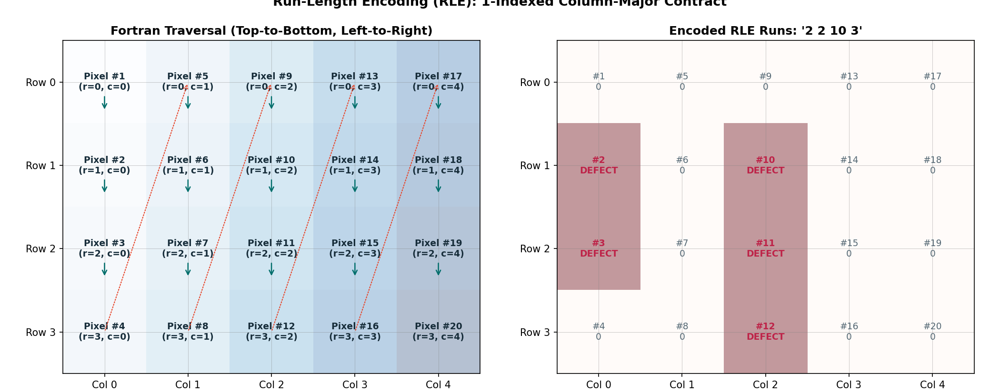

# Guide 06: Submission Integrity & The Competition Contract: Schema, RLE & Sentinels

After weeks of deep learning architecture design, loss function tuning, threshold optimization, and ensembling, everything culminates in a single file:
`/kaggle/working/submission.csv`

Kaggle’s automated scoring system is completely unyielding. It does not inspect your PyTorch training code, verify your training loss curves, or give partial credit for elegant neural architectures. It executes an automated, programmatic ingest pipeline that parses your submitted CSV file against strict schema rules.

If your submission file contains 12,000 rows instead of 12,001, if column headers are swapped, if empty predictions are saved as empty strings `""` (which parse as null values), or if a run-length string overflows beyond pixel 102,400, the evaluation engine immediately crashes with:

```text
Submission Scoring Error
Your submission could not be scored because the submission file format was invalid.
```

In this guide, you will dissect the precise submission contract of the **Industrial Surface Defect Detection** competition, master the 1-indexed column-major Fortran RLE standard, understand the single-space empty-mask sentinel (`" "`), and implement a programmatic pre-flight verification validator to guarantee 100% Kaggle compliance.

---

## 1. Concrete Failure Case: The Null String Rejection

Consider a team of students who build a high-performing ensemble achieving a 0.68 validation score.

At the end of their inference notebook, they serialize their predictions using standard Pandas:
```python
# FATAL FLAW: Naive Pandas serialization of empty masks!
submission_df["mask_rle"] = submission_df["mask_rle"].fillna("")
submission_df.to_csv("submission.csv", index=False)
```

In the resulting CSV file:
```csv
ID,image_id,defect_type,mask_rle
1,TEST_0001,defect_a,
2,TEST_0001,defect_b,
3,TEST_0001,defect_c,2450 12 2580 8
4,TEST_0001,defect_d,
```

Notice rows 1, 2, and 4: because there was no predicted defect, the field after the comma is empty (`...defect_a,`).

### What Happens on Kaggle?
When Kaggle’s automated evaluator reads this CSV, empty CSV fields (`,,`) parse as `NaN` / `null` values. The evaluator rejects the submission:

> **Evaluation Rejection**: *Empty/NaN value detected in column 'mask_rle' on row 1. Submission rejected.*

Because clean, defect-free material represents a large proportion of industrial production, thousands of rows in `submission.csv` represent empty masks. If you do not format these empty rows with the exact required sentinel, your submission fails instantly.

---

## 2. The 7 Rules of the Competition Contract

The competition template is established in `data/public/sample_submission.csv`. Your submission must strictly adhere to seven rules:

### Rule 1: Exactly 12,001 Lines
- 1 header row + 12,000 prediction rows.
- The test set contains exactly **3,000 images**. Each image must have exactly **4 rows** (one per defect class).
  $$3000\text{ test images} \times 4\text{ defect classes} = 12000\text{ prediction rows}$$
- No missing rows, no duplicate rows, and no extra lines.

### Rule 2: Strict Column Header Schema
The header row must match the template character-for-character:
```text
ID,image_id,defect_type,mask_rle
```

### Rule 3: Preserve Template Row Identity and Order
Use `sample_submission.csv` as the row-level contract. Preserve each template `ID`, `image_id`, and `defect_type` row in its original order; validate each output row against that template. This is safer than rebuilding IDs from filesystem order or assuming that a shuffled loader yields canonical rows.

### Rule 4: Valid Defect Names
Every row's `defect_type` must be one of `defect_a`, `defect_b`, `defect_c`, or `defect_d`, in the order specified by the sample template.

### Rule 5: The Mandatory Single-Space Sentinel (`" "`)
If an image-class pair contains no predicted defect (an all-zero binary mask), the `mask_rle` column **must contain exactly one ASCII space**: `" "` (ASCII code 32).
- Blank string `""`: ❌ Rejected as null.
- `NaN` / `None`: ❌ Rejected as null.
- Zero `"0"`: ❌ Rejected as corrupt RLE.
- Single space `" "`: ✅ Parsed by Kaggle as a non-null valid empty mask!

### Rule 6: 1-Indexed Column-Major Fortran RLE
Run-Length Encoding must follow the Kaggle / Severstal standard:
- Pixel coordinates are **1-indexed** (first pixel in upper-left corner is index 1, not 0).
- Traversal is **column-major** (`order='F'`): pixels are traversed top-to-bottom along column 0, then top-to-bottom along column 1, and so on.
- Format: Space-delimited pairs of `start length start length ...`.

### Rule 7: Strict Boundary Clamping at 102,400 Pixels
Industrial strip dimensions are fixed at Height = 128, Width = 800.
$$\text{Total Pixels} = 128 \times 800 = 102,400\text{ pixels}$$
- For 1-based start $s$ and length $l$, the inclusive final pixel is $s+l-1$ and must be at most $102{,}400$.
- When converting to a zero-based Python slice, use `[s-1 : min(s-1+l, 102400)]`; the exclusive endpoint may be $102{,}400$. Do not confuse an inclusive pixel index with an exclusive slice endpoint.

---

## 3. Worked Numerical Example: The Fortran Traversal Grid


*Figure 6.1: (Left) Column-major Fortran traversal on a 2D grid: indices increment vertically top-to-bottom before advancing to the next column. (Right) Encoding two defect runs into start-length pairs.*

Let us trace a tiny $4 \times 5$ canvas ($H = 4, W = 5$, total 20 pixels) to see how 1-indexed Fortran traversal works:

```
Row / Col     Col 0    Col 1    Col 2    Col 3    Col 4
Row 0         px #1    px #5    px #9    px #13   px #17
Row 1         px #2    px #6    px #10   px #14   px #18
Row 2         px #3    px #7    px #11   px #15   px #19
Row 3         px #4    px #8    px #12   px #16   px #20
```

Notice the column-major traversal:
- Column 0 contains pixels 1, 2, 3, 4.
- Column 1 contains pixels 5, 6, 7, 8.
- Column 2 contains pixels 9, 10, 11, 12.

### Encoding a Toy Defect Mask
Suppose our model predicts defects at the following coordinates:
- Defect Run 1: Column 0, Rows 1 and 2 (pixels #2 and #3).
- Defect Run 2: Column 2, Rows 1, 2, and 3 (pixels #10, #11, and #12).

```
Binary Mask Grid:
[ 0  0  0  0  0 ]
[ 1  0  1  0  0 ]  <-- Active at (1, 0) and (1, 2)
[ 1  0  1  0  0 ]  <-- Active at (2, 0) and (2, 2)
[ 0  0  1  0  0 ]  <-- Active at (3, 2)
```

1. **Flatten in Fortran Order**:
   $$\text{Pixels } 1..20 = [0, \mathbf{1}, \mathbf{1}, 0, 0, 0, 0, 0, 0, \mathbf{1}, \mathbf{1}, \mathbf{1}, 0, 0, 0, 0, 0, 0, 0, 0]$$
2. **Identify Continuous Runs**:
   - Run 1 starts at pixel **2**, spans **2** consecutive pixels. $\to$ `2 2`
   - Run 2 starts at pixel **10**, spans **3** consecutive pixels. $\to$ `10 3`
3. **Formatted RLE String**:
   $$\text{"2 2 10 3"}$$

---

## 4. The Canonical Encoder and Clamped Decoder

```python
import numpy as np

def rle_encode(mask: np.ndarray) -> str:
    """Encode binary mask (H, W) into 1-indexed column-major Fortran RLE string.

    Returns ' ' (single ASCII space) if mask is empty.
    """
    if mask.sum() == 0:
        return " "

    # Flatten in column-major Fortran order
    dots = mask.flatten(order="F")
    runs = np.where(dots[1:] != dots[:-1])[0] + 2
    prefix = np.array([1], dtype=np.int64) if dots[0] else np.array([], dtype=np.int64)
    suffix = np.array([len(dots) + 1], dtype=np.int64) if dots[-1] else np.array([], dtype=np.int64)
    runs = np.concatenate([prefix, runs.astype(np.int64), suffix]).astype(np.int64)
    starts = runs[::2]
    lengths = runs[1::2] - starts

    return " ".join(f"{int(s)} {int(l)}" for s, l in zip(starts, lengths))


def rle_decode(rle_str: str, shape: tuple[int, int] = (128, 800)) -> np.ndarray:
    """Decode 1-indexed Fortran RLE string into a binary mask of given shape.

    Clamps end indices to prevent canvas overflow.
    """
    if not rle_str or str(rle_str).strip() == "":
        return np.zeros(shape, dtype=np.uint8)

    s = rle_str.split()
    starts = np.asarray(s[0::2], dtype=int) - 1
    lengths = np.asarray(s[1::2], dtype=int)

    # Critical: Clamp end index to total canvas pixels
    max_pixels = shape[0] * shape[1]
    ends = np.minimum(starts + lengths, max_pixels)

    canvas = np.zeros(max_pixels, dtype=np.uint8)
    for lo, hi in zip(starts, ends):
        canvas[lo:hi] = 1

    return canvas.reshape(shape, order="F")
```

---

## 5. Automated Pre-Flight Submission Audit Script

Never submit a CSV file without running an automated verification check. Embed this audit directly at the end of your inference notebook:

```python
import csv
import os
from pathlib import Path

def validate_submission_file(csv_path: str, expected_num_images: int = 3000) -> bool:
    """Run a comprehensive 7-point audit on the generated submission CSV file."""
    print(f"Auditing submission file: {csv_path}...")
    assert os.path.exists(csv_path), f"File not found: {csv_path}"

    with open(csv_path, mode="r", encoding="utf-8") as f:
        reader = csv.reader(f)

        # Check 1: Header Schema
        header = next(reader)
        expected_header = ["ID", "image_id", "defect_type", "mask_rle"]
        assert header == expected_header, f"Header mismatch! Expected {expected_header}, got {header}"

        rows = list(reader)

    # Check 2: Exact Row Count
    expected_rows = expected_num_images * 4
    assert len(rows) == expected_rows, f"Row count error! Expected {expected_rows}, found {len(rows)}"

    valid_defects = ["defect_a", "defect_b", "defect_c", "defect_d"]
    empty_sentinel_count = 0
    active_prediction_count = 0

    seen_ids = set()

    for idx, (row_id, img_id, defect, rle) in enumerate(rows, start=1):
        # Check 3: Sequential ID
        assert int(row_id) == idx, f"Row {idx}: ID non-sequential (got {row_id})"

        # Check 4: Valid Defect Class
        expected_defect = valid_defects[(idx - 1) % 4]
        assert defect == expected_defect, f"Row {idx}: Defect order mismatch (expected {expected_defect}, got {defect})"

        # Check 5: No Blank Strings or Nulls
        assert rle != "", f"Row {idx}: Blank string detected! Must be ' ' for empty masks."

        if rle == " ":
            empty_sentinel_count += 1
        else:
            active_prediction_count += 1
            tokens = rle.split()
            # Check 6: Even number of RLE tokens
            assert len(tokens) % 2 == 0, f"Row {idx}: Odd RLE token count ({len(tokens)})"

            # Check 7: RLE Boundary Clamping & Decodability
            starts = [int(tokens[i]) for i in range(0, len(tokens), 2)]
            lengths = [int(tokens[i+1]) for i in range(0, len(tokens), 2)]
            for s, l in zip(starts, lengths):
                assert s >= 1, f"Row {idx}: Non-positive start index ({s})"
                assert s <= 102400, f"Row {idx}: Start index {s} exceeds 102,400"
                assert s + l <= 102401, f"Row {idx}: Run ends at {s+l}, exceeding boundary!"

    file_size_mb = os.path.getsize(csv_path) / (1024 * 1024)
    print("=" * 65)
    print("✓ SUBMISSION AUDIT PASSED 100% CLEANLY")
    print(f"  • Total rows verified     : {len(rows)} (12,001 lines with header)")
    print(f"  • Empty masks (' ')       : {empty_sentinel_count} ({empty_sentinel_count / len(rows) * 100:.1f}%)")
    print(f"  • Active defect masks     : {active_prediction_count} ({active_prediction_count / len(rows) * 100:.1f}%)")
    print(f"  • File size on disk       : {file_size_mb:.2f} MB")
    print("=" * 65)
    return True
```

---

## 6. Decision Analysis: Submission Engineering Checklist

| Checklist Item | What to Check | Failure Mode if Missed |
| :--- | :--- | :--- |
| **Row Count** | `wc -l submission.csv` must yield `12001`. | Missing rows trigger scoring failure. |
| **Column Names** | `ID,image_id,defect_type,mask_rle`. | Mismatched headers cause CSV parser rejection. |
| **Empty Sentinel** | Exactly `" "` (single space string). | Null entries trigger immediate submission scoring error. |
| **Fortran Ordering** | `order='F'` in NumPy flatten/reshape. | Transposed predictions have ~0.00 IoU with ground truth. |
| **Index Clamping** | Maximum index $\le 102,400$. | Canvas overflow errors crash the Kaggle backend. |

---

## Practice 7 · Spot the Submission Bug

Examine the following 4 candidate CSV excerpts from student submissions. Identify which one is **valid**, and diagnose the fatal bug in each of the other three:

### Excerpt 1:
```csv
ID,image_id,defect_type,mask_rle
1,TEST_0001,defect_a,
2,TEST_0001,defect_b,
3,TEST_0001,defect_c,100 15
4,TEST_0001,defect_d,
```

### Excerpt 2:
```csv
ID,image_id,defect_type,mask_rle
1,TEST_0001,defect_a,0
2,TEST_0001,defect_b,0
3,TEST_0001,defect_c,100 15
4,TEST_0001,defect_d,0
```

### Excerpt 3:
```csv
ID,image_id,defect_type,mask_rle
1,TEST_0001,defect_a,
2,TEST_0001,defect_b,
3,TEST_0001,defect_c,100 15
4,TEST_0001,defect_d,
```

### Excerpt 4:
```csv
image_id,defect_type,mask_rle
TEST_0001,defect_a,
TEST_0001,defect_b,
TEST_0001,defect_c,100 15
TEST_0001,defect_d,
```

*(Hint: Inspect column names, empty string representation, and numerical 0).*

---

## 8. Authoritative Competition Specifications

- **Kaggle Competition Rules**: [Industrial Surface Defect Detection Submission Guidelines](https://www.kaggle.com/competitions/industrial-surface-defect-detection)
- **Severstal Steel Defect Detection**: [Kaggle Official RLE Standard](https://www.kaggle.com/c/severstal-steel-defect-detection/overview/evaluation)
- **NumPy Documentation**: [`numpy.ndarray.flatten(order='F')`](https://numpy.org/doc/stable/reference/generated/numpy.ndarray.flatten.html)

## Assessment Crosswalk · Question 9: Submission Mechanics

Use this pipeline contract: load and apply the checkpoint's exact preprocessing; set `eval()` and run inference; convert logits to probabilities; for each TTA view inverse-transform its probability map; average aligned views and model probabilities; threshold once with strict $p>T$; label 8-connected components and discard only components with area $<N$ (area exactly $N$ survives); encode the final native-size mask in Fortran order; write each row in sample-submission order. The assessment asks why swapping adjacent steps can be a bug. Be precise: some linear operations commute when maps are aligned and use matching weights, but thresholding and component filtering are nonlinear, and aggregating unaligned maps is geometrically invalid. The declared pipeline makes these preconditions explicit.

The empty mask must be represented by exactly one ASCII space (`" "`) in `mask_rle`, not an empty string or null. The competition template has 12,000 data rows for 3,000 images × 4 classes, plus one header line. Preserve the template's ID, image, and class order instead of relying on arbitrary filesystem or shuffled-loader order.

RLE uses 1-based starts and lengths. For a run with start $s$ and length $l$, its inclusive last pixel is $s+l-1\le102{,}400$; its exclusive Python slice endpoint is $s+l\le102{,}401$. These are two notations for the same boundary.

### Practice with separate data

Encode a $3\times4$ all-zero mask and a different mask with foreground at `(row=0,col=1)` and `(row=1,col=1)`. Flatten in Fortran order, identify contiguous runs, and check the decoded mask equals the input. Verify a CSV round trip preserves the single-space sentinel as a one-character field.
