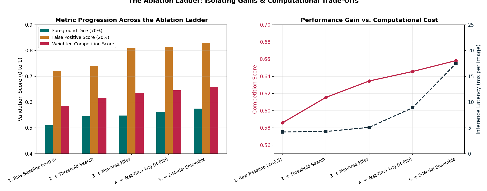

# Guide 07: Inference Experimentation Discipline: Ablation Ladders & Trade-Off Analysis

In the final week of a machine learning competition, panic and impatience frequently displace scientific discipline. Students frequently adjust four inference hyperparameters simultaneously: tweaking decision thresholds $\tau$, increasing minimum area cutoffs $A_{\min}$, enabling 4-view Test-Time Augmentation (TTA), and blending two newly trained model checkpoints in a single speculative submission.

When the Kaggle public leaderboard score shifts from $0.635$ to $0.648$, the student celebrates. But they have **zero causal knowledge**:
- Did the threshold change improve the score by $+0.025$, while TTA actually degraded it by $-0.012$?
- Did the aggressive minimum area filter inflate clean-sheet accuracy while wiping out rare defects like `defect_b`?
- Will this complex, fragile pipeline shake down catastrophically on the private test set?

In this final guide, you will establish rigorous **inference experimentation discipline**. You will learn how to construct an **ablation ladder** to isolate causal factors, track multi-objective trade-offs across foreground Dice, false-positive penalties, and latency, perform qualitative visual audits, and make sound, evidence-based submission decisions.

---

## 1. Concrete Failure Case: The Confounded Inference Submission

Consider a student who implements the following changes in a single evening:
1. Lowers threshold from $\tau = 0.50$ to $\tau = 0.35$ on all classes.
2. Increases minimum area cutoff from $A_{\min} = 0$ to $A_{\min} = 150\text{ px}$.
3. Adds 4-view TTA ($H + V + HV$ flips).
4. Ensembles a baseline ResNet34 with a newly trained EfficientNet-B2.

The student submits to the public leaderboard and observes a modest $+0.009$ bump.

### The Hidden Catastrophe Under the Hood:
When private test evaluation takes place after the competition ends:
- The aggressive area cutoff $A_{\min} = 150\text{ px}$ permanently eliminated every instance of `defect_b` in the private test set (since genuine `defect_b` flaws rarely exceed 100 pixels). The `defect_b` positive Dice dropped to **0.000**.
- The 4-view TTA caused the notebook to run for 8 hours and 52 minutes, perilously close to the 9-hour hard timeout.
- The threshold reduction $\tau = 0.35$ was the *only* component that genuinely helped, but its true gain ($+0.035$) was masked and diluted by the $-0.026$ penalty caused by the area filter!

Because the student changed everything at once, they had no way of diagnosing the failure. They submitted a slow, brittle pipeline that cratered on private data.

---

## 2. The Principle of Causal Attribution: The Ablation Ladder

In scientific deep learning, **causal attribution** requires isolating one variable at a time. You must construct an **Ablation Ladder** where each rung adds exactly one hypothesis to an invariant baseline:

```
                                The Inference Ablation Ladder
▲
│  Rung 5: + Multi-Model Ensemble       (Combines diverse backbones)
│  Rung 4: + Test-Time Augmentation     (Tests geometric invariance & variance reduction)
│  Rung 3: + Minimum-Area Filtering     (Tests morphological noise suppression)
│  Rung 2: + Calibrated Thresholds      (Tests per-class precision–recall trade-offs)
│  Rung 1: Raw Baseline Model           (Single checkpoint, τ = 0.50, Amin = 0, no TTA)
└────────────────────────────────────────────────────────────────────────────────────────►
```


*Figure 7.1: The Inference Ablation Ladder. (Left) Multi-metric progression across ablation stages: Foreground Dice (70%), False Positive score (20%), and weighted competition score. (Right) The computational cost axis: measuring performance gains against inference latency.*

### The Protocol for Climbing the Ladder:
1. **Fix the Validation Protocol**: Keep your validation split (e.g. Fold 0 combination-stratified holdout) completely frozen. Never switch validation sets between rungs!
2. **Step One Rung at a Time**:
   - Run Rung 1 (Baseline). Record all component metrics and latency.
   - Run Rung 2 (Tune $\boldsymbol{\tau}$ on Rung 1 probabilities). If it improves the weighted competition metric, adopt it as the new baseline.
   - Run Rung 3 (Apply $A_{\min}$ search on Rung 2 outputs). If it improves the metric without harming rare defect recall, adopt it.
   - Run Rung 4 (Enable TTA). Test 2-view ($H$-flip) first. If it improves the metric within latency budget, keep it.
   - Run Rung 5 (Blend with second model). Evaluate soft weights.
3. **If a Rung Fails, Discard It**: If 4-view TTA increases runtime by $4\times$ but improves validation score by only $+0.0005$, **discard it**. Do not accumulate computational complexity without meaningful statistical evidence.

---

## 3. Beyond a Single Scalar: The Multi-Objective Comparison Matrix

A single aggregated scalar score obscures critical trade-offs. You must evaluate every inference candidate against a multi-objective matrix:

### Fictional Ablation Comparison Matrix

| Rung | Configuration Description | Foreground Dice ($70\%$) | FP Penalty Score ($20\%$) | Empty Accuracy ($10\%$) | Rare `defect_b` Dice | Inference Latency (ms/img) | Competition Composite Score |
| :--- | :--- | :--- | :--- | :--- | :--- | :--- | :--- |
| **1** | Raw Baseline (Single model, $\tau=0.5, A_{\min}=0$) | $0.512$ | $0.724$ | $0.852$ | $0.380$ | $4.2\text{ ms}$ | $0.5884$ |
| **2** | + Calibrated $\boldsymbol{\tau}$ ($[0.45, 0.40, 0.55, 0.50]$) | $0.548$ | $0.741$ | $0.864$ | $0.442$ | $4.3\text{ ms}$ | $0.6182$ |
| **3a** | + Gentle $A_{\min}$ ($[30, 0, 50, 40]\text{ px}$) | $0.546$ | $0.812$ | $0.895$ | $0.442$ | $5.1\text{ ms}$ | $\mathbf{0.6341}$ |
| **3b** | + Aggressive $A_{\min}$ ($[100, 100, 150, 100]\text{ px}$) | $0.501$ | $0.895$ | $0.940$ | $\mathbf{0.000}$ | $5.3\text{ ms}$ | $0.6237$ (TRAP!) |
| **4** | + 2-View TTA ($H$-Flip on Rung 3a) | $0.561$ | $0.815$ | $0.898$ | $0.465$ | $8.6\text{ ms}$ | $\mathbf{0.6455}$ |
| **5** | + 2-Model Ensemble (U-Net + FPN + TTA) | $0.578$ | $0.832$ | $0.902$ | $0.490$ | $16.8\text{ ms}$ | $\mathbf{0.6612}$ |

### Critical Analytical Lessons from the Table:
- **Notice Rung 3b (The Aggressive Filtering Trap)**: False Positive score jumped from $0.812$ to $0.895$, and Empty Accuracy reached $0.940$. A superficial look at clean sheets would suggest a massive win. But look at **Rare `defect_b` Dice**: it collapsed to **$0.000$**! The overall competition score fell from $0.6341$ to $0.6237$ because losing foreground recall destroyed 70% of the metric.
- **Notice Rung 4 vs Rung 5 Latency**: Ensembling two models with TTA increases latency from $4.2\text{ ms}$ to $16.8\text{ ms}$ ($4.0\times$). Across 3,000 images, total inference takes:
  $$3000 \times 16.8\text{ ms} = 50.4\text{ seconds}$$
  This is well within Kaggle’s 9-hour limit, proving that the computational cost of Rung 5 is fully justified by the $+0.0157$ metric improvement.

---

## 4. Qualitative Error Auditing: Inspecting Masks

Quantitative tables tell you *what* the score is, but qualitative visual inspections tell you *why* a model is failing.

Set aside 10 validation images representing key diagnostic categories and inspect their prediction overlays before and after post-processing:

```
┌────────────────────────────────────────────────────────────────────────────────────────┐
│                        The Qualitative Visual Inspection Suite                         │
├────────────────────────────────────────────────────────────────────────────────────────┤
│ Canary Image 1: Faint Longitudinal Scratch (`defect_a`)  ──► Did threshold erase edges?│
│ Canary Image 2: Isolated Rare Inclusion (`defect_b`)      ──► Did area filter purge it?│
│ Canary Image 3: Dense Oxide Scale Patch (`defect_c`)      ──► Are boundaries sharp?    │
│ Canary Image 4: Fine Transverse Crack (`defect_d`)        ──► Did 8-connectivity hold? │
│ Canary Image 5: Spotless Clean Steel Strip                ──► Are false alarms zero?   │
│ Canary Image 6: Strip with Bright Specular Reflection     ──► Did glare trigger false P?│
└────────────────────────────────────────────────────────────────────────────────────────┘
```

```python
import matplotlib.pyplot as plt
import numpy as np

def visualize_inference_ablation(
    image: np.ndarray,
    gt_mask: np.ndarray,
    raw_pred: np.ndarray,
    clean_pred: np.ndarray,
    defect_name: str
):
    """Plot side-by-side diagnostic overlays for a single test strip."""
    fig, axs = plt.subplots(4, 1, figsize=(14, 8), sharex=True)

    # 1. Input Image
    axs[0].imshow(image, cmap="gray", aspect="auto")
    axs[0].set_title(f"1. Raw Industrial Strip (128 × 800) - Target: {defect_name}")

    # 2. Ground Truth Mask Overlay
    axs[1].imshow(image, cmap="gray", aspect="auto")
    axs[1].imshow(gt_mask, cmap="Reds", alpha=0.5, aspect="auto")
    axs[1].set_title(f"2. Ground Truth Mask ({gt_mask.sum()} active px)")

    # 3. Raw Prediction (τ = 0.50, no filter)
    axs[2].imshow(image, cmap="gray", aspect="auto")
    axs[2].imshow(raw_pred, cmap="Blues", alpha=0.5, aspect="auto")
    axs[2].set_title(f"3. Raw Baseline Prediction (τ=0.50, Amin=0: {raw_pred.sum()} px)")

    # 4. Calibrated Prediction (+τ, +Amin, +TTA)
    axs[3].imshow(image, cmap="gray", aspect="auto")
    axs[3].imshow(clean_pred, cmap="Greens", alpha=0.5, aspect="auto")
    axs[3].set_title(f"4. Calibrated Post-Processed Mask ({clean_pred.sum()} px)")

    for ax in axs:
        ax.set_yticks([])
    plt.tight_layout()
    plt.show()
```

---

## 5. Experiment Tracking Schema: Logging Inference Runs

When tuning inference, log every hyperparameter setting alongside your validation metrics in Weights & Biases or a structured local JSON file. Never leave settings undocumented!

### Structured Metadata Schema
```json
{
  "inference_run_id": "inf_eval_run_042",
  "base_checkpoints": [
    {"architecture": "unet_resnet34", "fold": 0, "sha256": "a3f89b..."},
    {"architecture": "fpn_efficientnet_b2", "fold": 0, "sha256": "c71e04..."}
  ],
  "ensemble_weights": [0.50, 0.50],
  "tta_policy": "hflip",
  "native_restoration": "bilinear_interp_native_128x800",
  "thresholds": {"defect_a": 0.45, "defect_b": 0.40, "defect_c": 0.55, "defect_d": 0.50},
  "min_areas": {"defect_a": 30, "defect_b": 0, "defect_c": 50, "defect_d": 40},
  "validation_metrics": {
    "composite_competition_score": 0.6612,
    "foreground_dice": 0.5780,
    "false_positive_score": 0.8320,
    "empty_accuracy": 0.9020,
    "positive_dice_defect_b": 0.4900
  },
  "runtime_profiling": {
    "latency_ms_per_image": 16.8,
    "peak_gpu_vram_mb": 4520,
    "total_test_extrapolation_minutes": 0.84
  }
}
```

Binding your post-processing parameters directly to the model checkpoint's SHA256 checksum guarantees that you will never accidentally apply Model A's thresholds to Model B!

---

## 6. How to Select Your Final 2 Competition Submissions

Kaggle allows you to select **exactly two final submissions** for private leaderboard scoring:

```
┌────────────────────────────────────────────────────────────────────────────────────────┐
│                        The Dual-Submission Selection Strategy                          │
├────────────────────────────────────────────────────────────────────────────────────────┤
│ Submission 1: The Safe Consensus Leader (Highest Local Out-of-Fold Score)              │
│ • Best validated ensemble with conservative post-processing                            │
│ • Moderate thresholds and gentle minimum area filters ($A_{\min, b} = 0$)              │
│ • Prioritizes stability, high recall on rare defects, and zero over-filtering          │
├────────────────────────────────────────────────────────────────────────────────────────┤
│ Submission 2: The High-Precision Challenger                                            │
│ • Slightly more aggressive false-positive suppression or alternative backbone          │
│ • Validated on OOF, but slightly more optimized for false alarm reduction              │
│ • Provides healthy diversification without sacrificing statistical soundness          │
└────────────────────────────────────────────────────────────────────────────────────────┘
```

### What You Must NEVER Do:
- ❌ Do **not** select a submission based purely on a high public leaderboard score if its local cross-validation score was mediocre. (This is the definition of public leaderboard overfitting).
- ❌ Do **not** select a submission that was never validated locally.
- ❌ Do **not** select two identical submissions with a tiny 0.01 threshold difference. Make your two submissions represent genuinely distinct, justified modeling decisions.

---

## 7. Diagnostic Checklist: Final Inference Verification

Before you push the final "Submit" button on Kaggle, verify these five items:

1. **Deterministic Reproducibility**: Run inference twice on 20 test images with identical random seeds. Verify that the resulting RLE strings match character-for-character:
   $$\text{Hash}(\text{CSV}_1) == \text{Hash}(\text{CSV}_2)$$
2. **Kaggle Internet Independence**: In code competitions, internet access is disabled during submission evaluation! Ensure your inference notebook does **not** download pretrained weights or pip packages at runtime. All weights must be loaded from local attached Kaggle datasets.
3. **Execution Latency Buffer**: Confirm that total test inference takes less than **3 hours**, leaving a 6-hour safety margin below Kaggle’s 9-hour timeout.
4. **Valid Row & Schema Verification**: Run `validate_submission_file()` to confirm exactly 12,001 lines, correct headers, single-space sentinels, and clamped indices.
5. **No Confidential Leaks**: Ensure no private internal training logs or unverified conclusions are exposed in markdown comments.

---

## Practice 8 · Spot the Flawed Selection Rationale

Read the following statements from three fictional students preparing their final Kaggle submissions. Determine which student has the soundest methodology, and identify the fatal flaw in the other two:

- **Student Alpha**: *"My single U-Net scored 0.650 on local 5-fold CV and 0.642 on the public leaderboard. My 4-model ensemble scored 0.672 on local CV and 0.655 on the public leaderboard. I will select the 4-model ensemble as my primary submission because local CV reliably aggregates all folds."*
- **Student Beta**: *"I tested a speculative threshold $\tau = 0.85$ with $A_{\min} = 300\text{ px}$. My local validation score plummeted from 0.65 to 0.52, but my public leaderboard score jumped to 0.665! I am selecting this submission because the public leaderboard is the real test data."*
- **Student Gamma**: *"I have 20 different submissions. I will pick the two that scored highest on the public leaderboard, regardless of what my local CV said."*

*(Hint: Reflect on why the public leaderboard represents only a small fraction of the test set, and why optimizing against it without validation support leads to catastrophic leaderboard shakeup.)*

---

## 9. Authoritative References & Further Reading

- **Kaggle Documentation**: [How Competitions Work: Public vs. Private Leaderboards and Overfitting](https://www.kaggle.com/docs/competitions#the-leaderboard)
- **Varoquaux (2018)**: *Cross-validation failure: Small sample sizes lead to competition artifacts*, NeuroImage.
- **Sculley et al. (2015)**: *Hidden Technical Debt in Machine Learning Systems*, Advances in Neural Information Processing Systems (NeurIPS).

## Assessment Crosswalk · Question 9: Validation and Safety

Repeatedly adjusting thresholds and minimum areas against one holdout turns it into part of the training process: candidate choices start fitting its particular noise and cases. Stronger safeguards include a second untouched validation fold or out-of-fold predictions, plus a predeclared small search and one final confirmation. An all-empty baseline is a useful diagnostic: it can look strong under empty-aware mean Dice while missing every positive pair, so use the stated weighted components and test for degenerate predictions.

For the final notebook, separate one-change validation experiments from the frozen submission recipe. A compact safety audit should cover at least: (1) local checkpoint and dependency availability; (2) a small end-to-end smoke test; (3) peak host/GPU memory estimate; (4) measured time with room for RLE and file validation; (5) deterministic template row order and exact schema; (6) empty sentinel and RLE round-trip/bounds; and (7) final artifact existence and row count. Choose the applicable checks and justify them rather than copying a fixed answer.

### Practice with separate data

Suppose one validation fold was used to compare 40 threshold/min-area combinations. Propose a second evaluation plan that does not reuse that same fold for every decision. Then explain why an all-empty model can receive perfect empty-pair terms while having zero Foreground Dice when positives exist. These are discussion prompts; keep them distinct from the requested assessment bullets.
