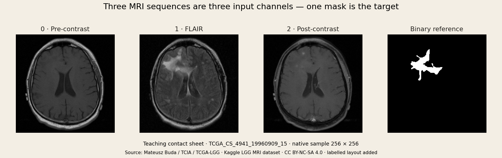

# Optional: about the MRI example

**You can use the pictures in class without downloading this dataset.** This page is here when you want to explore the example yourself.

## The familiar task: image in, mask out

The input is an MRI slice. The reference mask marks an annotated region. The model learns to predict that mask, just as your existing U-Net learns to predict surface-defect masks.



The three input panels show different MRI sequences, not red, green and blue. The middle channel is called **FLAIR**. The supplied target is a single binary FLAIR-abnormality mask. Missing sequences may be replaced with FLAIR in the supplied files.

For today, the useful distinction is simply **input picture versus target mask**. The acquisition details can wait.

## One new rule if you train on these images

A patient contributes several slices. Keep all slices from the same patient on one side of the training/validation split. Otherwise the model can see a person’s slices during training and again during validation.

<div class="mri-lab" data-lab="mri" data-ai-help="off" data-mri-lab="split">
<p>Compare splitting whole patients with splitting slices within each patient. In the fictional four-patient example, a patient split has zero patients on both sides; a slice split can put all four on both sides.</p>
</div>

## Connection to your project

For the MRI example, the target has one channel. Your industrial project has four independent defect targets and uses **800 × 128** images. Keep those task-specific requirements when applying the transfer-learning idea back to your own model.

Source: [Mateusz Buda’s dataset](https://www.kaggle.com/datasets/mateuszbuda/lgg-mri-segmentation), from TCIA / TCGA-LGG, with a listed **CC BY-NC-SA 4.0** license. The [figure provenance](figures/provenance.json) records the selected source files and teaching layout. The target is an annotated abnormal region, not a tumor-grade label.

[Back to the classroom path](README.md)

<details>
<summary>Go deeper: TIFF loading and patient-split code</summary>

## Match each image to its mask

Typical extracted paths look like this:

```text
kaggle_3m/
  TCGA_CS_4941_19960909/
    TCGA_CS_4941_19960909_10.tif
    TCGA_CS_4941_19960909_10_mask.tif
```

The case directory is our grouping key. The final number identifies a slice, not a patient. Match paths by the `_mask` suffix; do not independently sort two lists and assume their entries align.

```python
records = []
for mask_path in sorted(root.rglob("*_mask.tif")):
    image_path = mask_path.with_name(mask_path.stem[:-5] + ".tif")
    if not image_path.is_file():
        raise FileNotFoundError(image_path)
    records.append({
        "image": image_path,
        "mask": mask_path,
        "patient": mask_path.parent.name,
    })
```

`stem[:-5]` removes the five characters `_mask`. Recursive discovery supports a Kaggle mount containing an extra `kaggle_3m/` directory. The companion notebook additionally checks naming consistency, duplicates, unpaired images, shapes and mask values. It fails visibly if the input is malformed.

## Inspect before transforming

For the real files inspected while preparing these notes, images were unsigned 8-bit arrays `[256,256,3]` and masks were `[256,256]` with values in `{0,255}`. These are observed examples, not a replacement for validation of your own files.

```python
image = np.asarray(Image.open(image_path))
raw_mask = np.asarray(Image.open(mask_path))
assert image.ndim == 3 and image.shape[2] == 3
assert raw_mask.shape == image.shape[:2]
mask = (raw_mask > 0).astype(np.float32)
```

A mask containing only 0 is valid: the selected slice contains no annotated foreground. Preserve those slices. Do not use `convert("L")` on the three-sequence image: that forms an arbitrary color-weighted mixture, not the FLAIR sequence. Select index 1 explicitly when you need FLAIR alone.

After preprocessing, use:

- Image: float32 `[3,H,W]`, with documented intensity scaling and normalization.
- Target: float32 `[1,H,W]`, values 0 or 1.
- Batch: image `[B,3,H,W]`, target `[B,1,H,W]`.
- Model output: raw logits `[B,1,H,W]`; sigmoid is applied inside the Dice term and for evaluation, not before `BCEWithLogitsLoss`.

## Why a random slice split leaks information

Adjacent slices share anatomy, scanner characteristics and acquisition conditions. If one patient occurs on both sides, validation is partly testing familiarity with that patient. It does not answer our intended question: “How does this model behave on a patient unseen during training?”

First permute unique case IDs with a seed; then assign every slice according to its case. The author’s [reference loader](https://github.com/mateuszbuda/brain-segmentation-pytorch/blob/master/dataset.py) also selects validation cases at the patient level.

```python
patients = sorted({r["patient"] for r in records})
rng = np.random.default_rng(42)
rng.shuffle(patients)
n_val = max(1, int(np.ceil(0.2 * len(patients))))
val_ids = set(patients[:n_val])
train_ids = set(patients[n_val:])
train = [r for r in records if r["patient"] in train_ids]
valid = [r for r in records if r["patient"] in val_ids]
assert train_ids.isdisjoint(val_ids)
assert train_ids | val_ids == set(patients)
```

Require at least two patients before this split. “80/20” refers to case counts; it need not produce exactly 80% of slices because patients contribute different numbers of slices. Save the exact IDs and reuse them in both experiment arms. A future site-held-out experiment would answer a different, harder question; patient separation alone does not prove robustness to new hospitals.

## Keep preprocessing on the correct side

Random paired spatial transforms belong to training only. Validation preprocessing is deterministic. Any statistics learned across the dataset must use training patients only. The notebook uses fixed scaling and fixed channel-normalization constants, so no validation-fitted statistics are required.

The teaching loader retains the full square field of view and resizes image and mask together. It does not use the mask to crop around the abnormality. A target-guided crop at validation would give the model information it would not have at inference.


</details>
