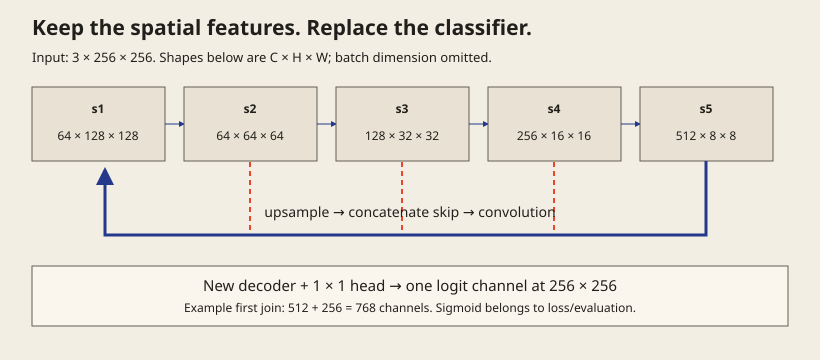

# 1. Understand what the encoder contributes

A pretrained encoder is useful only if we understand what it supplies to the rest of the model. Start with the U-Net you have already trained: **the encoder builds features, the decoder combines them into pixel-level predictions, and skip connections carry spatial detail across the network.**

<div class="lesson-flow" aria-label="Segmentation flow">
<span>Image</span><span>Encoder<br><small>Extract features</small></span><span>Decoder<br><small>Combine and upsample</small></span><span>Mask logits</span>
</div>

## What is a feature map?

A feature map is a grid of responses produced by a learned filter. For example, a filter may respond strongly near a particular edge or texture. A layer usually produces many such maps, stacked along the channel dimension.

As the encoder goes deeper, its spatial grids become smaller. Later features can combine information from a larger region of the input. This helps with context, but precise locations become harder to recover. The decoder uses earlier, finer features as well as the deeper representation.

## Trace one example

For a **128 × 128** image and a ResNet18 encoder, selected feature sizes are:

| Point in the encoder | Tensor shape | What changed? |
| :--- | :--- | :--- |
| Input | `[B,3,128,128]` | Three input channels |
| After the stem, before max pooling | `[B,64,64,64]` | More feature channels; smaller spatial grid |
| After `layer3` | `[B,256,8,8]` | Coarser features with more context |
| After `layer4` | `[B,512,4,4]` | Deepest feature in this example |

`B` is the batch size. A channel count of 512 means 512 learned feature maps; it does not mean 512 defect classes. The output layer decides how many target channels we predict.

## How one decoder join works

To combine the deepest feature with the `layer3` skip, first resize it from 4 × 4 to 8 × 8. Then join the channels:

```python
up = F.interpolate(deep, size=skip.shape[-2:],
                   mode="bilinear", align_corners=False)
joined = torch.cat([up, skip], dim=1)
```

Here, `deep` has 512 channels and `skip` has 256. The result has **768 channels at 8 × 8**. A learned convolution block then mixes those features and can reduce the channel count.

`dim=1` is the channel axis in `[B,C,H,W]`. The spatial sizes must match before concatenation. This is why we resize to the skip’s actual height and width rather than assuming that doubling always fits.

<div class="mri-lab" data-lab="mri" data-ai-help="off" data-mri-lab="shapes">
<p>Trace the feature sizes, then select a decoder join. Predict the concatenated channel count before reading it. Try the 128 × 800 industrial input and notice which dimensions change.</p>
</div>

## What do we borrow from ResNet?

A classification ResNet ends with pooling and an image-classification layer. For segmentation, we reuse its spatial feature layers and build a decoder that can produce a dense mask. “Backbone” refers to this feature-extracting part.

The pretrained encoder does not supply a trained segmentation decoder. We still need to learn how its features should map to our target masks.

For the MRI example, the target has one channel. Your industrial project has four independent targets and must preserve its **800 × 128** aspect ratio. Reusing the encoder idea does not change those task requirements.

## Check your understanding

A decoder receives `[B,512,4,4]` and a skip `[B,256,8,8]`. A student concatenates them immediately, then applies a convolution expecting 512 input channels. Identify both problems.

<details>
<summary>Reveal the reasoning</summary>

First match the spatial sizes, for example by resizing the deeper feature to 8 × 8. Concatenation then produces 768 channels, so the next convolution must accept 768 unless an explicit projection changes that count.

</details>

Next: [understand what pretraining changes](transfer.md).

<details>
<summary>Go deeper: exact tensor shapes and decoder code</summary>

## Trace one 256 × 256 MRI slice

Our companion model uses the stem and four residual stages of torchvision’s ResNet18. For a batch size `B`, its feature shapes are:

| Feature | Operation | Tensor shape |
| :--- | :--- | :--- |
| Input | Three MRI channels | `[B,3,256,256]` |
| `s1` | `conv1 → bn1 → relu`, stride 2 | `[B,64,128,128]` |
| `s2` | `maxpool → layer1` | `[B,64,64,64]` |
| `s3` | `layer2` | `[B,128,32,32]` |
| `s4` | `layer3` | `[B,256,16,16]` |
| `s5` | `layer4` | `[B,512,8,8]` |

The stem feature is captured **before max pooling**. Moving that tap changes its spatial size. The notebook prints these shapes instead of relying on a diagram alone. At classroom resolution 128 × 128, all spatial dimensions in the table halve; channel counts stay the same.



## Build one decoder block

To join the deepest feature with the previous encoder stage:

```python
up = F.interpolate(s5, size=s4.shape[-2:], mode="bilinear",
                   align_corners=False)
joined = torch.cat([up, s4], dim=1)
d4 = block(joined)
```

- `size=s4.shape[-2:]` requests the skip tensor’s exact height and width. This avoids assuming that doubling always matches, especially on odd dimensions.
- `torch.cat(..., dim=1)` joins channels: 512 plus 256 gives **768**, not 512.
- The convolution block consumes 768 channels and learns a smaller output representation; our first block emits 256.
- Bilinear interpolation is appropriate for continuous feature maps. It does not justify bilinear resizing of hard target labels.

Repeat with `s3`, `s2` and `s1`. Finally interpolate to the original input size, refine, and apply a one-channel `1×1` convolution. No final sigmoid is included in `forward`; the training loss expects logits.

## Two kinds of skip connection

A **ResNet residual shortcut** usually adds tensors of compatible shape: `output = branch(x) + shortcut(x)`. A projection can align channel counts or stride when necessary. The addition offers a route for information and gradients within the encoder.

A **U-Net skip connection** passes an earlier feature into the decoder, commonly by channel concatenation. It restores access to spatial detail. Concatenation increases the number of channels, while addition requires matching channels. Saying “both have skip connections” does not make their mechanics interchangeable.

## The decoder does not reconstruct the original photograph

Upsampling alone cannot recover every detail lost during downsampling. Fine features from skip connections and learned convolutional refinement help produce useful boundaries. The objective is a target mask, not an exact reconstruction of MRI intensities. A pretrained encoder still needs adaptation to the new input distribution and target.

## Sanity checks before training

```python
model.eval()
with torch.no_grad():
    logits = model(torch.zeros(2, 3, 128, 128))
assert logits.shape == (2, 1, 128, 128)
assert torch.isfinite(logits).all()
```

This checks geometry and finite outputs, not learned quality. Check target shape and visualization separately. A model can pass this test and still receive mismatched masks or a leaking split.


</details>
